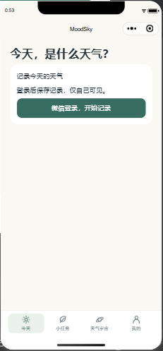
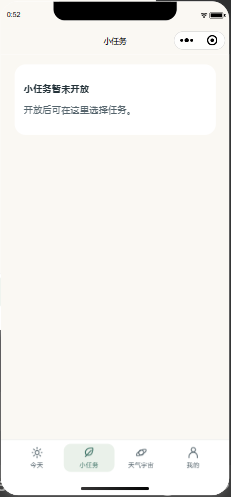
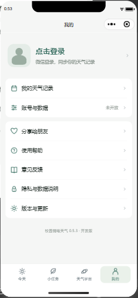
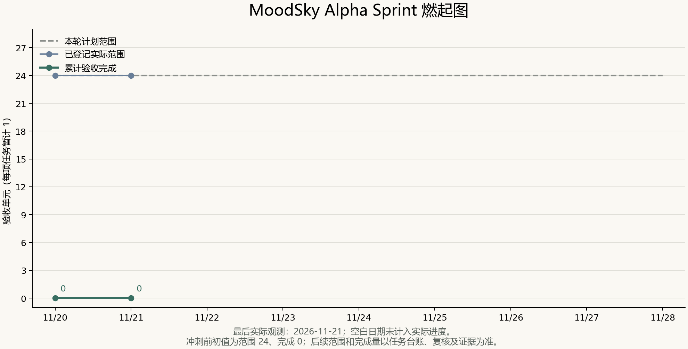

# 洪翔第一期实际交付｜2026-11-21阶段记录

<!-- c1-current-handoff -->

本页保持11/21原阶段来源；11/22本地收尾、当前统计和完整日志见[本期收尾交付](../c1-20261122/README.md)。当前C1-H待指定独立复核，不以本页旧状态覆盖新记录。

对应 C1-H（11/21–22）、[AS-H01 / #198](https://github.com/HX-Jan/MoodSky/issues/198)。本记录由 Codex 在负责人授权下执行和整理，个人工时、投入时段及本人签认不代填。AS-H01 的版本/范围/接收成果交审，独立复核待 Yuen、蔡奇真；C1-H 仍进行中，日志1等11月22日收件后定稿。AS-H02不因本次出包或资料归档视为已验收。

## 当前基线和范围

本期源码起点 `60b12534425a84c38397cb3d9f08d7a8a4a89896`，是接收 #196 返修后的 main；[主干 quality](https://github.com/HX-Jan/MoodSky/actions/runs/44773550176) 成功。本记录后续 PR 仅补第一期资料，不改变产品。

已上传客户端与两支云入口冻结在 `0580e148004bda027ac5c14b3178538c1ebc8e2f` / 0.5.3，任务 enabled、校园新增打卡暂停；#196后来只增加4份工具/资料，与冻结构建的产品目录无差异。189文件指纹、增量部署、真实健康及496593字节上传回执是既有发布任务证据，按其实际执行时间引用，不冒作本期新验收。

GitHub Latest仍为v0.5.2 / `5b2775393a4adbf5d9a77ff2a3c61b3c3bb3958c`，本次不将“0.5.3源码/微信上传”写作“0.5.3固定GitHub发行已发布”。微信体验、提交审核及公开版本没有取得成功回执；用户提供的提审表单图只证明进入表单。

详见[版本表](version-scope.csv)、[功能范围与外部依赖](feature-scope.csv)、[原24项任务范围](../scope-24.csv)。24项原验收单元、48个周期检查点保持，不按PR数或文件数计完成。

## PR接收与返修闭环

| PR                                                             | 固定交审、后续与结果                                                                                                                                                                     | 当前采用范围与边界                                                                                                             |
| -------------------------------------------------------------- | ---------------------------------------------------------------------------------------------------------------------------------------------------------------------------------------- | ------------------------------------------------------------------------------------------------------------------------------ |
| [#197](https://github.com/HX-Jan/MoodSky/pull/197) Yuen        | 原1035ce115e675e72176315a32d9dd6710a3a2b25；同步25e297a7269dc3a3fd847c6a33f722019a01908a；合入f6e60841478cb90ca1cf0b36dce1077e9bd85ba5                                                   | W6原始回归/候选/未测归档；旧1634项及原终端空白告警保持，非C1全员验收                                                           |
| [#210](https://github.com/HX-Jan/MoodSky/pull/210) Qizhen Chen | c246bc855c021465ceddfba5148c62f1e6fd2880；合入562a099b6b8bf5ee37df83583b3a66f85914f607                                                                                                   | 4项未知结果回归、24行动作矩阵及预跑资料；原日期保持                                                                            |
| [#212](https://github.com/HX-Jan/MoodSky/pull/212) Qizhen Chen | e246adc52e51da0999110e2ac9566299f42366d2；合入60551adb5768f83d63e7d342d3051dd4c1dc8bc5                                                                                                   | 保存后重开原生工具和测试页初始化修正；不修改产品，不将原截图改记当期                                                           |
| [#196](https://github.com/HX-Jan/MoodSky/pull/196) Junhan      | 原080950d3a28611f217eaa69bff389c9bb0e5f2ee；返修23d199bd9a51d8a35f2776a12073b817a74f682b；同步批准f1fed1654cc3e031b9e642066cdcbb067197928e；合入60b12534425a84c38397cb3d9f08d7a8a4a89896 | 导出域/适配器来源修正；第二页实测1条且hasMore=false；23样例完全复现，所有来源可定位。原审查两线程解决，成员签认/外部待验不追认 |

本轮重新读取开放PR为0。原失败、返修、来源及测试数量分别保存；#196已合入这一结论替代11/20预跑“待返修”的当前状态，原预跑记录不回写。

## 本期实际收件与独立复核

逐项读取 #198–#209 及评论，12项均开放、均无评论，未收到本人确认、环境/可投入时段或独立验收结论。[12人收件表](member-intake.csv)列每人的C1目标、已有材料、具体应交和交接对象；[快照](receipt-snapshot.json)保留统计依据。“未从这些入口收到”不等于成员没有工作，W6及Alpha预跑材料已知来源不丢失。

Yuen需复核当前源码/冻结上传包差异、检查日志和189指纹；蔡奇真需复核数据边界、开关与平台待验。本轮只请实际复核人按证据回传，不代写通过。记录已提交、源码已合入、任务已验收是三种不同状态。

## 本期原生运行效果

以60b1253的全部跟踪客户端文件制作独立副本，关闭云且不启用demo，Node 24.21.0/npm 11.19.0。新配置不进入产品源码。以下是微信开发者工具实际渲染后的原图，详见[源码/预览配置及图片哈希](native-evidence.json)。没有登录、注入假数据或操作私人记录。

今天页提示登录后保存，仅本人可见。

禁云预览显示“小任务暂未开放”，证明本地能力门禁；**不是正式enabled包被关闭，也不证明任务端云成功**。

个人中心显示未登录及0.5.3开发版，账号与数据未开放。最早两张过早截到的欢迎/加载画面留本地，等待真实页面选择器后重拍，没有将空白图冒作产品通过。

## 本期燃起图与检查

原范围24，已登记独立验收0；只更新11/21实际观测，11/22–28保持空白。验收尚未登记不代表开发工作量0，接收PR不等于任务完成。图由既有工具基于实际Issue及台账快照生成，交Yuen复核后再用于定稿。

本轮 cloud:prepare、check、离线生产联调及新文档链接的实际退出结果见[检查摘要](checks.json)，完整日志留负责人本地test-results/2026-11-21-c1-owner。测试子集不与全量相加。旧发布检查和本轮检查分别登记。

## 日志1定稿及下一接续

[日志1阶段稿](log1-draft.md)已填真实版本、问题闭环、三张当期运行图、燃起图、成员收件及接手人；本地合集和台账同步。11/22尚未发生，各成员当期成果、共同种子、独立复核及发布链接缺失明确保留，不能用阶段稿冒充完整周期日志。

接下来：Yifan/Zhifeng交同组记录种子和月历预期；Jiawei/Qizhen对齐三模式样例；Qinghan/Junhan对齐校园请求与历史；Linghan/Xiang Yu对齐文件格式与真实送达待验；Jiaqi/Yuen接运行素材及图；蔡奇真给独立意见。每人具体缺件见收件表。CSDN和课程作业页继续按负责人此前指示暂不发布。本次不新增云部署、上传或真实数据操作，也不替平台声明生效。
