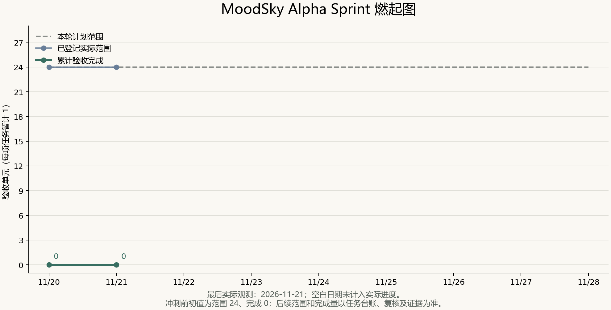
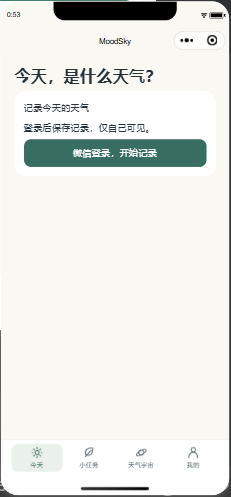
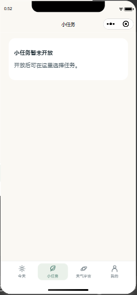
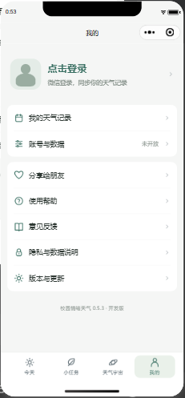

# MoodSky Alpha Sprint 日志1｜11月21–22日

| 项目     | 内容                                                                            |
| -------- | ------------------------------------------------------------------------------- |
| 所属课程 | [2601_FZU-MU_SE](https://bbs.csdn.net/forums/2601_MU_SE_FZU)                    |
| 作业要求 | [Fifth Assignment—Alpha Sprint](https://bbs.csdn.net/topics/620611106)          |
| 本篇目标 | 统一开工版本，登记实际成果、运行效果、验收与接手人                              |
| 参考资料 | [MoodSky仓库](https://github.com/HX-Jan/MoodSky)、[第一期负责人交付](README.md) |

> 11月21日阶段稿。第一期尚未结束，11月22日收件后定稿；尚未发布CSDN或提交课程作业页。既有预跑与新运行证据分列，不代写成员经历和独立验收。

## 版本、目标和实际进展

原任务基线为v0.5.2 / 5b2775393a4adbf5d9a77ff2a3c61b3c3bb3958c；本期开始核对的最新源码为60b12534425a84c38397cb3d9f08d7a8a4a89896。正式上传构建0.5.3固定0580e148004bda027ac5c14b3178538c1ebc8e2f，后续#196只增加工具/资料，产品实现未变。

负责人已把主干、固定发行、上传包、目标云和平台待验分列，核对12个Issue及24项范围，复核#196/#197/#210/#212的固定来源。当前没有开放PR。源码整合、上传、平台审核和任务验收独立统计；未把旧提交再算本期开发，未新增业务功能或伪造缺陷。

## 项目燃起图

截至11月21日，本轮范围24、已登记独立验收0；11/22及后续实际值留空。12个任务Issue尚无本人确认或独立验收评论，现有W6/预跑成果仍保留引用。0表示当前登记的验收数，不代表没有开展工作。

## 当期运行效果

运行来源为60b1253 / 0.5.3，环境为微信原生模拟器的独立禁云副本，未登录、未启用演示或写入数据；与原样上传包的区别仅按预览来源清单说明。截图只证明当前未登录/禁云入口和门禁，不作为端云、设备或完成态证明。

## 成员实际收件

| 成员              | Issue与已知来源                                                                                                 | 当前状态及下一步                                                  |
| ----------------- | --------------------------------------------------------------------------------------------------------------- | ----------------------------------------------------------------- |
| 洪翔 Xiang Hong   | [#198](https://github.com/HX-Jan/MoodSky/issues/198)；本期负责人交付见本目录；待Yuen、蔡奇真复核                | 版本、范围、收件和证据已成稿；待Yuen/蔡奇真复核；C1日志待全员回传 |
| Yifan Ji          | [#199](https://github.com/HX-Jan/MoodSky/issues/199)；W6 #186已接收；未收到本人C1回传                           | 本人C1回传、环境/投入确认及独立复核待收到；按本人任务分册交付     |
| Zhifeng Dai       | [#200](https://github.com/HX-Jan/MoodSky/issues/200)；W6 #189已接收；未收到本人C1回传                           | 本人C1回传、环境/投入确认及独立复核待收到；按本人任务分册交付     |
| Linghan Chen      | [#201](https://github.com/HX-Jan/MoodSky/issues/201)；W6 #188已接收；未收到本人C1回传                           | 本人C1回传、环境/投入确认及独立复核待收到；按本人任务分册交付     |
| Jiaqi Zhu         | [#202](https://github.com/HX-Jan/MoodSky/issues/202)；未收到对应C1新材料                                        | 本人C1回传、环境/投入确认及独立复核待收到；按本人任务分册交付     |
| Qinghan Zhang     | [#203](https://github.com/HX-Jan/MoodSky/issues/203)；W6 #185已接收；未收到本人C1回传                           | 本人C1回传、环境/投入确认及独立复核待收到；按本人任务分册交付     |
| Junhan Huang      | [#204](https://github.com/HX-Jan/MoodSky/issues/204)；W6 #196返修已合入60b1253；原日期/构建保持，非本人C1确认   | 本人C1回传、环境/投入确认及独立复核待收到；按本人任务分册交付     |
| Jiawei Fang       | [#205](https://github.com/HX-Jan/MoodSky/issues/205)；未收到对应C1新材料                                        | 本人C1回传、环境/投入确认及独立复核待收到；按本人任务分册交付     |
| Qizhen Chen       | [#206](https://github.com/HX-Jan/MoodSky/issues/206)；Alpha #210/#212预跑材料已接收；仍需当期输入对照和独立验收 | 本人C1回传、环境/投入确认及独立复核待收到；按本人任务分册交付     |
| Xiang Yu          | [#207](https://github.com/HX-Jan/MoodSky/issues/207)；W6 #187已接收；未收到本人C1回传                           | 本人C1回传、环境/投入确认及独立复核待收到；按本人任务分册交付     |
| Yuen Lin          | [#208](https://github.com/HX-Jan/MoodSky/issues/208)；W6 #197已接收；未收到本人C1回传及负责人复核意见           | 本人C1回传、环境/投入确认及独立复核待收到；按本人任务分册交付     |
| 蔡奇真 Qizhen Cai | [#209](https://github.com/HX-Jan/MoodSky/issues/209)；未收到独立验收结果或负责人复核意见                        | 本人C1回传、环境/投入确认及独立复核待收到；按本人任务分册交付     |

详细每人应交的附件、输入及复核人见[12人收件表](member-intake.csv)。工时由本人统计，不按PR或机器耗时估算。

## 问题、处理与验证

| 问题                                     | 实际处理                                                            | 验证与边界                                                                                           |
| ---------------------------------------- | ------------------------------------------------------------------- | ---------------------------------------------------------------------------------------------------- |
| #196导出来源不存在；第二页说明与实际不符 | Junhan返修23d199b；同步main后f1fed16通过固定head评审，Squash60b1253 | 23样例完全复现、来源可定位、第二页1条且hasMore=false，1638项完整检查成功；是资料修正，不称产品新修复 |
| 初次原生截图过早停在欢迎/加载态          | 保留失败捕获，等待真实页面选择器后重新截图                          | 三张本期原生图经查看为实际页面；没有改产品或把空白图当通过                                           |
| 全员当期供稿、共同输入与独立意见尚未收到 | 按12个Issue和本人任务卡建立缺件表                                   | 不能提前替成员确认，不据旧报告增加完成数                                                             |
| 微信后台最终状态未有成功回执             | 保存上传与真实健康既有证据；平台体验/审核/公开分列                  | 用户提供的提审表单图不能作为提交/审核/公开成功证明                                                   |

## 本期检查与接续

本轮真实检查结果见[检查摘要](checks.json)。本地、原生截图、既有真实云健康及微信上传回执按层级登记，未新增真实生命周期或手机通过结论。

第一期剩余工作：接收11/21–22各成员真实新增与共同输入；Yuen复核版本、图和日志，蔡奇真复核边界；Jiaqi补主要流程运行素材。11/22按实际收件更新本稿及燃起图，不补写未来结果。第二期围绕已复现问题、失败/重试和账号边界继续，相关接口由实际调用方复核。

发布前仍需：成员当期具体成果收齐或如实记未完成、两位实际复核意见、11/22期末版本/观测、CSDN图片及文章公开链接和课程回执。当前是可继续编辑的事实稿，不是完整发布稿。
