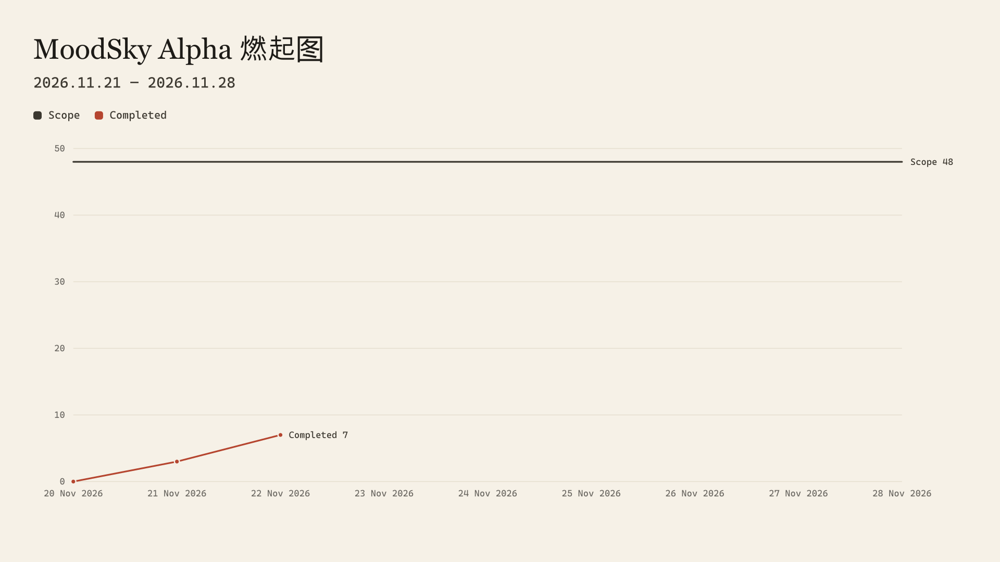
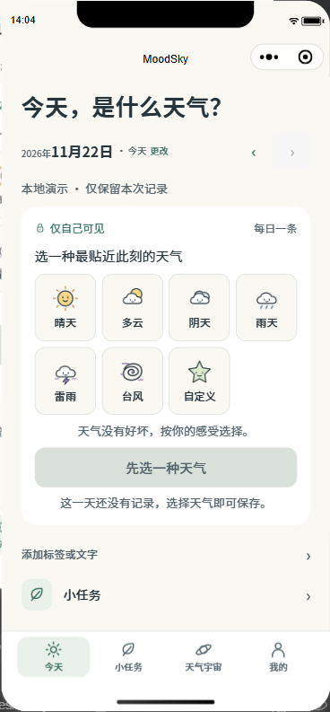
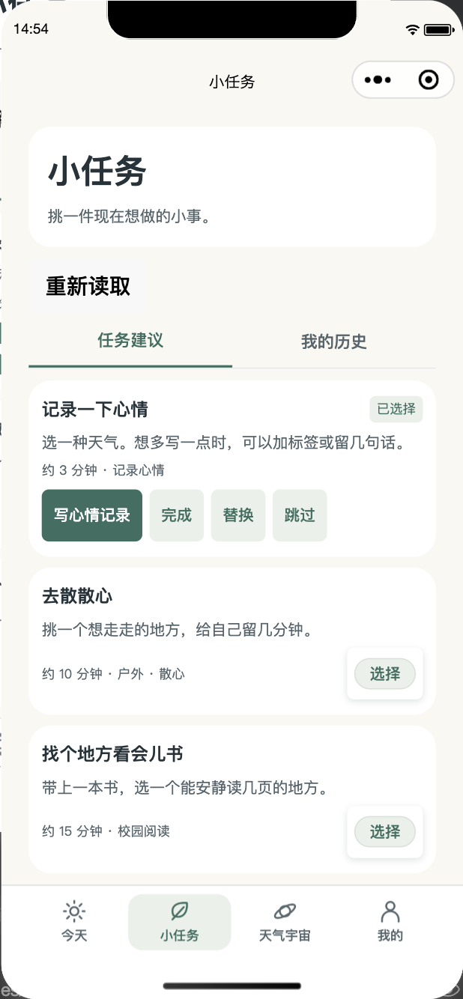
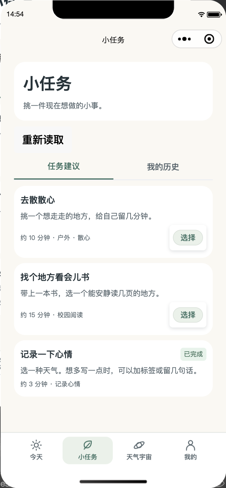
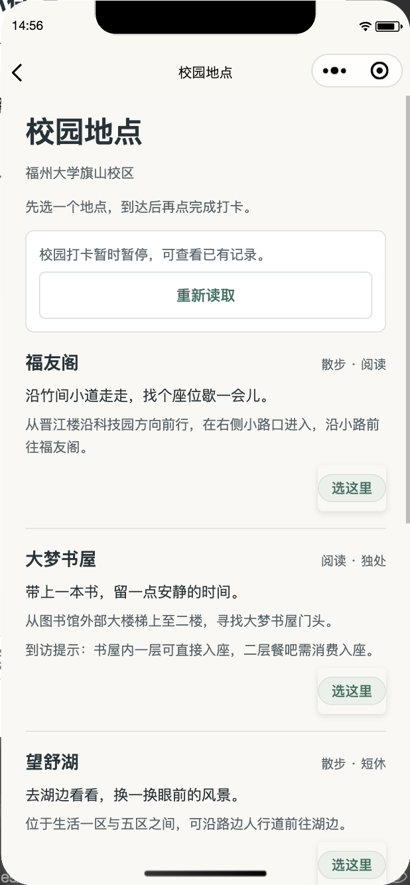
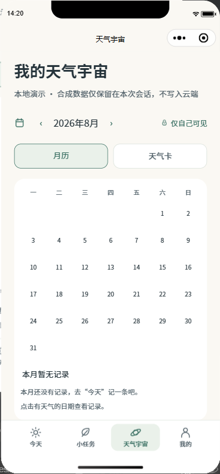

# MoodSky Alpha Sprint Log 1: Integration and Baseline Verification (November 21–22)

| Item       | Details                                                                                                                                                                                                                                                           |
| ---------- | ----------------------------------------------------------------------------------------------------------------------------------------------------------------------------------------------------------------------------------------------------------------- |
| Course     | [2601_FZU-MU_SE](https://bbs.csdn.net/forums/2601_MU_SE_FZU)                                                                                                                                                                                                      |
| Assignment | [Fifth Assignment — Alpha Sprint](https://bbs.csdn.net/topics/620611106)                                                                                                                                                                                          |
| Objective  | Report the first two days of development, testing, application behaviour, delivery progress, and the next period's work                                                                                                                                           |
| References | [MoodSky repository](https://github.com/HX-Jan/MoodSky), [integration PR #223](https://github.com/HX-Jan/MoodSky/pull/223), [integration PR #231](https://github.com/HX-Jan/MoodSky/pull/231), [task service PR #233](https://github.com/HX-Jan/MoodSky/pull/233) |

**Reporting period:** November 21–22, 2026. Member intake and delivery statistics were checked up to **18:25 on November 22, Beijing time**. The final local checks performed afterwards are recorded separately in the handoff package. This article is a local draft; its publication time will be recorded only after publication.

## 1. Goals and version baseline

MoodSky is a private mood journal that uses weather to represent feelings. It includes mood records, a calendar and reviews, small tasks, campus places, and personal data management. During the first period, we focused on agreeing on a common development baseline, integrating submitted changes, and collecting reproducible results and actual application screenshots.

| Version layer                                                | Verified reference                                                                                                                    |
| ------------------------------------------------------------ | ------------------------------------------------------------------------------------------------------------------------------------- |
| Original sprint baseline                                     | GitHub `v0.5.2`, commit `5b2775393a4adbf5d9a77ff2a3c61b3c3bb3958c`                                                                    |
| Product source after this period's integrations              | `11e230d84f3e0c7316de42cca3fda9476ca8dbd3`; package version `0.5.3`                                                                   |
| Fixed GitHub Latest release                                  | Still `v0.5.2`; the current main branch is not a newly published fixed release                                                        |
| Last archived WeChat upload and cloud verification           | Version `0.5.3`, build `0580e148004bda027ac5c14b3178538c1ebc8e2f`; these are earlier receipts, not deployments performed for this log |
| Current WeChat experience, review, and public release status | Awaiting a current platform receipt                                                                                                   |

These references describe different things. The button, re-registration, and task service changes merged after the archived upload must not be described as already running in the uploaded WeChat build.

## 2. Development and integration

### Button feedback and the agreed layout

Jiaqi's [PR #218](https://github.com/HX-Jan/MoodSky/pull/218) added press and release feedback across 13 pages and three components. Integration also corrected a condition that disabled the animation of task buttons even when the business action was available. The existing business properties of 147 buttons were retained. Task selection and campus **Select here** buttons remain on the right.

The work is tracked in [Issue #202](https://github.com/HX-Jan/MoodSky/issues/202). The November 22 supplement includes 29 native screenshots and an index of normal, failure, read-only, and empty states.

### Registering a new empty account after deactivation

[PR #226](https://github.com/HX-Jan/MoodSky/pull/226) implements the agreed behaviour: after deactivation, the same WeChat identity can explicitly register a separate, empty account. Old private data is not restored. Old requests and cleanup work must remain scoped to the old account. Fifteen regression tests were added.

This behaviour does not provide two active profiles that one WeChat user can switch between. That distinction matters for the independent A/B tests discussed below.

### Consistent task templates and service messages

Jiawei's [PR #233](https://github.com/HX-Jan/MoodSky/pull/233), linked to [Issue #205](https://github.com/HX-Jan/MoodSky/issues/205), provides task mode, template, and account-state examples. It also fixes two service problems: an enabled task path still reported that task operations were not connected, and public suggestions and private task selection applied inconsistent template limits.

The change aligns the limits and rejects a template with no usable step. It adds 29 regression tests. Review included comparison of five generated sample files, 17 additional boundary checks, and the task page's consumer scenarios.

### Incremental integration

[PR #223](https://github.com/HX-Jan/MoodSky/pull/223) integrates seven submitted changes; [PR #231](https://github.com/HX-Jan/MoodSky/pull/231) integrates six supplements. Older branches were integrated incrementally, preserving the current pages, right-side buttons, request recovery, and account boundaries. Original reports, failed runs, author attribution, and earlier evidence dates remain available.

## 3. Delivery progress and burnup chart

<!-- FIGURE 1: Insert evidence/burnup-20261122.png here. -->

**Figure 1.** The scope is 48 period-delivery checkpoints. Three were complete on November 21; four more became complete on November 22, bringing the total to seven. Future actual values are blank.

The chart counts **12 members × four reporting periods**, with one equal checkpoint per member per period. A checkpoint is counted after the required materials, necessary verification, and delivery review are available. It does not count PRs, files, hours, or story points. The original 24 `AS-*` final acceptance units and their named independent reviewers are tracked separately.

| Date                              |  Newly completed | Cumulative completed | Deliveries                             |
| --------------------------------- | ---------------: | -------------------: | -------------------------------------- |
| November 20, before the sprint    |                0 |                    0 | Baseline for the 48-checkpoint measure |
| November 21                       |                3 |                    3 | Linghan, Junhan, Xiang Yu              |
| November 22, at the intake cutoff |                4 |                    7 | Zhifeng, Jiaqi, Qizhen Chen, Jiawei    |
| November 23–28                    | Not yet observed |           Left blank | No future completion is assumed        |

Seven of the 12 first-period deliveries meet their delivery conditions, giving **7/48** across the full sprint. Xiang Hong's local handoff is ready for independent review and has not been counted as an eighth completed checkpoint. Earlier charts showing three completions remain historical snapshots.

The chart was created by entering the verified CSV data into [4080 Studio](https://4080studio.com/tools/chart-maker/burnup-chart). Its original SVG is archived. The website's PNG export did not return a file, so the upload image was rasterized directly from that SVG without redrawing the chart. The application screenshots below were copied without editing.

## 4. Actual application screenshots

These five application images were captured in WeChat Developer Tools on November 22. Jiaqi used cloud-disabled synthetic demo data; Qizhen Chen used a local production entry with an offline SDK fixture. They are simulator evidence, with cloud and phone verification tracked separately.

The capture commits were `5678336e800f8cb98744894b4821d4da3ccd746a` and `11a34159ab4e606ae269c9e23f51acfdaf748ab2`. Their `miniprogram` trees match the product baseline used for this log. Later service changes are covered by the service tests. The screenshots have not been cropped, resized, annotated, or combined.

### Today: seven weather choices

<!-- FIGURE 2: Insert evidence/today-native.png here. -->

**Figure 2.** The Today page shows seven weather choices and the private-record notice. This is an initial state without a saved record. Source: Jiaqi's November 22 native simulator capture using cloud-disabled synthetic demo data.

### Saving a record keeps the task selected

<!-- FIGURE 3: Insert evidence/record-return-selected-native.png here. -->

**Figure 3.** After entering the record page from a task, saving, and returning, the task remains selected. Saving a mood record does not automatically complete the task. Source: Qizhen Chen's November 22 native simulator capture using the local offline bridge.

### Completion requires an explicit action

<!-- FIGURE 4: Insert evidence/task-completed-native.png here. -->

**Figure 4.** The task displays its completed state only after the user performs the completion action and the service confirms it. Source: the same local environment as Figure 3.

### Campus selection stays on the right

<!-- FIGURE 5: Insert evidence/campus-right-native.png here. -->

**Figure 5.** Campus selection buttons remain on the right. The page displays directions and restrictions, and states that new check-ins are paused while existing records remain available. Selecting a place is not evidence of arrival or a successful check-in. Source: the same local environment as Figure 3.

### An empty calendar month

<!-- FIGURE 6: Insert evidence/calendar-empty-native.png here. -->

**Figure 6.** August 2026 contains no records in this synthetic scenario. The calendar displays an empty state and a next-step hint instead of filling the month with stale data. Source: Jiaqi's November 22 native simulator capture using cloud-disabled synthetic demo data.

## 5. Member contributions and outstanding handoffs

Delivery review and named independent acceptance are separate. A missing current-period report means that we have not received the required material; it does not establish that the member has done no work.

| Member                                                               | First-period work received                                                                                                     | Current status and next handoff                                                                                                           |
| -------------------------------------------------------------------- | ------------------------------------------------------------------------------------------------------------------------------ | ----------------------------------------------------------------------------------------------------------------------------------------- |
| Xiang Hong ([#198](https://github.com/HX-Jan/MoodSky/issues/198))    | Version references, PR decisions, checks and evidence index, this log, chart, and member intake                                | Local handoff ready; awaiting Yuen and Qizhen Cai's independent review                                                                    |
| Yifan Ji ([#199](https://github.com/HX-Jan/MoodSky/issues/199))      | PR #228 record scenarios and synthetic seed; key images and a seed-confirmation image are present in the Issue                 | Complete the task-entry round trip in local enabled mode and connect each result to its actual build and evidence; review by Yuen pending |
| Zhifeng Dai ([#200](https://github.com/HX-Jan/MoodSky/issues/200))   | PR #227 four-view comparisons, non-current and empty-month cases, and native screenshots; maintainer rerun                     | Period delivery complete; joint verification with Yifan's new seed and Yuen's independent feedback pending                                |
| Linghan Chen ([#201](https://github.com/HX-Jan/MoodSky/issues/201))  | PR #216 login and optional-profile branches, a 13-page sharing table, seven cloud-disabled screenshots, and local test subsets | Period delivery complete; independent review, real login, and device file delivery pending                                                |
| Jiaqi Zhu ([#202](https://github.com/HX-Jan/MoodSky/issues/202))     | Button feedback, 29 native screenshots, state indexes, and issue ownership                                                     | Period delivery complete; page-specific wording issues and named review remain open                                                       |
| Qinghan Zhang ([#203](https://github.com/HX-Jan/MoodSky/issues/203)) | PR #230 five-place source table, entry results, and 59 local tests                                                             | Add native evidence for both entry paths, right-side selection, return state, and paused feedback; hand off to Junhan and Yuen            |
| Junhan Huang ([#204](https://github.com/HX-Jan/MoodSky/issues/204))  | PR #221 examples for three interfaces, including authentication, isolation, pagination, and replay                             | Period delivery complete; Qinghan's adaptation, Qizhen Cai's independent review, and target-cloud checks pending                          |
| Jiawei Fang ([#205](https://github.com/HX-Jan/MoodSky/issues/205))   | PR #233 mode, template, and account examples, two service fixes, and 29 added regressions; reviewed and merged                 | Period delivery complete; independent acceptance by Qizhen Chen, Yuen, and Qizhen Cai pending                                             |
| Qizhen Chen ([#206](https://github.com/HX-Jan/MoodSky/issues/206))   | PR #229 current 24-row mode matrix, four unknown-result actions, nine native images, and explicit completion checks            | Period delivery complete; shared-input alignment and named independent feedback pending                                                   |
| Xiang Yu ([#207](https://github.com/HX-Jan/MoodSky/issues/207))      | PR #220 two export formats and coverage, nine scenarios with 15 assertions; PR #219 DD07 receipts                              | Period delivery complete; field feedback, Linghan's actual adaptation, and independent review pending                                     |
| Yuen Lin ([#208](https://github.com/HX-Jan/MoodSky/issues/208))      | Earlier Week 6 report retained; maintainer logs are available as references                                                    | Current C1 matrix and statistical review still missing; the older PR #197 is not a substitute                                             |
| Qizhen Cai ([#209](https://github.com/HX-Jan/MoodSky/issues/209))    | PR #225 initial A/B page observations, seven original images, privacy table, and blocked-test report                           | Blocked by a project test-support limitation tracked in Bug #232; no cross-account rejection result is claimed                            |

Actual hours, availability, acknowledgements, and independent signatures remain for the relevant people to provide.

## 6. Verification results and problems

The final local check completed **1,691 tests: 1,691 passed, zero failed, and zero skipped**, using Windows, Node 24.21.0, and synthetic data. All **eight offline production-assembly groups** also passed. The checks prepare shared contracts first, then cover linting, formatting, structure, document links, types, and tests. The product main branch's [quality run](https://github.com/HX-Jan/MoodSky/actions/runs/45011435406) also succeeded.

The total rose from 1,662 to 1,691 through Jiawei's 29 additional regressions. Focused subsets, the eight offline groups, sample comparisons, and tool scenarios are not added again to inflate the full test count. Sample clocks remain documented as fixture dates rather than being relabelled as execution dates.

The first closeout format check failed on eight newly written Markdown/JSON files. Those files were formatted, and the required full check then passed; the failed log is preserved. An earlier PR #231 import also retains its seven original whitespace warnings and exit code 2. That historical result is kept separate from subsequent successful checks.

| Problem                                                                                                                   | Action taken                                                                                                    | Remaining boundary                                                                      |
| ------------------------------------------------------------------------------------------------------------------------- | --------------------------------------------------------------------------------------------------------------- | --------------------------------------------------------------------------------------- |
| Task button feedback was disabled in an otherwise available state                                                         | Corrected the condition, preserved business handlers, and added regression coverage                             | Merged source does not establish a new WeChat upload                                    |
| Deactivated users could not follow the agreed empty-account registration flow                                             | Added an isolated new account generation and 15 regressions                                                     | Real verification using the same deployed client and backend remains separate           |
| Public task suggestions and private selection used different template limits                                              | Aligned validation and checked empty steps and boundary counterexamples                                         | Existing target-cloud templates must be checked before deploying the stricter limits    |
| Re-login through one WeChat identity does not provide an independent B identity or controlled cross-account request entry | Recorded [Bug #232](https://github.com/HX-Jan/MoodSky/issues/232) and its reproduction and closure requirements | A test-support gap remains; current evidence does not establish an authorization bypass |
| A read-only guest state still shows wording suggesting login will enable tasks                                            | Recorded the exact state, screenshot, and page owner in Jiaqi's issue list                                      | Page owner to confirm the wording and rerun the same scenario                           |

Local fixtures can represent independent A/B identities, but the current member-facing path does not yet let Qizhen Cai perform the required controlled test reliably. Her blocked report is accepted as a project limitation, rather than treated as an individual failure to submit.

## 7. Next period: November 23–24

The next period will prioritize four handoffs:

1. Yifan and Qinghan will complete the missing task round-trip and native-operation evidence on known local builds.
2. Qizhen Chen will align the page scenarios with Jiawei's current samples, Junhan's interfaces, and the shared synthetic seed.
3. Xiang Hong will progress Bug #232's controlled local test entry so that Qizhen Cai can independently execute and record the A/B results.
4. Yuen will consolidate the current regression matrix and review the delivery statistics and source references.

Reproduced interface wording issues will be fixed and retested on their original paths. Materials prepared early for later periods keep their real execution dates and require period-appropriate inputs and verification. Blog publication, course submission, platform review, cloud deployment, and WeChat release will each require their own actual receipt.
