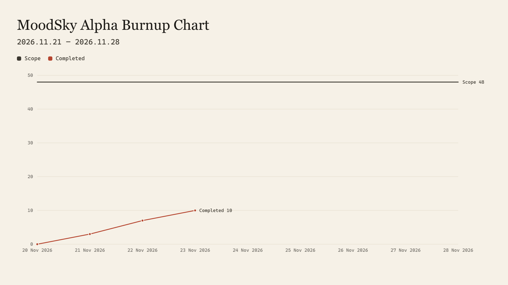
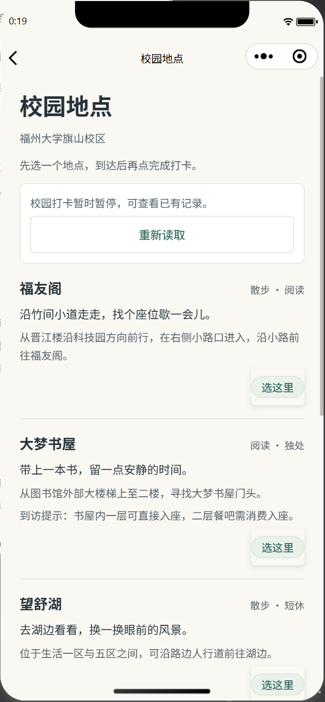
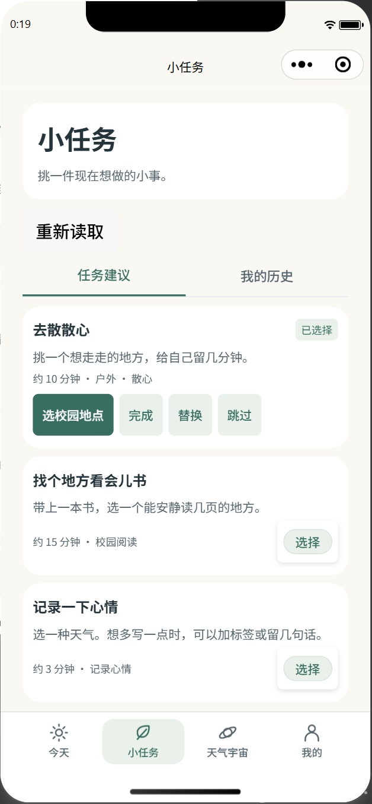

# MoodSky Alpha Sprint Log 2: Controlled Access Tests and Integration (November 23–24)

| Item       | Details                                                                                                                                                                                                                                                                            |
| ---------- | ---------------------------------------------------------------------------------------------------------------------------------------------------------------------------------------------------------------------------------------------------------------------------------- |
| Course     | [2601_FZU-MU_SE](https://bbs.csdn.net/forums/2601_MU_SE_FZU)                                                                                                                                                                                                                       |
| Assignment | [Fifth Assignment — Alpha Sprint](https://bbs.csdn.net/topics/620611106)                                                                                                                                                                                                           |
| Objective  | Integrate the first fixes and shared inputs, make blocked local checks executable, and record the second period's actual evidence                                                                                                                                                  |
| References | [MoodSky](https://github.com/HX-Jan/MoodSky), [C1 carryover integration #240](https://github.com/HX-Jan/MoodSky/pull/240), [C2 export-access submission #241](https://github.com/HX-Jan/MoodSky/pull/241), [test-support issue #232](https://github.com/HX-Jan/MoodSky/issues/232) |

**Progress update verified on November 23, 2026.** The reporting period continues through November 24. This draft records work already executed; the remaining member reports, independent feedback, and the second day's results have not been filled in in advance. It has not been published to CSDN or submitted to the course page.

## 1. Baseline and priorities

This period starts from main commit `78812fedeb90c5603e927fbda8050eab23b5338f`, following integration #240. The product version remains 0.5.3. Our immediate priorities are account isolation, export access, preservation of the agreed interface, and traceable handoffs between modules.

The current work adds local verification tools and evidence. Product pages, production services, database rules, and release switches remain unchanged. The seven-weather interface, right-side selection buttons, explicit task completion, original-request retries, and empty-account re-registration remain the baseline. Source integration is recorded separately from cloud deployment and WeChat release.

## 2. Export access: a reproducible C2 submission

Xiang Yu submitted [PR #241](https://github.com/HX-Jan/MoodSky/pull/241), with review head `057c07db371d5a9961617f0ae68abb3a49b0c374`. Its 64 checks cover export content and ownership, cross-account requests, stale exports, expiry, deactivation and re-registration, and a separate claim-policy module.

The maintainer ran the tool twice into different output directories. Both runs passed all 64 checks, and all five generated files matched each other and the submitted files byte for byte. The tool uses six independent scenario groups; sequential checks within a group share that group's state. Two descriptions were corrected to state this accurately.

The production-entry checks confirm that a user can obtain their own file, another account cannot obtain it using its job ID, source changes invalidate an old export, and deactivation denies private access. The candidate's 300-second claim-token policy is tested separately and is not presented as an already connected production endpoint. Real file delivery, natural expiry in the target cloud, and device verification remain pending.

## 3. Making independent A/B verification executable

[Issue #232](https://github.com/HX-Jan/MoodSky/issues/232) records a test-support gap: signing out and back in through the same WeChat identity does not create an independent B account. A second empty page also does not prove that B was denied access to A's data.

We added `tools/alpha-h/ab-workbench.cjs`. It runs the actual production business entry against a disposable memory database, with two independent synthetic identities supplied by the test host. It does not add an identity override to the application or require cloud credentials.

| Check group | What is verified                                                                                                                                      |
| ----------- | ----------------------------------------------------------------------------------------------------------------------------------------------------- |
| H01–H04     | A and B can each read their own distinct campus history; a client-supplied owner and a mixed identity/scope are rejected                              |
| E01–E04     | Both accounts can obtain their own JSON export; B's targeted status and download requests for A's actual generated job are denied                     |
| E05–E06     | Editing A's record invalidates A's old export while B's file remains available                                                                        |
| L01–L06     | Deactivation denies A's private access, B remains usable, and explicit re-registration creates an empty new account that cannot read predecessor data |

All **16 checks passed** at implementation commit `9996362f7ad6927d2cca86b91cf383e99ef5bf84`, from a clean worktree. The output records the source commit, execution time, fixture business date, requests, and responses. Session scopes, cleanup receipts, file bodies, and record text are masked before the report is written.

We also tested a deliberately incorrect export cache that used only the job ID as its cache key. The workbench detected B receiving A's cached response and marked the check as failed. This counterexample checks that the verifier can detect a regression instead of only producing a successful summary.

Qizhen Cai can now execute the documented local command and return her own results. The maintainer's run is not her independent acceptance. Issue #232 remains open for that verification and for the separately tracked device and account-switching requirements.

## 4. Progress and carryover

<!-- FIGURE 1: Insert evidence/images/01_burnup.png here. -->

**Figure 1.** The scope remains 48 equal period-delivery checkpoints. Cumulative completion is 3 on November 21, 7 on November 22, and 10 on November 23. Later actual values remain blank.

November 23 adds three checkpoints: Yuen's and Qinghan's C1 carryover deliveries, plus Xiang Yu's C2 export-access delivery. The two C1 supplements are not counted again as C2 work. The original 24 final acceptance units remain a separate ledger.

Xiang Hong's C2 handoff is still in progress and has not been awarded a completion point. The chart was made in 4080 Studio from the verified CSV. The earlier C1 chart and its data were preserved in a separate chart and dataset. The downloaded native SVG was converted directly to the upload PNG.

## 5. Application evidence from this period

The following images are Qinghan's original November 23 native simulator captures from the two campus entry checks received through #240. They document a C1 supplement executed during the current reporting period. They have not been cropped, resized, combined, or annotated.

Their capture baseline was `36ff7f54476ff19cbacba7238b11ee34a5adcdf6`, using an offline SDK fixture with real cloud calls disabled. The captured client tree matches this period's unchanged client tree. These images do not establish real arrival, a successful check-in, or a device/cloud acceptance result.

<!-- FIGURE 2: Insert evidence/images/02_campus_right_selection.png here. -->

**Figure 2.** Campus directions and restrictions remain readable, and Select here stays on the right. The pause message remains visible. Selecting a destination changes the local target without creating a check-in.

<!-- FIGURE 3: Insert evidence/images/03_return_selected.png here. -->

**Figure 3.** After selecting a campus destination and returning, the task remains selected. A destination choice is not reported as task completion. Source: Qinghan's November 23 local native simulator evidence.

## 6. Checks, issues, and decisions

The current full check passed **1,693 of 1,693 tests**, with zero failures and zero skipped tests. The increase from 1,691 consists of two workbench regressions: the normal targeted A/B flow and the incorrect-cache counterexample. All nine local team integration groups and eight production-assembly offline groups passed.

The 64 export checks and 16 workbench checks are separate tool results and are not added again to inflate the full test total. All checks use synthetic data. Cloud, phone, platform, and independent acceptance evidence are recorded separately.

| Issue                                                                         | Current decision                                                         | Next owner/action                                                                   |
| ----------------------------------------------------------------------------- | ------------------------------------------------------------------------ | ----------------------------------------------------------------------------------- |
| Missing member-friendly A/B test entry                                        | Local workbench implemented and verified; independent execution pending  | Qizhen Cai to run it and return actual feedback                                     |
| PR #236 removes a shared synthetic seed and references unavailable evidence   | Changes requested; no deletion adopted                                   | Yifan to restore the seed and provide accessible native and failure logs            |
| PR #237's enabled phone entry blocks the original WeChat re-registration flow | Changes requested; product change not adopted                            | Login/account owner to restore the reachable flow and test new-generation isolation |
| Campus standard native suite timed out                                        | Original failure retained; the two focused campus checks remain separate | Qinghan, Qizhen Chen, and Yuen to rerun the standard suite in a stable session      |
| Read-only guest wording suggests login will enable tasks                      | Assigned for page-level correction and matching visual retest            | Qizhen Chen and Linghan                                                             |
| Production claim-token and favourites-write boundaries                        | Recorded as candidate limitations                                        | Relevant service and interface owners before enabling them                          |

## 7. Member intake for the current period

| Member        | C2 material available at this update                                                                | Remaining handoff                                                     |
| ------------- | --------------------------------------------------------------------------------------------------- | --------------------------------------------------------------------- |
| Xiang Hong    | Local A/B workbench, integration decisions, risk and retest tables, and this English progress draft | Full November 24 intake and named review pending                      |
| Xiang Yu      | PR #241's 64-check matrix, samples, and source tool; maintainer rerun completed                     | Qizhen Cai and Yuen's independent feedback pending                    |
| Yifan Ji      | C1 supplement is under revision; no verifiable C2 return received yet                               | Submit current-period recovery and account-switch evidence            |
| Zhifeng Dai   | Earlier harness and C1 review remain attributed to their original dates                             | Current-period shared-input and failure-path return pending           |
| Linghan Chen  | Earlier pre-run material remains a dated reference                                                  | Current-period interface and file-delivery branch results pending     |
| Jiaqi Zhu     | Existing issue and media indexes available                                                          | Current-period review and updated visual issue status pending         |
| Qinghan Zhang | November 23 campus evidence received as C1 carryover                                                | Current-period boundary return and named review pending               |
| Junhan Huang  | Existing interface examples available                                                               | Current-period replay, date, pause, and history results pending       |
| Jiawei Fang   | Existing mode and account examples available                                                        | Current-period transition and preference-isolation results pending    |
| Qizhen Chen   | Existing page matrix and independent local review available                                         | Current-period cross-page and failure results pending                 |
| Yuen Lin      | C1 matrix, candidate, and local independent opinions received                                       | Current-period regression update and review pending                   |
| Qizhen Cai    | Earlier blocked report retained                                                                     | Independently execute the new entry and return current-period results |

Not having received a report does not mean that a member has done no work. Actual hours, acknowledgements, and signatures remain for the relevant people to provide.

## 8. What remains for November 24

Collect the remaining C2 reports, obtain actual independent feedback on the new A/B entry, review updated fixed PR heads, and rerun affected paths if product code changes. Update this draft, the member table, and the burnup chart using the actual cutoff. Platform publication and release actions require their own receipts; none has been performed for this update.
