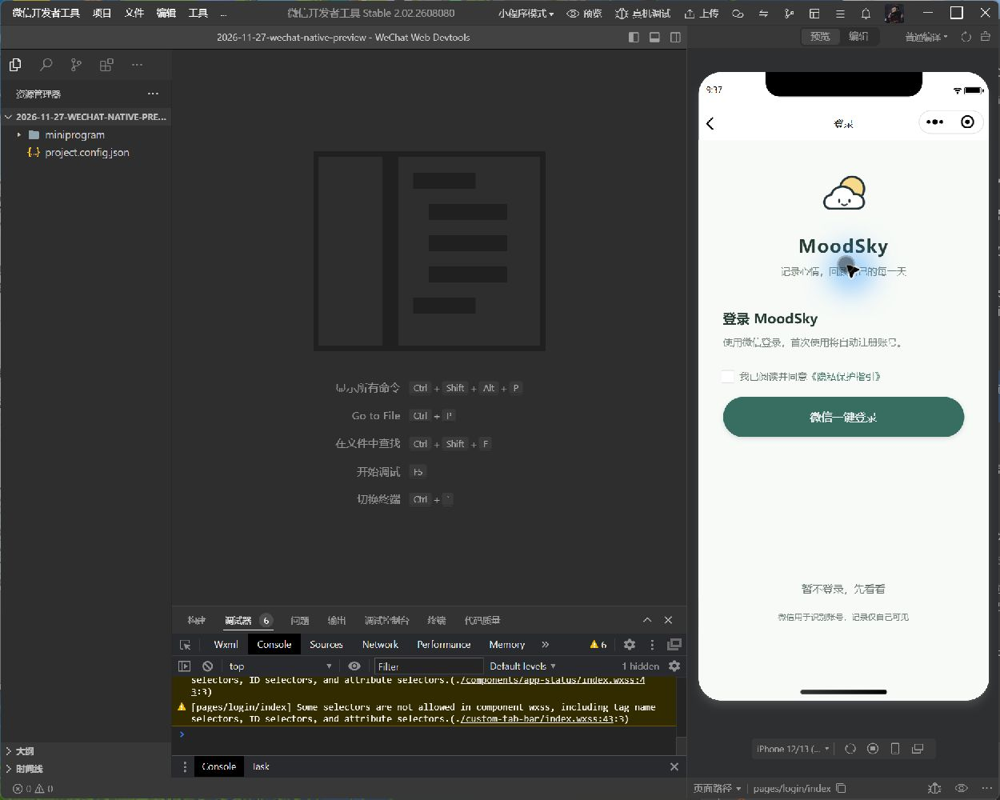
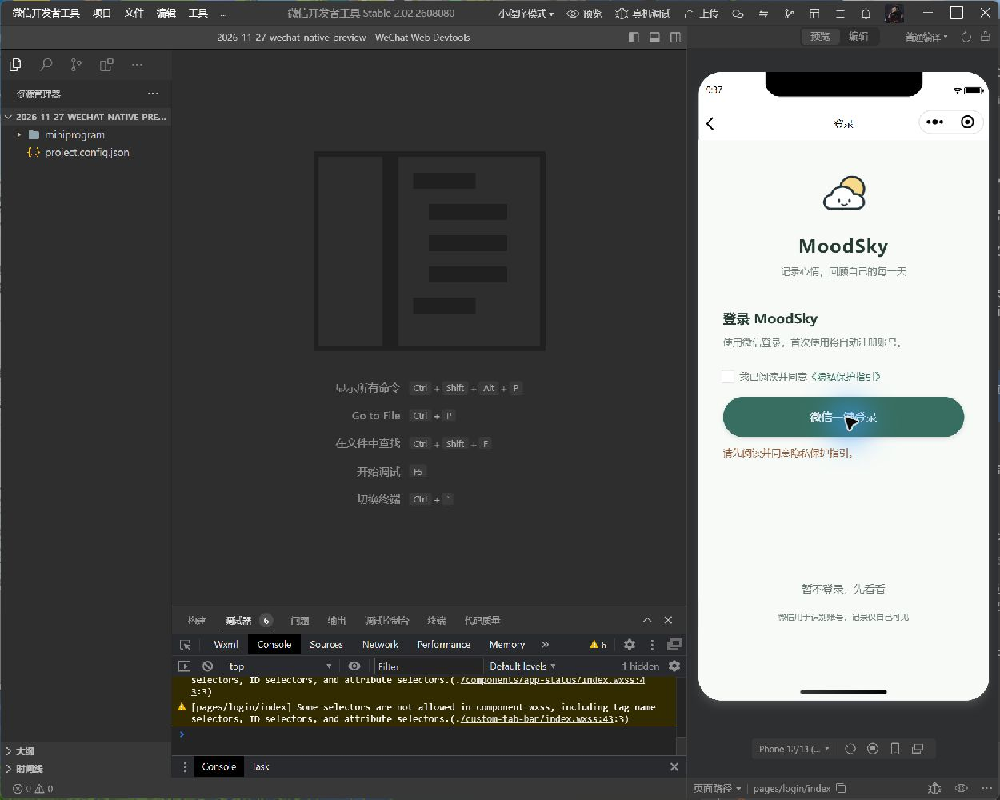
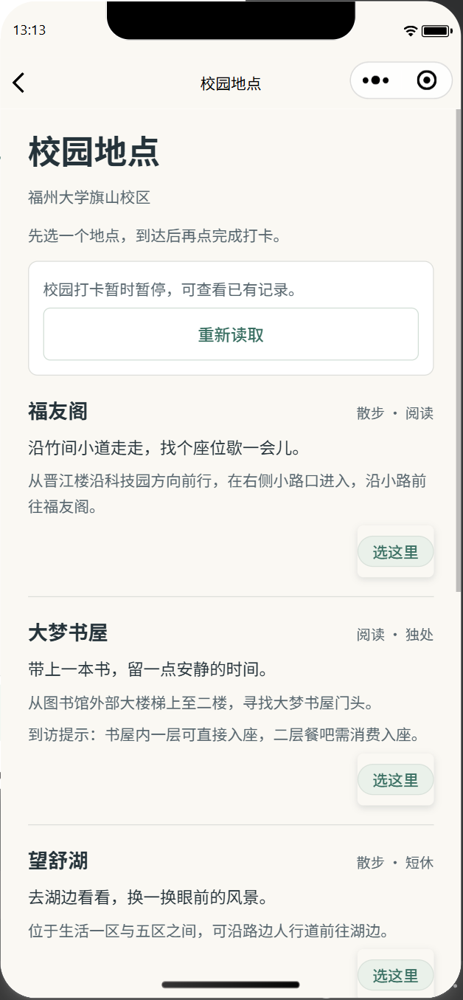
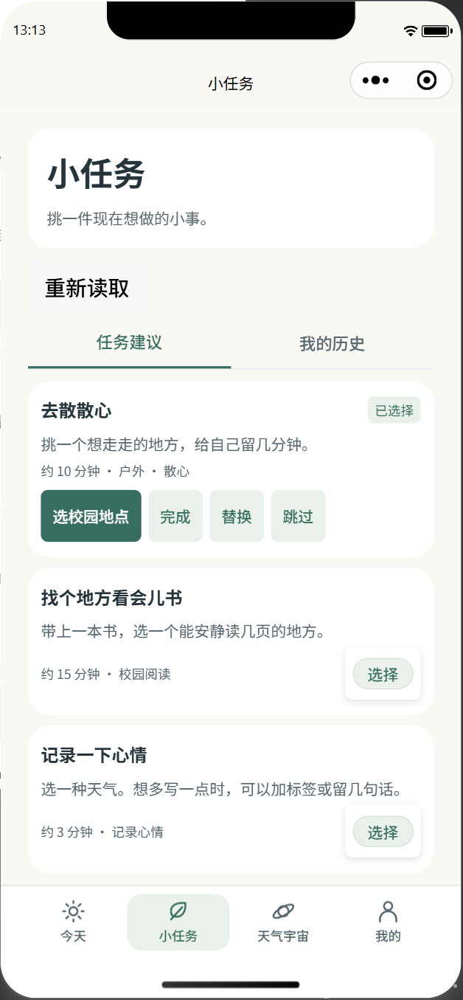
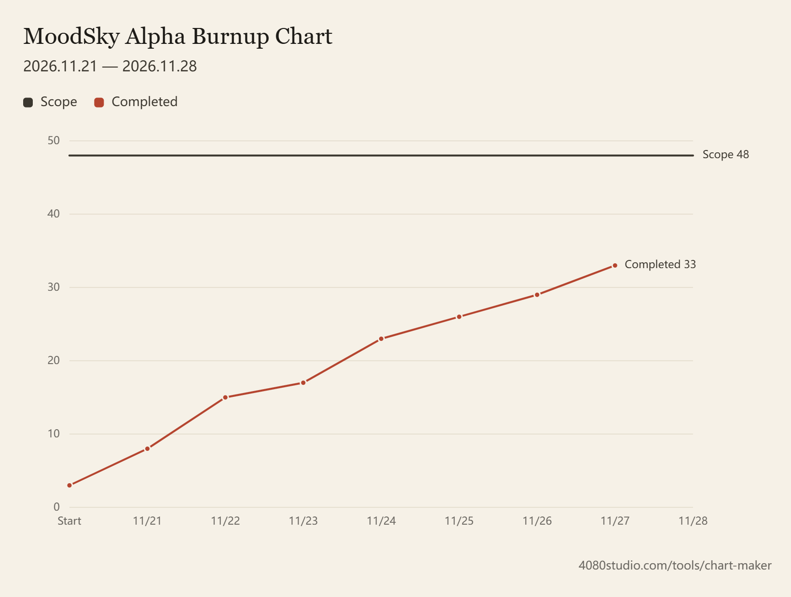
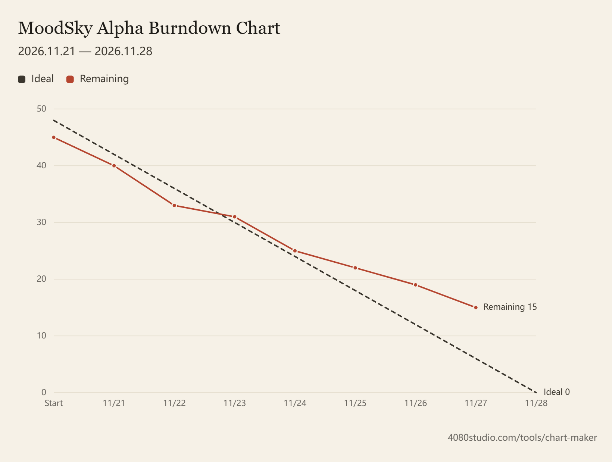

# MoodSky Alpha Sprint Log 4: A Traceable Candidate and Final Handoff

| Item             | Details                                                                                                                                                                                    |
| ---------------- | ------------------------------------------------------------------------------------------------------------------------------------------------------------------------------------------ |
| Course           | [2601_FZU-MU_SE](https://bbs.csdn.net/forums/2601_MU_SE_FZU)                                                                                                                               |
| Assignment       | [Fifth Assignment — Alpha Sprint](https://bbs.csdn.net/topics/620611106)                                                                                                                   |
| Reporting period | November 27–28, 2026; observations recorded through 2026-11-27T23:55:00+08:00                                                                                                              |
| Objective        | Freeze a reproducible candidate, reconcile submitted evidence and prepare release and classroom handoffs                                                                                   |
| References       | [Repository](https://github.com/HX-Jan/MoodSky), [frozen source](https://github.com/HX-Jan/MoodSky/tree/00c59a1af7ccd27e9c2ae4bc77f6b65fc66b117c), [release decision](release-decision.md) |

This is the November 27 progress edition. November 28 results and final reviewer decisions have not been reported yet.

## 1. Candidate and login change

We fixed the candidate source at `00c59a1af7ccd27e9c2ae4bc77f6b65fc66b117c`: version 0.5.3, task mode `closed`, new campus check-ins paused and phone-number login disabled. The owner confirmed that this app cannot enable WeChat's phone-number capability. We therefore selected WeChat identity login with automatic registration on first use. Returning with the same WeChat identity opens the existing account. Re-registration after deletion requires explicit confirmation and creates an empty account; it does not restore old records.

The client from this source was uploaded through the official WeChat Developer Tools on November 27. This establishes a development-version upload, not an experience-version selection, approval or public release. The business and maintenance cloud functions were not redeployed in this work.

<!-- FIGURE 1: Insert images/02-wechat-login.png here, unchanged. -->

**Figure 1.** The actual November 27 native simulator page shows WeChat login and first-use registration. The screenshot is unedited. This preview has cloud access disabled; it demonstrates the interface, not successful real-device authentication.

<!-- FIGURE 2: Insert images/03-consent-required.png here, unchanged. -->

**Figure 2.** Clicking login with the privacy agreement unchecked produces a consent reminder. The checkbox was not selected on the user's behalf, and no real account was created for this capture.

## 2. Evidence reconciliation and integration

| Member / source                                                                                                      | Concrete result                                                                                                                                                                                                                                                                                                                                         | Remaining boundary                                                                                                                 |
| -------------------------------------------------------------------------------------------------------------------- | ------------------------------------------------------------------------------------------------------------------------------------------------------------------------------------------------------------------------------------------------------------------------------------------------------------------------------------------------------- | ---------------------------------------------------------------------------------------------------------------------------------- |
| Junhan Huang, [#257](https://github.com/HX-Jan/MoodSky/pull/257)                                                     | Fourteen campus regression rows, pagination and export/cleanup cross-checks; current maintainer rerun retains A=0, B=1 and public-place count=1 after completed cleanup                                                                                                                                                                                 | Caller review and target-cloud validation remain separate                                                                          |
| Qizhen Cai, [#260](https://github.com/HX-Jan/MoodSky/pull/260)                                                       | A personally operated November 26 local A/B run and fourteen cleanup scenarios, including eleven batches to `completed`                                                                                                                                                                                                                                 | Local snapshot-to-remote mapping and final frozen-candidate opinion are still needed                                               |
| Yuen Lin, [#264](https://github.com/HX-Jan/MoodSky/pull/264)                                                         | 1730 tests, A/B16, XY64 and an independently assembled candidate from 00c59a1                                                                                                                                                                                                                                                                           | Submitted as a precheck; final freeze confirmation and the completed testing article are still needed                              |
| Qinghan Zhang, [#265](https://github.com/HX-Jan/MoodSky/pull/265)                                                    | C2/C3 page/service and boundary matrices, 94 tests, ten original native images and two campus round trips from 00c59a1                                                                                                                                                                                                                                  | The preview and member package use `enabled`; the frozen candidate is `closed`, so final same-mode C4 confirmation is still needed |
| Jiawei Fang, [#254](https://github.com/HX-Jan/MoodSky/pull/254) & [#270](https://github.com/HX-Jan/MoodSky/pull/270) | 40 targeted tests and 1733 full-suite recheck on frozen `00c59a1/closed`, external checklist and summary draft (`ee86e6c4`, integrated via [#267](https://github.com/HX-Jan/MoodSky/pull/267)), plus confirmed C1–C4 actual hours (10 hours total) and personal summary confirmation in [#270](https://github.com/HX-Jan/MoodSky/pull/270) (`712fc196`) | Qizhen/Cai independent reviews and external cloud/device checks remain pending                                                     |
| Xiang Yu, [#269](https://github.com/HX-Jan/MoodSky/pull/269)                                                         | `tools/alpha-xy/c3-cleanup.cjs` and C3-XY evidence (`2d18ca53`): 14/14 scenarios, 11 batches (30 rows deleted, `completed`), 6 expired residue records with body removed and `fileId: null`, B/public rows untouched, and M1–M8 / G1 handoff; independently rerun by maintainer                                                                         | Qizhen Cai and Yuen independent reviews, live cloud triggers, natural expiry, backups and G1 new-generation cleanup remain pending |

The maintainer found a reporting defect in the campus evidence generator: some cases were labelled PASS before their outcome was asserted, and cleanup did not require the terminal state. The generator now checks each recorded result, the exact permission refusal and completed cleanup. Three negative regression tests reject successful guest access, leaked account history or incorrect pagination, and incomplete cleanup or the wrong error code. It also records its actual generation time and source instead of a fixed historical date. Member logs remain attributed to their original executions.

The integration branch passes **1733 tests**: the frozen product suite has 1730, and this handoff adds three evidence-tool regression tests. These numbers describe different source trees. Separate local runs pass A/B **16/16**, export access **64/64**, and lifecycle **14 scenarios with 137 assertions**. Overlapping runs are not added together as a larger independent test total.

<!-- FIGURE 3: Insert images/05-campus-right-selection.png here, unchanged. -->

**Figure 3.** Qinghan's original November 27 simulator capture shows the right-side selection controls and paused check-in notice. The source matches 00c59a1. The isolated preview uses an offline SDK and enabled tasks, so this is a local test view rather than the closed-mode release candidate running against the cloud.

<!-- FIGURE 4: Insert images/06-campus-return-selected.png here, unchanged. -->

**Figure 4.** After the campus round trip the task remains selected; choosing a place does not complete a task or write a check-in. The submitted report records zero check-in writes before selection, after selection and after the pause probe. All ten submitted image hashes and reported source-file hashes were checked by the maintainer.

## 3. Reproducing the package

Yuen reported that the C3 manifest `29b31dd…` could not be reproduced with a newer packager. We located the original candidate and rebuilt it with the packager from its own `dde127c` source. The complete manifest hash matched exactly. The newer packager adds phone-feature fields and generated configuration, so applying it to old source changes the manifest. The original observation and the resolution are both retained.

For C4, the owner's candidate manifest matches Yuen's independently submitted manifest byte for byte: `711deb7e5f20c1c0c7473b3b9de4e0a52fafc8aea5e9c67524a2746abcd1edb0`. The audit verifies **193 file hashes**: 185 client files, three business-function files, four maintenance-function files and one root project configuration. The package contains 195 files when the manifest and empty-secret environment template are also counted.

## 4. Submission progress

<!-- FIGURE 5: Insert images/01-burnup.png here. -->

**Figure 5.** The scope is 48 period deliverables. Complete submissions are counted on their actual submission date, including early work; waiting for review does not remove a submitted result. Three deliveries were already submitted on November 20. November 21 adds five and November 22 adds seven. The cumulative total is 33 at this cutoff; November 28 actual values are blank.

<!-- FIGURE 6: Insert images/04-burndown.png here. -->

**Figure 6.** Remaining deliverables equal 48 minus complete submissions, giving 15 at the current cutoff. The dashed ideal line is a reference schedule. Both charts use the same dated submission ledger and were exported from 4080 Studio (Editorial theme native PNG exports); their interiors contain only chart labels, dates and statistics.

Cai's cleanup evidence is one additional complete submission, received in [#260](https://github.com/HX-Jan/MoodSky/pull/260) at **16:27:09 Beijing time on November 26**. Four complete submissions are recorded on November 27: Qinghan's C2 and C3 results received in [#265](https://github.com/HX-Jan/MoodSky/pull/265) at **13:18:07 Beijing time**, Jiawei's C4-JF frozen-candidate recheck (`ee86e6c4`, integrated via [#267](https://github.com/HX-Jan/MoodSky/pull/267)) received in [#254](https://github.com/HX-Jan/MoodSky/pull/254) at **18:15:33 Beijing time** (with C1–C4 hours confirmed at 10 hours in [#270](https://github.com/HX-Jan/MoodSky/pull/270) at **21:46:57 Beijing time**), and Xiang Yu's C3-XY expiry maintenance and batched cleanup evidence received in [#269](https://github.com/HX-Jan/MoodSky/pull/269) at **19:46:21 Beijing time**. These results are counted on their actual receipt dates rather than their planned period dates. Qinghan's C4 material stays partial because it uses an enabled-mode candidate instead of the frozen closed-mode package. Cai's folder is named C4, but its content supplies the previously missing C3 cleanup result, so it is counted once under C3. The earlier execution time is not substituted for the submission receipt. Yuen's new precheck and the current maintainer preparation are recorded as partial deliveries until their remaining deliverables are supplied. The twenty-four independent acceptance units use a separate ledger.

## 5. Release conditions and next steps

The local candidate is available for review and authorized external testing. A public release decision still needs final independent opinions, two-WeChat device login checks, actual exported-file delivery, real maintenance receipts and platform/privacy/UGC verification. The task feature remains closed and new campus writes remain paused in this candidate.

We prepared the release table, 24-unit gap ledger, submission checklist, summary draft, collection draft and slide-by-slide defense content. Members' personal reflections, actual hours and final confirmations remain attributable to the members; missing entries have not been invented. The complete November 28 handoff will update these materials using actual new evidence. Blog publication and submission to the course assignment page have not been performed; the assignment deadline is **November 29, 2026, 23:59**.
