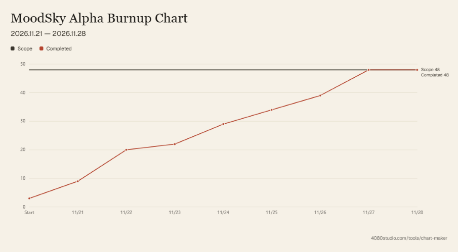

# MoodSky Alpha Sprint Summary

| Item       | Details                                                                                                                                           |
| ---------- | ------------------------------------------------------------------------------------------------------------------------------------------------- |
| Course     | [2601_FZU-MU_SE](https://bbs.csdn.net/forums/2601_MU_SE_FZU)                                                                                      |
| Assignment | [Fifth Assignment — Alpha Sprint](https://bbs.csdn.net/topics/620611106)                                                                          |
| Objective  | Compare the planned sprint with verified delivery, contributions and remaining work                                                               |
| References | [Repository](https://github.com/HX-Jan/MoodSky), [24 acceptance units](acceptance-gaps.csv), [48 submission checkpoints](submission-audit-48.csv) |

Prepared on November 27. The November 28 final results and outstanding personal contributions must be incorporated before this becomes the final sprint summary.

## Planned scope and actual progress

The sprint runs from November 21 to November 28. The plan assigns twelve members two final acceptance units each, with a report every two days. This yields 24 acceptance units and 48 period-delivery checkpoints. The pre-sprint baseline is v0.5.2 / `5b2775393a4adbf5d9a77ff2a3c61b3c3bb3958c`.

The current product candidate is 0.5.3 / `00c59a1af7ccd27e9c2ae4bc77f6b65fc66b117c`. It retains seven weather choices, private record/review flows, right-side campus selection and explicit task completion. The candidate keeps task mode closed and new campus writes paused. After phone-number capability proved unavailable for this app, WeChat identity login with first-use registration became the selected route. Explicit empty-account re-registration preserves the deletion boundary.

At this cutoff, 31 of the 48 period deliverables have been submitted completely, leaving 17 incomplete or missing. This measures submitted artifacts, not independent acceptance or production availability. Early submissions are assigned to their actual dates. The separate acceptance ledger retains real reviewer decisions and external gaps.

## Development, testing and integration

We integrated reviewed increments instead of replacing current source with old branches. Existing records, account lifecycle safeguards and selected-button positions remain intact. Local testing exercises original-request retry, pending work, stale responses, identity isolation and export/cleanup boundaries. The frozen product suite has 1730 tests; the C4 evidence-tool correction adds three negative tests, producing 1733 on the integration tree.

Two concrete lessons came from the handoff. First, a historical package must be rebuilt with the packaging script from its own source version: the original C3 manifest was reproduced exactly once that dependency was respected. Second, an evidence generator must assert the result before writing PASS; completion requires the terminal cleanup state and precise authorization outcome. The maintainer corrected those checks and preserved member outputs.

The independently assembled C4 manifest matches the owner's package. The client was uploaded as a development version. Neither that upload nor local checks establish platform approval, real-device file delivery or a matching deployment of both cloud functions.

## Individual contributions and collaboration

The table below records evidenced work and explicitly outstanding personal input. It does not assign invented hours or first-person reflections.

| Member        | Verified contribution source                                                                                              | Still needed                                                                                                         |
| ------------- | ------------------------------------------------------------------------------------------------------------------------- | -------------------------------------------------------------------------------------------------------------------- |
| Xiang Hong    | Candidate freeze; four reviewed member increments; package reproduction; evidence-tool correction and handoff manuscripts | Actual hours and owner-confirmed personal reflection                                                                 |
| Yifan Ji      | Record/recovery/account-switch evidence; Yuen's explicit local acceptance                                                 | Shared four-view C3 comparison, frozen-source confirmation and personal summary/hours                                |
| Zhifeng Dai   | Four-view C1–C3 results and early C4 demo/summary material                                                                | Final 00c59a1 confirmation and member-confirmed reflection/hours                                                     |
| Linghan Chen  | Login/share/file branches and early C4 material                                                                           | Final WeChat-only entry confirmation, actual file delivery and personal summary/hours                                |
| Jiaqi Zhu     | C1 visual work and original media                                                                                         | C2–C4 issue disposition, final media and personal summary/hours                                                      |
| Qinghan Zhang | PR265: C2/C3 matrices, 94 tests, ten native images, two campus round trips and summary facts                              | Closed-mode candidate confirmation, standard native suite, designated feedback and member-confirmed reflection/hours |
| Junhan Huang  | PR257: fourteen campus rows and export/cleanup cross-check                                                                | Review of the tool correction, final service confirmation and personal summary/hours                                 |
| Jiawei Fang   | C2/C3 reports and PR254's early C4 partial delivery and summary draft                                                     | Final mode/service/page comparison, actual C2–C4 hours and confirmation                                              |
| Qizhen Chen   | Shared task flows, November 24 native media, C4 precheck and summary draft                                                | Frozen closed-mode route checks and member-confirmed summary/hours                                                   |
| Xiang Yu      | Two export formats, 64 access checks and redacted requests                                                                | Own C3 cleanup and final C4 delivery, summary and actual hours                                                       |
| Yuen Lin      | PR264: 1730 tests, A/B16, XY64 and independently assembled candidate                                                      | Freeze confirmation, final testing article and personal summary/hours                                                |
| Qizhen Cai    | PR260: personally operated November 26 cleanup/A-B runs and scope-draft opinion                                           | Snapshot mapping, final per-feature opinion and personal summary/hours                                               |

Existing individual summary drafts from Zhifeng, Linghan, Jiawei and Qizhen Chen remain attributed to their original authors and dates. Their final confirmations and actual hours are not inferred from the drafts. The remaining members' reflections will be inserted from actual submissions. The record of work distribution uses delivered development, testing, design and review artifacts; PR count alone is not a workload measure.

## Next iteration

The immediate priorities are final same-source reviewer confirmation, real WeChat login/registration checks, actual JSON/Markdown file delivery, real export expiry and cleanup maintenance, and platform privacy/UGC evidence. Each condition has a named owner in the release table. If product source changes after the freeze, affected checks and the package must be regenerated from the new full commit. The final report will record actual November 28 progress and retain any unresolved condition.
