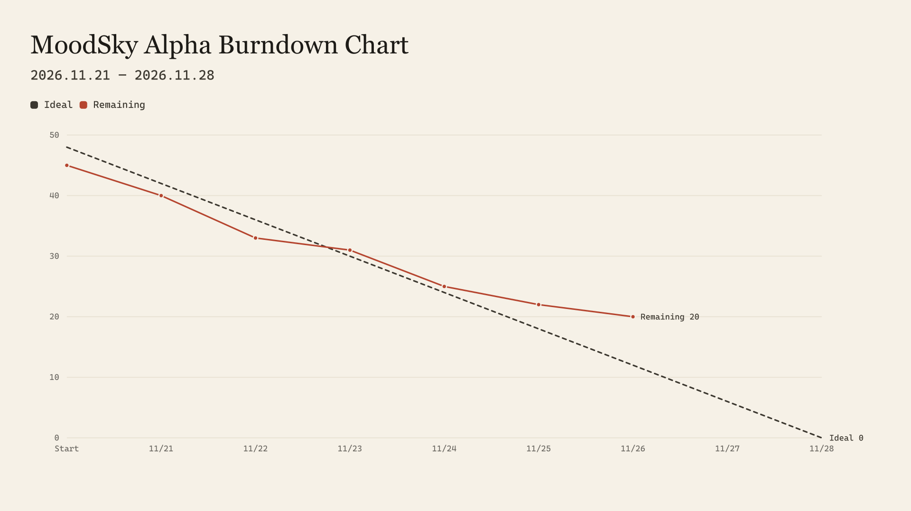

# 48项周期任务提交复查与燃尽图｜2026-11-26

核对截止：2026-11-26T16:09:32+08:00（Asia/Shanghai）。范围：12人×4周期，固定48项。核对源码：`dde127cb78f7a4a078c3239ee06dba64a4430201`。本次只更正统计、图表与文章；产品、开关和部署均无变化。

## 结论与口径

**28项完整提交，6项部分提交，14项未收到本期关键成果；剩余20项。** 分周期：C1 12/12，C2 10/12，C3 6/12，C4 0/12。这是本地成果提交统计，不是最终验收或线上完成率。

依用户11月26日确认：完整、可查的提前成果按实际提交日期计入；等待评审、合并、指定签认不扣除。材料缺关键成果则只记部分提交。本人实测有日志与环境，即使暴露其他失败，也不伪装成没有提交；失败与验收风险另列。负责人H与其他成员适用同一提交标准，不以缺独立签认排除本人交付。

时间以GitHub服务器收件为准：首版已有成果采用PR `createdAt`；PR创建后追加关键成果采用含该补件的 `PushEvent.created_at`。不使用本地执行日、Git作者/提交日、评论或合并日倒填。`pushedDate`查询均为null，故没有拿它推断日期。首次可核实回执是统计依据；若中间推送回执不可取得，不声称精确到真实上传秒。PR254的C4后追加材料没有取得服务器精确时间，留空而非套用更早的PR创建时间。

每条完整交付的证据文件均核对为存在于对应提交树，避免把后补文件算进PR初版。审查了PR #210—#257中的Alpha相关材料、12项任务Issue的成员回传，以及主仓库/相关fork的可见推送记录。开放#237/#247不产生独立的周期完成点，#254只作为C4部分材料。

## 每日统计

| 北京日期   | 当日完整提交 | 累计完整提交 | 剩余 |
| ---------- | -----------: | -----------: | ---: |
| 2026-11-20 |            3 |            3 |   45 |
| 2026-11-21 |            5 |            8 |   40 |
| 2026-11-22 |            7 |           15 |   33 |
| 2026-11-23 |            2 |           17 |   31 |
| 2026-11-24 |            6 |           23 |   25 |
| 2026-11-25 |            3 |           26 |   22 |
| 2026-11-26 |            1 |           27 |   21 |
| 2026-11-27 |            — |            — |    — |
| 2026-11-28 |            — |            — |    — |

26日为上述核对时点，不是26日全天最终结果；27、28日实际值留空。20日3项是Qizhen Chen的C1/C2/C3提前交付；因此21日期初已提交3项，Start剩余45。21日新增5项，22日新增7项，不能混成同一天。

## 十二人四周期矩阵

日期为首次完整提交的北京时间；“部分”表示已有实际成果但缺关键内容。“未收”不表示本人没有工作，亦不表示尚未到期的C4逾期。

| 成员              | C1         | C2         | C3         | C4   |
| ----------------- | ---------- | ---------- | ---------- | ---- |
| 洪翔 Xiang Hong   | 已交 11-22 | 已交 11-24 | 已交 11-26 | 未收 |
| Yifan Ji          | 已交 11-24 | 已交 11-25 | 部分       | 未收 |
| Zhifeng Dai       | 已交 11-22 | 已交 11-22 | 已交 11-22 | 部分 |
| Linghan Chen      | 已交 11-21 | 已交 11-21 | 已交 11-21 | 部分 |
| Jiaqi Zhu         | 已交 11-22 | 未收       | 未收       | 未收 |
| Qinghan Zhang     | 已交 11-23 | 未收       | 未收       | 未收 |
| Junhan Huang      | 已交 11-21 | 已交 11-24 | 未收       | 未收 |
| Jiawei Fang       | 已交 11-22 | 已交 11-25 | 已交 11-25 | 部分 |
| Qizhen Chen       | 已交 11-20 | 已交 11-20 | 已交 11-20 | 部分 |
| Xiang Yu          | 已交 11-21 | 已交 11-23 | 未收       | 未收 |
| Yuen Lin          | 已交 11-22 | 已交 11-24 | 未收       | 未收 |
| 蔡奇真 Qizhen Cai | 已交 11-24 | 已交 11-24 | 部分       | 未收 |

## 本次更正的具体原因

- Linghan：#216不只交C1。C2/C3的本地分支表、原始TAP、生命周期状态与补验单在21日已追加；C1/C2原生图在同日补齐。C2/C3各加1项，不等到计划周期或维护者评审日。
- Zhifeng：#227首版已包含C2修改删除/降级25行和C3旧响应/回归41行，22日提交；C1/C2/C3分别对应不同关键成果，全部保留原21日执行时间。
- Qizhen Chen：#210已交C1三模式/原生入口和C3未知结果/迟到导航/文章供稿；#212补齐C2保存后重开与两条链路。三项均在20日实际交出，24日复跑不重复加点。
- H：C1/C2/C3完整稿分别在22/24/26日提交；独立复核仍在24单元台账中，不把本人提交排除在48项统计外。
- Junhan、Jiawei、Yuen：分别按24/25/24日成员实际回传计算C2，不再挪到26日维护者整合；Jiawei C3按25日计。
- Yifan：C1关键原生补件在24日实际推送，不能按22日原执行日或PR创建日提前。C2补件在25日PR255已交；其本人完整原始日志内直接`W4 H02 a late save from A cannot repopulate B or trigger a saved notification`用例确实通过。18项定向命令不覆盖该直接场景，但不能忽略已交的1693项原始日志。十项其他失败保留原因待核，不称本人全量通过。C3共同种子四入口核对仍缺。
- 蔡奇真：225已有本人正常访问/隐私首轮观察，但定向请求受阻；252在24日补入本人16项本地生产入口实际执行，覆盖正常/越权拒绝和领取/旧回执/停用，分别补齐C1/C2关键结果。同一次16项支撑两个不同交付条件，不说成32项测试。归档快照未与远端SHA映射、设备构建未明、真实云未验均保留；不把本地提交计成真实云验收。16项没有运行清理worker，C3仍部分。
- Qinghan：239为UTC22日16:22:39，即北京时间23日00:22:39；按23日计。C1缺的原生链路不能按230创建时间提前。

26日16:04:21（北京时间）新收到[Junhan C3 PR257](https://github.com/HX-Jan/MoodSky/pull/257)，14项服务回归、生命周期交叉核对与原始日志已齐，计入26日。上午11:40的27项快照保留在[snapshots/1140](snapshots/1140/README.md)；本次更新到28项，未把它挪到维护者评审或合并日。

## 已有部分成果及补交要求

- **C3-YF · Yifan Ji**：AB16、18项和原始失败日志已提交。 补交：本期要求与Zhifeng共同种子四入口逐条对照，未提供regression-c3.csv等同等成果；C2已计，不能将同一补件直接视为C3齐。
- **C3-C · 蔡奇真 Qizhen Cai**：实际独立AB16已交，并非未执行。 补交：未执行cleanup worker；缺本人分批清理回执、A前后对照及B/公共保留对照。16项用于C1/C2，不满足C3清理。
- **C4-Z · Zhifeng Dai**：提前60项、演示、原生图及总结已交。 补交：为成员分支候选提前预检，未与负责人最终冻结包绑定；最终同包复测仍缺，不因未到窗口排除。
- **C4-L · Linghan Chen**：提前37项、演示与总结已交。 补交：报告明确最终冻结SHA待指定；缺最终包同构建界面核对。
- **C4-JF · Jiawei Fang**：25日提前本地复检、外部清单及总结已交。 补交：PR仍Draft不是扣分理由；缺最终候选清单/服务/页面同构建确认，保持部分提交。
- **C4-QC · Qizhen Chen**：24日三模式静态候选、原生素材、演示与总结已交。 补交：报告明确未获最终冻结回执，原样包端云与独立预览分列；缺最终冻结包路径对照。

其余14项按成员列于48项表中；应提交物从原任务卡继承，没有替成员生成成果或签字。C2-JQ与C2-QH缺本期处置/页面服务对照和当期媒体；C3-JQ/QH/XY/YL缺对应本期完整材料；C4-H/YF/JQ/QH/JH/XY/YL/C尚未收到最终包成果，C4期限未到。

## 图表与复查文件

横轴Start为11月21日00:00的期初状态，此前已有3项提交。红线Remaining=48−累计完整提交；虚线Ideal是48项在8个周期日均匀降到0的参考线，不是预测。图内只保留标题、日期、坐标、图例与数值，不放任务解释。4080 Studio原生SVG导出，PNG直接等比例转换；没有AI生成或手工重画曲线。

- [48项逐项核对](submission-audit-48.csv)：固定原始SHA、实际提交时点、逐文件证据及缺口。
- [按时间排序的28项提交事件](submission-events.csv)、[每日统计](daily-submissions.csv)、[12人矩阵](member-matrix.csv)。
- [6项部分提交及补件](partial-submissions.csv)、[图表输入](burndown-data.csv)、[GitHub时间回执摘录](github-receipts.json)、[图表来源及校验](chart-source.json)。
- [更正后的英文日志3](log3-en.md)。旧16/48评审口径图/报告保留历史出处，不再作为当前提交统计。24项独立验收台账未被改成27项验收通过。
