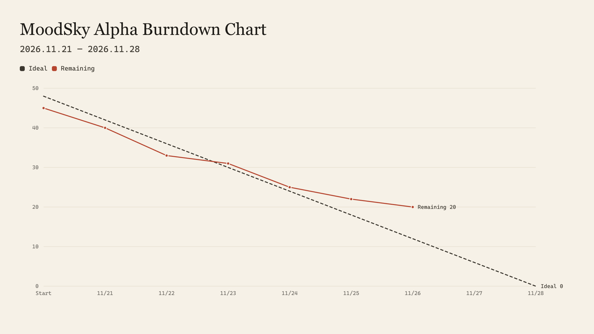
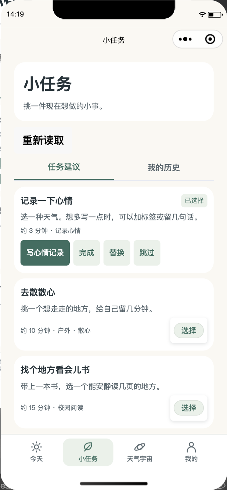
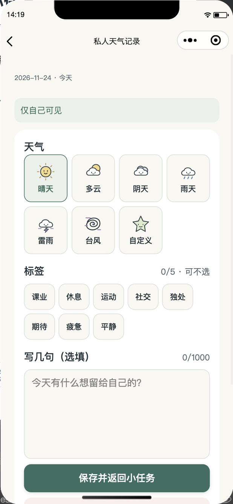
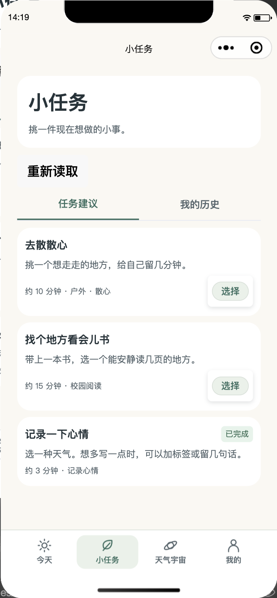

# MoodSky Alpha Sprint Log 3: Candidate Scope and Lifecycle Verification

| Item             | Details                                                                                                                                 |
| ---------------- | --------------------------------------------------------------------------------------------------------------------------------------- |
| Course           | [2601_FZU-MU_SE](https://bbs.csdn.net/forums/2601_MU_SE_FZU)                                                                            |
| Assignment       | [Fifth Assignment — Alpha Sprint](https://bbs.csdn.net/topics/620611106)                                                                |
| Reporting period | November 25–26, 2026                                                                                                                    |
| Objective        | Consolidate lifecycle evidence, review candidate scope and prepare the final regression handoff                                         |
| References       | [Repository](https://github.com/HX-Jan/MoodSky), [candidate scope](candidate-scope-draft.md), [24 acceptance gaps](acceptance-gaps.csv) |

## 1. Scope for the next candidate

We reviewed the current submissions against main `7feca53ff0ed461cac270b7da7e7c36f36b7973b`. Version **0.5.3** remains the product baseline. This period adds verification tools, two evidence-tool fixes and reports. Client pages, production services, database rules and release switches are unchanged.

The proposed candidate uses **task mode `closed`**, with new campus check-ins paused. The three task modes are tested in separate local fixtures; they are not simultaneously enabled in the candidate. The seven weather choices, right-side selection buttons, explicit task completion and empty-account re-registration remain intact.

The scope draft lists each feature's evidence and outstanding dependencies. Real cloud operation, device file delivery, privacy/UGC status and platform review remain separate checks. This draft does not declare the product ready for public release.

## 2. Integration and evidence fixes

| Source                                                               | Work reviewed and adopted                                                                                                                    |
| -------------------------------------------------------------------- | -------------------------------------------------------------------------------------------------------------------------------------------- |
| [#246 — Qizhen Chen](https://github.com/HX-Jan/MoodSky/pull/246)     | Three-mode page matrix, seven-weather shared-input flows, campus round trips, unknown-result checks and original November 24 native captures |
| [#248 — Junhan Huang](https://github.com/HX-Jan/MoodSky/pull/248)    | Thirteen steps for deduplication, original-request replay, date rollover, pause and retired-place history; six-collection lifecycle map      |
| [#249 — Xiang Yu](https://github.com/HX-Jan/MoodSky/pull/249)        | Sixteen redacted export/account request receipts; the unsupported cleanup-progress claim is excluded                                         |
| [#250 — Yuen Lin](https://github.com/HX-Jan/MoodSky/pull/250)        | C2 regression links, dated statistics snapshot and testing-method contribution                                                               |
| [#251/#252 — Qizhen Cai](https://github.com/HX-Jan/MoodSky/pull/252) | Client observations and an actual independent local A/B run, with source and cleanup limitations retained                                    |
| [#253 — Jiawei Fang](https://github.com/HX-Jan/MoodSky/pull/253)     | C2 carryover and C3 task/account regression, service samples and page/lifecycle comparison                                                   |
| [#255 — Yifan Ji](https://github.com/HX-Jan/MoodSky/pull/255)        | A/B workbench run, eighteen focused tests and the previously missing full-check failure log                                                  |

The maintainer fixed two reproducible reporting problems. The export request logger could not find the shared Git references in a linked worktree, so its normal command failed before generating evidence. It now resolves the shared Git directory. The service evidence generators used a fixed November 25 timestamp for later reruns; they now record the actual generation time. Two regression tests cover these failures.

Original screenshots and logs are retained. Jiawei's new regression logs use a dated directory so the older C1 logs remain available. Cai's formatting failures were corrected without rewriting the raw local receipts. Reports that describe the former “no re-login” behavior now carry a note distinguishing that historical observation from the current requirement for explicit registration of an empty new account.

Phone-login [#237](https://github.com/HX-Jan/MoodSky/pull/237) remains held because the enabled entry blocks the existing re-registration route. The paid AI scheduling proposal in [#247](https://github.com/HX-Jan/MoodSky/pull/247) stays separate and has not been enabled. [#254](https://github.com/HX-Jan/MoodSky/pull/254) remains a C4 draft; its submitted C4 material still lacks evidence tied to the final frozen candidate.

## 3. Lifecycle boundaries checked

The maintainer reran **14 lifecycle scenarios with 137 assertions** against disposable synthetic data. They distinguish export expiry from body removal, deactivation from cleanup completion, and a cleanup request from a completed batch. The checks also cover receipt binding, preservation of B and public data, and recovery without reviving the old account.

Cai has now supplied an actual **16/16 local A/B run**. It includes normal own-account access, B's targeted requests for A's generated export, stale-export rejection, deactivation and empty-account re-registration. We no longer describe that independent run as missing. Its archive-derived snapshot has not been mapped to the remote commit, and the sixteen checks do not execute the cleanup worker. Those gaps remain explicit.

Yifan's eighteen tests cover logout confirmation, protected pending work and task retries. Yifan's submitted full log also contains a passing direct late-save isolation case; his eighteen-test subset does not include it. The maintainer additionally reran the existing `session-races` case: A commits a record, the client switches to B, and A's response is released afterwards. B receives no A content or write; returning to A reads version 1, with one effective write. This is recorded as the maintainer's verification, separately from the member's submitted full-log evidence.

The client-only report that a file could be previewed but not sent still needs a traceable device build and actual delivery evidence. Current local file-API tests pass; that does not establish that a phone received the file.

## 4. Burndown chart

<!-- FIGURE 1: Insert images/01_burndown.png here. -->

**Figure 1.** Scope: 48 period-delivery checkpoints. The red line shows work remaining after complete submissions: 45 at the start, 40 on November 21, 33 on November 22, 31 on November 23, 25 on November 24, 22 on November 25 and 20 at the November 26 audit cutoff. Future actual values are blank. The dashed line is an even eight-day reference, not a forecast.

The corrected count is **28/48 complete submissions**: C1 **12/12**, C2 **10/12**, C3 **6/12**, C4 **0/12**. Six further checkpoints have partial materials; fourteen lack a complete period return. The three submissions already present at the start are Qizhen Chen's C1/C2/C3 results submitted on November 20. November 21 added five checkpoints, and November 22 added seven.

We count the first complete, traceable submission in Beijing time, including early work. Waiting for review or merge does not move its date. Initial PR material uses the PR receipt; later key supplements use their server push receipt. Execution dates and Git commit timestamps are retained as provenance rather than used as submission dates. Every linked artifact was checked in its corresponding submitted tree.

The earlier **16/48** figure mixed review timing with submissions and omitted usable early returns. Linghan's C2/C3 material arrived on November 21, and Zhifeng's on November 22; Qizhen Chen had already supplied three checkpoints before the sprint. Xiang Hong's own submitted reports are now included without claiming independent approval. Cai's actual local A/B run supplies the missing targeted-access and export-boundary results for C1/C2; it does not execute C3 batch cleanup. Yifan's submitted full log already contains the passing direct late-save isolation case, although his eighteen-test subset does not cover it. Other failures in that full log remain unresolved.

Junhan submitted [C3 PR #257](https://github.com/HX-Jan/MoodSky/pull/257) at **16:04:21 on November 26 (Beijing time)**: fourteen current-main campus regression cases, redacted responses, A/B export and cleanup cross-checks, raw test logs and the log contribution. This adds one complete submission on November 26. The earlier 11:40 snapshot had twenty-seven; it is archived. The PR remains separate from merger and independent approval.

The final twenty-four acceptance units remain separate. Partial C4 packages from Linghan, Zhifeng, Qizhen Chen and Jiawei still need evidence tied to the team's final frozen candidate. Their early work is recorded; missing final-package evidence prevents counting a complete C4 delivery. Earlier dated snapshots are archived under their original metric.

The chart was exported as native SVG from 4080 Studio and converted directly to PNG. The companion audit lists all forty-eight decisions, original commits, server receipts and partial-submission requirements. No review result, cloud deployment or device delivery is implied by the submission count.

## 5. Application evidence and today's simulator limitation

A fresh native run was attempted on November 26, but the official developer tool reported **simulator launch failed**, and automation timed out. No new native success or screenshot was claimed. The following are the latest reviewed working captures supplied by Qizhen Chen, taken on **November 24**, using the same unchanged client source and an offline SDK fixture. They are reused without cropping, resizing or annotations; they are not presented as November 26 captures.

<!-- FIGURE 2: Insert images/02_01-saved-return-selected.png here. -->

**Figure 2.** Saving the synthetic record returns to the task page with the task still selected. Other task cards retain their right-side selection controls. Source: Qizhen Chen, November 24 native simulator capture.

<!-- FIGURE 3: Insert images/03_02-reopened-saved-record.png here. -->

**Figure 3.** Reopening retains the saved SUNNY weather and empty synthetic body. The page shows all seven weather choices. The displayed November 24 date is part of the original capture.

<!-- FIGURE 4: Insert images/04_03-explicit-complete.png here. -->

**Figure 4.** The record task becomes completed only after the explicit completion action. Saving a record is not itself task completion. These local images do not prove target-cloud or real-device behavior.

## 6. Verification and remaining work

The full local check passed **1,695/1,695 tests**, with zero failures or skips. The increase from 1,693 is the two evidence-tool regressions. The **69 focused tests** and **20 source/session tests** are overlapping subsets, not additional tests to add to that total. The shared Page/SDK runner passed sixteen scenarios; the task matrix covers twenty-four rows and four unknown-result action paths. All nine team groups and eight production-assembly offline groups passed.

| Member        | Verifiable progress received                                                               | Next required handoff                                           |
| ------------- | ------------------------------------------------------------------------------------------ | --------------------------------------------------------------- |
| Xiang Hong    | Reviews, tool fixes, 24-gap review, candidate draft, lifecycle comparison and this article | Yuen/Cai review; C4 freeze and final decision                   |
| Yifan Ji      | #255 A/B and pending-work evidence, executed November 25                                   | Common-seed four-entry comparison and Yuen's current opinion    |
| Zhifeng Dai   | Complete C1/C2/C3 material submitted early on November 22                                  | Current shared-input review and final-candidate retest          |
| Linghan Chen  | Complete C1/C2/C3 local material submitted early on November 21                            | Current interface review and traceable device file delivery     |
| Jiaqi Zhu     | Existing native media and visual issue index                                               | Read-only wording retest, current media and final storyboard    |
| Qinghan Zhang | Existing campus captures and shared-flow inputs                                            | Current pause/history/failure results and review                |
| Junhan Huang  | #248 C2 and #257 C3 current-main regression/lifecycle materials received                   | Caller and independent review; final frozen-candidate checks    |
| Jiawei Fang   | #253 C2 carryover and C3 regression received                                               | Actual caller feedback and final frozen-source checks           |
| Qizhen Chen   | C1/C2/C3 results submitted November 20; #246 adds November 24 regression                   | Final frozen-candidate evidence and named review                |
| Xiang Yu      | #249 additional redacted requests received                                                 | Current lifecycle handoff and independent cleanup feedback      |
| Yuen Lin      | #250 C2 statistics/methods completed                                                       | Updated coverage, final candidate and testing essay             |
| Qizhen Cai    | Actual local sixteen-check run and client observations received                            | Source mapping, independent batch cleanup and candidate opinion |

Missing current-period reports are recorded as missing evidence, not as proof that someone has done no work. Actual hours and signatures remain for each member to provide. No cloud deployment, WeChat upload, CSDN publication or course-page submission was performed for this update.

For C4, freeze the actual source and mode, rerun affected cases, assemble and verify the same client and two cloud packages, obtain the named independent opinions, and record a feature-by-feature decision. The summary structure is prepared; final results and personal reflections will be filled from actual returns.
