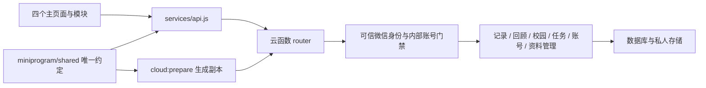

# 基础架构与扩展边界

学生端使用原生 JavaScript 微信小程序，后台使用微信云函数、数据库和存储。先保留一个 moodsky 云函数作为统一入口，在内部按职责分模块；后续若有运行时或成本依据再通过架构 PR 拆分函数。

图中的业务数据层和身份适配器仍待实现。现有代码只提供门禁结构、请求校验和未实现响应。不能把骨架当作已部署业务系统。

pages 放页面装配；modules 放各自交互和服务；components 放跨页面组件。公共样式使用 styles/tokens.wxss。不得在各页面复制天气编码、接口错误或数据库调用。

miniprogram/shared 是唯一共享源码，复制到 cloudfunctions/moodsky/shared 的内容为生成文件，不入 Git。云函数运行不依赖部署包之外的 ../../miniprogram 相对路径。CI 对比原文件与生成副本，避免前后端使用不同约定。

router 先验证请求，再按 public/private/operator/receipt 执行门禁，最后分发到对应 domain。私人处理器只接收内部 accountId；账号查询从可信 OPENID 解析，客户端不能指定本人归属。运营角色单独从服务端查询；清理进度回执只能查询进度，不具备普通账号权限。

账号解析、运营角色、清理回执当前均返回 NOT_IMPLEMENTED；公开业务也只返回未实现，固定模拟说明除外。后端成员实现时必须为每个 action 补完整输入输出白名单、拥有者过滤、幂等和异常处理。

数据库集合与索引位于 database/collections.json，只是设计基线。所有集合拒绝直接客户端读取/写入，公开地点也通过云函数过滤核验状态。运营端和学生端使用同一接口约定，不绕过授权。

回顾、卡片与月份档案共享原始 journal 数据。派生索引不复制正文，删除时一并失效。将导出与注销从第一周纳入模型设计，不能在全部页面完成后再临时拼接清理流程。

## 执行分工与待接入能力

2026-10-12执行分工：Xiang Hong负责记录、回顾与后端集成；Junhan Huang负责校园及后台业务；Jiawei Fang负责小任务、偏好、微信账号解析、停用及清理进度；Xiang Yu负责数据库、完整导出实现与清理执行；Linghan Chen负责前端集成；Yuen Lin负责CI及测试部署。

独立后台建议用HTML/CSS/JavaScript及CloudBase Web SDK，Qizhen Chen负责界面与可信Web身份接入。现有云函数仍只解析微信上下文，Web路径未实现；第一周验证实际环境的登录、身份来源、内部账号映射及运营权限，再确定SDK、模块和部署入口。公共路由、集合或身份字段变化须在同一接口PR更新所有调用方，不能把浏览器提交的身份字段当作可信主体。

导出与清理执行在云函数目录内拆为独立模块，由Xiang Yu负责；account.js保留Jiawei的偏好、停用和进度接口。各领域提供本模块的数据查询及清理能力，回顾继续使用记录源，避免复制私人正文。新增目录和身份路径属于后续实现计划，本次只更新职责和设计说明。
