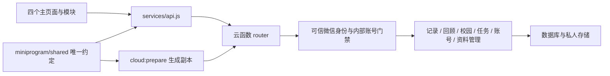

# 基础架构与扩展边界

学生端使用原生JavaScript微信小程序，默认正式云函数为moodsky。代码按职责分模块，服务端候选通过显式工厂注入数据层。下图描述接线职责，不表示默认部署已经连接业务数据库；当前体验、源码和固定历史云验证范围见[首页](../README.md)。

## 三种接线分别核对

| 范围                 | 源码入口                                                                                                                                               | 已有能力与限制                                                                                |
| -------------------- | ------------------------------------------------------------------------------------------------------------------------------------------------------ | --------------------------------------------------------------------------------------------- |
| 默认正式包           | [index.js](../cloudfunctions/moodsky/index.js)、[router.js](../cloudfunctions/moodsky/router.js)                                                       | 基础健康和既有模拟说明；默认身份/数据适配门禁保留，没有自动导入候选仓库                       |
| 服务端显式候选       | [W2组装](../tools/week2-integration/backend.js)、[候选路由](../cloudfunctions/moodsky/candidate-router.js)、[本地后端协议](local-journal-backend.md)   | 账号/记录/回顾、装饰和任务的范围由实际注入选项决定；内存与SDK离线验证不自动成为正式部署或验收 |
| 受限试验及客户端演示 | [本人测试源码](../tools/private-pilot/closed.js)、[关闭记录](deployment/private-pilot-business-20261026.md)、[体验包](releases/experience-20261026.md) | 固定历史云/手机反馈与本地内存展示分别记录；源码合并不重开旧测试，也不自动上传新包             |

已有模块不能因默认返回NOT_IMPLEMENTED就被判断为“完全未实现”；也不能因候选存在就直接改成正式开放。校园/后台候选PR #72经[修复与整合](reviews/2026-10-28-pr72-integration.md)提供显式`createCampusBackend(cloud)`；学生service兼容现有页面，默认正式入口仍不接线，私人操作、真实资料和Web身份验收待完成。

pages 放页面装配；modules 放各自交互和服务；components 放跨页面组件。公共样式使用 styles/tokens.wxss。不得在各页面复制天气编码、接口错误或数据库调用。

miniprogram/shared 是唯一共享源码，复制到 cloudfunctions/moodsky/shared 的内容为生成文件，不入 Git。云函数运行不依赖部署包之外的 ../../miniprogram 相对路径。CI 对比原文件与生成副本，避免前后端使用不同约定。

router 先验证请求，再按 public/private/operator/receipt 执行门禁，最后分发到对应 domain。私人处理器只接收内部 accountId；账号查询从可信 OPENID 解析，客户端不能指定本人归属。运营角色单独从服务端查询；清理进度回执只能查询进度，不具备普通账号权限。

默认router的账号解析、运营角色及清理回执适配仍拒绝未接入路径；显式候选已有可信账号/内部投影和多项事务实现。接入新action时对照唯一注册表、调用方和实际响应，保留白名单、归属过滤、幂等及异常处理，不从旧报告复制另一套接口。

数据库集合与索引位于 database/collections.json，只是设计基线。所有集合拒绝直接客户端读取/写入，公开地点也通过云函数过滤核验状态。运营端和学生端使用同一接口约定，不绕过授权。

回顾、卡片与月份档案共享原始 journal 数据。派生索引不复制正文，删除时一并失效。将导出与注销从第一周纳入模型设计，不能在全部页面完成后再临时拼接清理流程。

## 执行分工与待接入能力

2026-10-12执行分工：Xiang Hong负责记录、回顾与后端集成；Junhan Huang负责校园及后台业务；Jiawei Fang负责小任务、偏好、微信账号解析、停用及清理进度；Xiang Yu负责数据库、完整导出实现与清理执行；Linghan Chen负责前端集成；Yuen Lin负责CI及测试部署。

独立后台已有HTML/CSS/JavaScript表单、固定Web SDK及本地身份接缝，见[后台说明](../admin/README.md)。正式服务端Web身份映射、运营授权与真实维护链路仍待接入；浏览器登录不能代替后台业务授权。公共路由、集合或身份字段变化在同一接口PR更新所有调用方，客户端提交的身份不能成为可信主体。

导出/清理内部模块、准备和发布候选已经存在；完整文件交付、清理执行协议与正式账号生命周期仍需按具体范围验证。account模块保留偏好、停用及进度职责；回顾继续使用记录源，避免复制私人正文。[存储排错](troubleshooting/storage-tests.md)说明根DB/事务/仓库层级及账本协议，不能只补一个方法名就跳过围栏。
