# MoodSky 软件需求规格说明书

[Word 正式提交版](MoodSky_A3_SRS.docx) · [PDF 阅读版](MoodSky_A3_SRS.pdf)

本页为第三次作业 SRS 的在线全文，正文、14 张表格和 11 幅图均从 Word 提交版转换，便于直接阅读和检索。需求状态与验证结果沿用原文记录的时间和环境；其中界面原型保留设计材料标识。

本文件面向课程评审、产品设计、前端、后端和测试成员。它描述 MoodSky 首版的用户需求、权限边界、功能行为、界面状态、验收标准和当前证据。除非明确标注为“已实现”或“已验证”，其余内容都属于需求、设计或待验证目标。

## 目录

- [1 引言](#srs-section-1)
  - [1.1 目的](#srs-section-2)
  - [1.2 项目背景](#srs-section-3)
  - [1.3 参考文献](#srs-section-4)
  - [1.4 术语与缩写](#srs-section-5)
- [2 总体描述](#srs-section-6)
  - [2.1 目标](#srs-section-7)
    - [2.1.1 开发意图](#srs-section-8)
    - [2.1.2 应用目标与范围](#srs-section-9)
    - [2.1.3 产品前景](#srs-section-10)
- [3 具体需求（类图、属性和场景）](#srs-section-11)
  - [3.1 类图](#srs-section-12)
  - [3.2 属性](#srs-section-13)
    - [3.2.1 可用性](#srs-section-14)
    - [3.2.2 安全性](#srs-section-15)
  - [3.3 用户角色与典型场景](#srs-section-16)
    - [3.3.1 用户角色与权限](#srs-section-17)
    - [3.3.2 用户场景](#srs-section-18)
- [4 界面原型](#srs-section-19)
  - [4.1 页面交互要求](#srs-section-20)
- [5 功能描述与验收/验证标准](#srs-section-21)
  - [5.1 详细功能描述](#srs-section-22)
  - [5.2 输入和输出格式](#srs-section-23)
  - [5.3 界面验收标准](#srs-section-24)
  - [5.4 功能验收标准](#srs-section-25)
  - [5.5 验收、验证与证据边界](#srs-section-26)
    - [5.5.1 当前真实证据](#srs-section-27)
    - [5.5.2 提交前验收记录格式](#srs-section-28)
    - [5.5.3 当前待补验证](#srs-section-29)
- [6 非功能需求](#srs-section-30)
- [7 团队组织与协作](#srs-section-31)
  - [7.1 贡献比例计算方法](#srs-section-32)
- [8 风险、未决事项与后续计划](#srs-section-33)
  - [8.1 后续计划](#srs-section-34)
- [9 变更记录与参考资料](#srs-section-35)
  - [9.1 参考文献分类](#srs-section-36)

## 1 引言

### 1.1 目的

本规格说明书将 MoodSky 的产品方案、前期需求规格和 GitHub 仓库当前实现统一到一份可检查的需求基线中。对于开发团队，它规定输入、输出、权限、异常和接口约束；对于测试成员，它提供功能和界面验收条件；对于课程评审者，它提供用户场景、类图、界面原型、功能描述和验证证据。

### 1.2 项目背景

软件名称：MoodSky 校园情绪天气小程序。项目提出者：课程项目教师与团队成员。项目开发者：MoodSky 团队。MoodSky 面向大学生，将天气作为低负担的情绪表达入口，支持私人记录、个人回顾、校园地点浏览、轻量任务和数据控制。系统包含 Today、Campus、Weather Universe 和 Me 四个主页面，前端采用原生 JavaScript 微信小程序，后端采用微信云函数与 CloudBase 数据库。

### 1.3 参考文献

本节先列出编写 SRS 所依据的国家标准、官方技术文档和专业方法资料，再列出本项目的仓库与课程资料。项目仓库和博客用于说明本项目的实现事实，不替代需求工程和软件文档规范。

\[1\] 国家市场监督管理总局，国家标准化管理委员会. GB/T 9385—2008 计算机软件需求规格说明规范\[S\]. 2008. https://openstd.samr.gov.cn/bzgk/std/newGbInfo?hcno=2790825C43AD0B69E3C38C140BFFCFE6

\[2\] 国家市场监督管理总局，国家标准化管理委员会. GB/T 8567—2006 计算机软件文档编制规范\[S\]. 2006. https://openstd.samr.gov.cn/bzgk/std/newGbInfo?hcno=84C42B6277D2714B7176B10C6E6B1A44

\[3\] 国家市场监督管理总局，国家标准化管理委员会. GB/T 35273—2020 信息安全技术 个人信息安全规范\[S\]. 2020. https://std.samr.gov.cn/gb/search/gbDetailed?id=XU7f%2F%2BKaBU0%3D&mode=p

\[4\] 微信开放文档. 微信小程序开发指南\[EB/OL\]. https://developers.weixin.qq.com/miniprogram/dev/framework/

\[5\] 腾讯云. 云开发 CloudBase 小程序端 SDK 与数据库文档\[EB/OL\]. https://cloud.tencent.cn/document/product/876/19385

\[6\] Nielsen Norman Group. 10 Usability Heuristics for User Interface Design\[EB/OL\]. https://www.nngroup.com/articles/ten-usability-heuristics/

\[7\] MoodSky 项目仓库与 README\[EB/OL\]. https://github.com/HX-Jan/MoodSky

\[8\] MoodSky 项目需求基线、团队分工和验证报告\[EB/OL\]. https://github.com/HX-Jan/MoodSky/tree/main/docs

\[9\] A3 需求分析作业要求（课程资料）\[EB/OL\]. https://bbs.csdn.net/topics/620549144

### 1.4 术语与缩写

| 术语 | 定义 |
| --- | --- |
| SRS | Software Requirements Specification，软件需求规格说明书。 |
| F01—F24 | 24 项功能需求编号，保留前期需求规格中的 UW3-F01—UW3-F24。 |
| T01—T24 | 与 F01—F24 对应的功能验收测试编号。 |
| ownerId | 服务端根据可信身份解析出的内部账号归属，不接受客户端提交。 |
| requestId | 一次逻辑操作的幂等请求标识，失败重试必须复用原请求对象。 |
| 本地演示 | 显式开启 journalDemo 后的内存演示，不写入云端或 Storage。 |
| 合成数据 | 为接口、页面或权限演示准备的虚构数据，不代表真实用户数据。 |

## 2 总体描述

### 2.1 目标

#### 2.1.1 开发意图

让大学生用天气表达心情，在需要时回顾自己的记录或寻找校园中的合适地点，同时保持私人数据边界。天气是低负担表达方式，不是心理量表；用户可以不写文字、跳过记录或只查看公开资料。

#### 2.1.2 应用目标与范围

| 范围 | 包含内容 | 当前状态 |
| --- | --- | --- |
| P0 私人记录 | 天气、标签、文字、编辑、删除、日期边界、失败重试 | Today 有本地内存演示；正式云端 journal 未实现 |
| P1 个人回顾 | 月历、分布、时间线、月份档案、天气卡片 | 需求和接口草稿；Universe/review 尚未完成 |
| P1 校园与任务 | 地点列表、筛选、详情、主动导航、任务选择和历史 | 页面/接口占位和模拟说明；业务未完成 |
| P1 数据控制 | 偏好、JSON/Markdown 导出、注销和清理进度 | 设计完成；执行器和真实账号适配未完成 |
| 明确排除 | 匿名树洞、自由评论、陌生人互动、真实群体情绪贡献、心理诊断 | 不属于首版 |

#### 2.1.3 产品前景

GitHub README 和 2026-10-15 验证报告显示，仓库已具备四页骨架、统一请求封装、共享契约、Today 本地内存演示和基础测试。真实账号映射、云端记录、导出、注销、回顾、后台业务适配器和真机验收仍未完成。

## 3 具体需求

### 3.1 类图

系统采用原生微信小程序前端、统一 services/api.js 请求入口、moodsky 云函数 router 和按领域拆分的 domains。miniprogram/shared 作为前后端共享常量、校验和契约的唯一来源；数据库集合和客户端权限策略位于 database。下图同时标出当前已验证的基础部署和仍待实现的业务层。

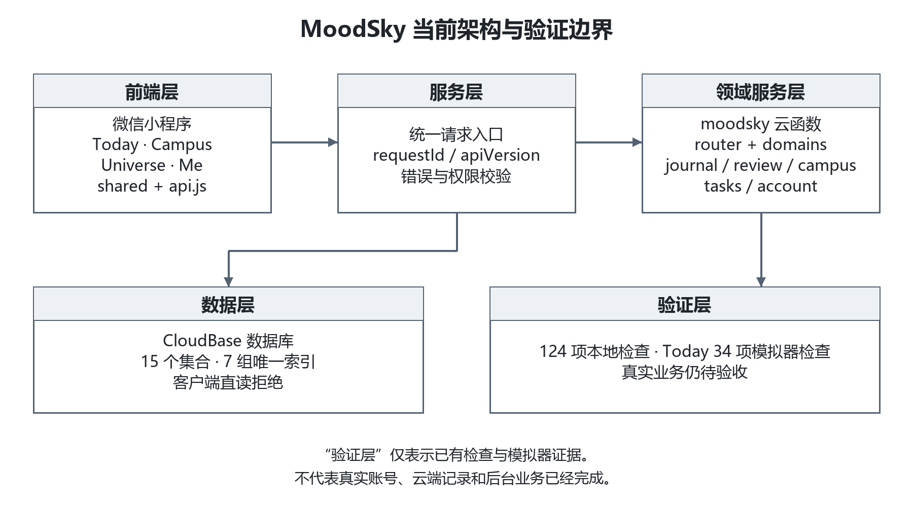

图 1  MoodSky 当前架构与验证边界

类图用于明确需求层的核心对象关系。它表达的是首版设计基线，不代表所有对象已经在云函数中完成持久化。

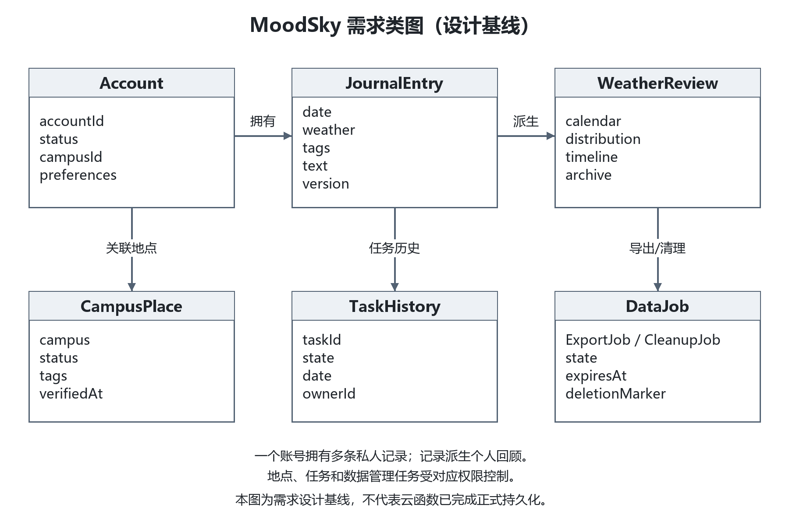

图 2  MoodSky 需求类图（设计基线）

### 3.2 属性

#### 3.2.1 可用性

首条记录不要求长文本，天气、标签和文字可以为空；错误状态保留输入并提供重试。

页面提供空态、失败、拒绝定位和处理中状态；未记录日期保持留白。

当前可用性目标和 12 人访谈结果需要在后续真实测试中补充。

#### 3.2.2 安全性

私人记录只允许本人读取；ownerId、角色和账号身份由服务端可信上下文解析。

运营员只能维护校园资料，不能访问私人日记或微信身份映射。

导出凭证、文件有效期、注销清理和删除标记必须在正式云环境验证。

### 3.3 用户角色与典型场景

#### 3.3.1 用户角色与权限

| 角色 | 允许行为 | 禁止行为 |
| --- | --- | --- |
| 游客 | 浏览地点、静态任务、固定模拟说明 | 读取或保存私人数据 |
| 活跃学生账号 | 管理本人记录、回顾、偏好、收藏、任务历史、导出和注销 | 指定他人 ownerId、读取他人记录 |
| 停用账号 | 浏览必要公开内容、查询受限清理进度 | 访问私人记录、导出和历史 |
| 数据运营员 | 维护校园资料、任务和支持资源、审核纠错 | 读取私人日记或微信身份映射 |
| 维护任务 | 执行授权的导出、清理和过期处理 | 暴露正文、凭证或原始身份 |

#### 3.3.2 用户场景

首次记录：选择天气即可保存，文字和标签可空；保存成功后显示“仅自己可见”。

编辑与删除：同一天再次进入编辑；删除需要确认并联动失效回顾视图和关联导出。

天气宇宙回顾：按月查看日历、分布、时间线和卡片，缺失日期保持留白。

寻找地点：先浏览列表，用户主动请求定位或导航；拒绝定位不能阻断列表浏览。

选择任务：最多三项建议，用户可完成、替换、跳过，不要求照片、GPS 或连续打卡。

暂时不做：用户可以直接离开，不显示断签或负面评价。

## 4 界面原型

本节使用仓库对应的高保真原型截图，展示四页主流程及关键交互页；它们属于界面设计证据。Today 的运行验收截图另在验证报告中记录，不能把高保真原型直接当作云端业务已上线证据。

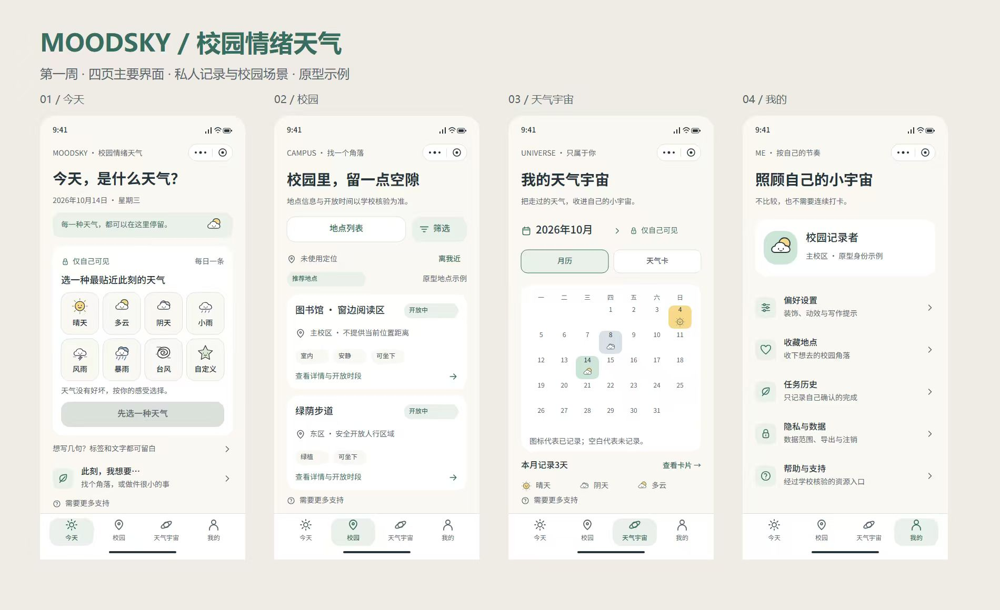

图 3  MoodSky 四页高保真原型总览

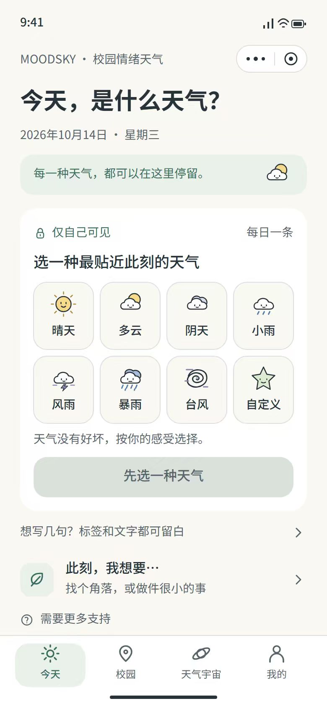

图 4  Today 主页高保真原型

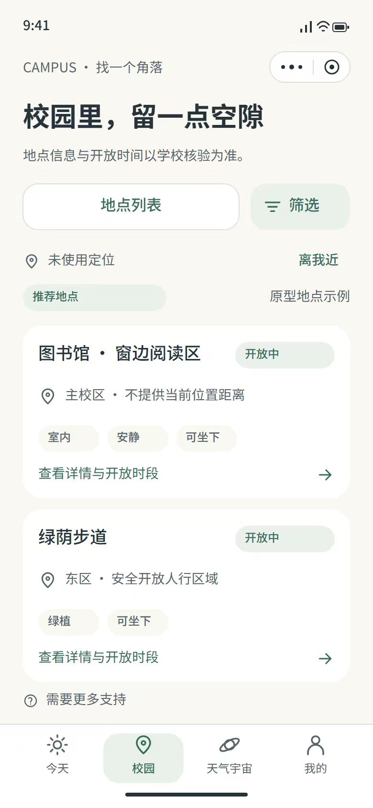

图 5  Campus 地点列表高保真原型

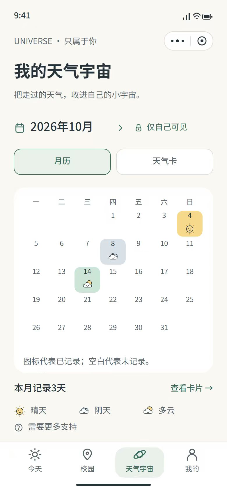

图 6  Weather Universe 月历高保真原型

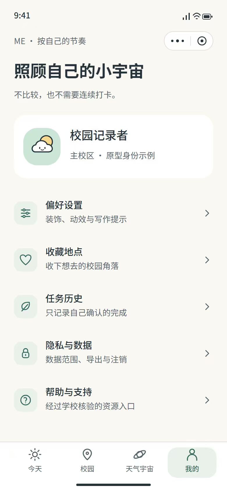

图 7  Me 个人中心高保真原型

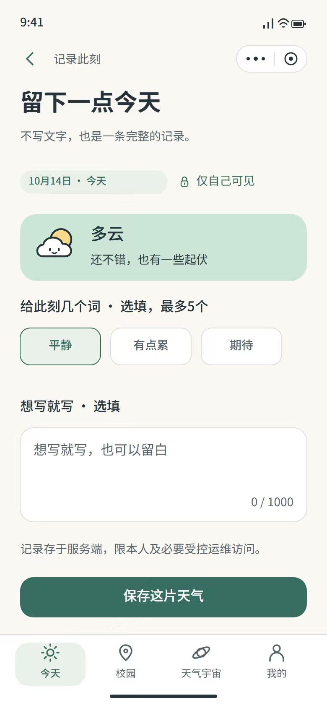

图 8  Today 记录输入页高保真原型

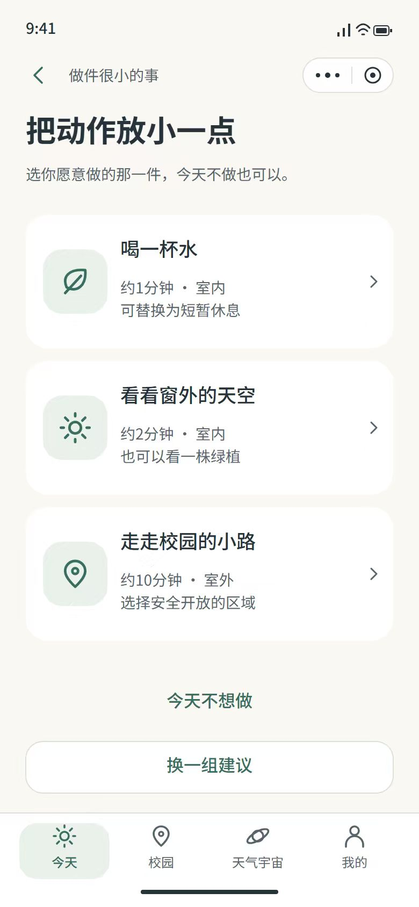

图 9  轻量任务选择页高保真原型

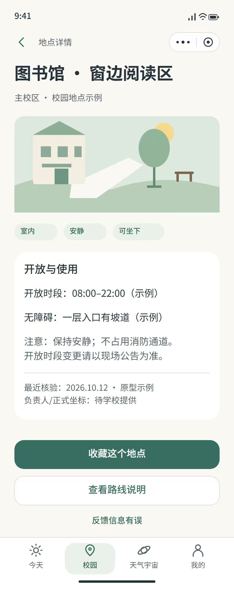

图 10  校园地点详情页高保真原型

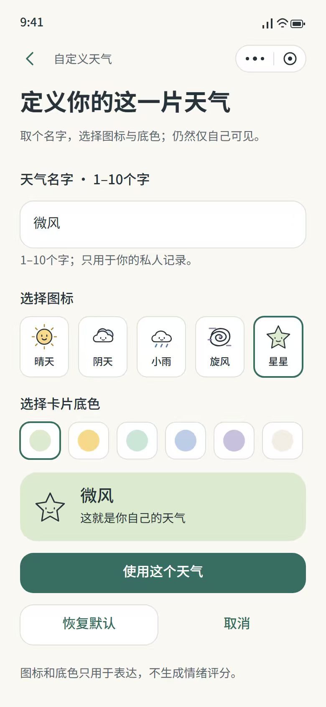

图 11  自定义天气页高保真原型

### 4.1 页面交互要求

| 页面 | 核心交互 | 当前证据/状态 |
| --- | --- | --- |
| Today | 天气单选、标签多选、正文、保存/修改/删除、日期切换、失败重试 | 本地内存演示已验证；正式云端未实现 |
| Campus | 地点列表、筛选、详情、地图、收藏、纠错、支持资源 | 当前为准备中空态和固定模拟说明 |
| Universe | 月历、分布、时间线、月份档案、卡片详情、装饰 | 当前为准备中空态 |
| Me | 隐私偏好、导出、任务状态、注销和清理进度 | 当前为准备中空态；账号接口未实现 |

## 5 功能描述与验收/验证标准

下表将原 Requirements Specification 中的功能需求与仓库当前状态对齐。状态分为：本地演示、设计中、未实现、固定模拟说明。所有“待验证”项目在正式验收前不得改写为已完成。

| 编号 | 需求 | 优先级 | 主责 | 当前状态 | 验收重点 |
| --- | --- | --- | --- | --- | --- |
| F01 | 天气记录 | P0 | Yifan / Xiang Hong | 本地演示；正式 journal 未实现 | T01：天气必选；只选天气可保存；服务端 owner/date 唯一 |
| F02 | 标签和文字输入 | P0 | Yifan / Xiang Hong | 本地演示与边界测试 | T02：标签≤5；正文 0–1000 Unicode 码点；输入超限不丢失 |
| F03 | 补记和编辑 | P0 | Yifan / Xiang Hong | 本地演示；服务端窗口未实现 | T03：今天及前29天新建；旧记录编辑；版本冲突明确 |
| F04 | 删除及回顾同步 | P0 | Yifan / Xiang Hong | 本地删除演示；云端联动未实现 | T04：确认删除；刷新不恢复；其他账号无权删除 |
| F05 | 私人天气日历 | P0 | Zhifeng / Xiang Hong | 设计中；Universe 空态 | T05：空月、跨月、缺失日期留白 |
| F06 | 个人天气分布 | P0 | Zhifeng / Xiang Hong | 设计中 | T06：分母为实际记录日；空数据不除零 |
| F07 | 阶段时间线 | P1 | Zhifeng / Xiang Hong | 设计中 | T07：7/30/90 日窗口；少于3条不输出趋势结论 |
| F08 | 月份档案 | P1 | Zhifeng / Xiang Hong | 未实现 | T08：三步内进入月份档案；空月有中性空态 |
| F09 | 私人天气卡片 | P1 | Zhifeng / Xiang Hong | 未实现 | T09：正文默认隐藏；详情仅本人可见 |
| F10 | 轻量装饰和重置 | P1 | Zhifeng / Xiang Hong | 未实现 | T10：素材失败不影响记录；重置不影响核心数据 |
| F11 | 校园地点列表和地图 | P1 | Qinghan / Junhan | 未实现；Campus 空态 | T11：拒绝定位或地图失败仍可浏览列表 |
| F12 | 地点偏好筛选 | P1 | Qinghan / Junhan | 未实现 | T12：组合筛选、重置和无结果状态 |
| F13 | 地点详情和主动导航 | P1 | Qinghan / Junhan | 未实现 | T13：详情不强制定位；关闭地点不推荐 |
| F14 | 地点收藏 | P1 | Qinghan / Junhan | 未实现 | T14：重复点击不产生重复收藏；账号隔离 |
| F15 | 地点纠错和审核状态 | P1 | Qinghan / Junhan | 未实现 | T15：1–200码点；用户不能直接改正式坐标 |
| F16 | 校园支持资源 | P1 | Qinghan / Junhan | 未实现 | T16：未核验或过期资源显示不可用 |
| F17 | 自主小任务建议 | P1 | Qizhen Chen / Jiawei | 接口/演示设计；正式后端未实现 | T17：最多3项；不读取私人正文 |
| F18 | 完成、替换或跳过任务 | P1 | Qizhen Chen / Jiawei | 未实现 | T18：幂等；跳过无惩罚；重试不重复 |
| F19 | 任务历史 | P1 | Qizhen Chen / Jiawei | 未实现 | T19：本人可见；删除后刷新不恢复 |
| F20 | 此刻我想要什么 | P1 | Yifan / Jiawei | 接口设计；页面未完整实现 | T20：未保存日记也可进入地点或任务 |
| F21 | 隐私与显示偏好 | P1 | Linghan / Jiawei | 设计中；Me 空态 | T21：偏好只影响显示，不改变权限 |
| F22 | 本人数据导出 | P1 | Linghan / Xiang Yu | 设计中；执行器未实现 | T22：跨账号拒绝；凭证≤5分钟；文件≤24小时 |
| F23 | 账号注销和清理进度 | P1 | Linghan / Jiawei / Xiang Yu | 设计中；清理未执行 | T23：注销先停用；受限回执不能恢复账号 |
| F24 | 校园气象固定模拟说明 | P1 | Linghan / 固定模拟 | 模拟说明已实现 | T24：明确 simulated；不读取私人记录、不采集真实贡献 |

### 5.1 详细功能描述

业务时区为 Asia/Shanghai，业务日期采用 YYYY-MM-DD，时间戳采用 UTC。

同一 owner/date 至多一条记录；编辑使用 expectedVersion，失败重试必须复用原 requestId 和原输入摘要。

天气编码为 SUNNY、PARTLY\_CLOUDY、CLOUDY、RAINY、STORMY；天气不代表健康评分。

标签最多五个，正文最多 1,000 个 Unicode 码点；标签和正文均可为空。

私人记录永不自动发布、自动参与校园统计或自动生成诊断结论。

### 5.2 输入和输出格式

| 接口/页面 | 输入 | 输出/状态 |
| --- | --- | --- |
| Today 记录 | weather、tags、text、date、expectedVersion | 成功、冲突、失败；失败保留输入 |
| 回顾查询 | month、windowDays、date | 日历、分布、时间线、月份档案或空态 |
| 校园地点 | campus、tags、status、page | 地点列表、详情、无结果或不可用状态 |
| 任务操作 | taskId、state、date、requestId | 选择、完成、替换、跳过或幂等结果 |
| 数据管理 | format、jobId、account state | 导出状态、受限领取、注销和清理进度 |

### 5.3 界面验收标准

| 页面/证据 | 验收条件 | 当前状态 |
| --- | --- | --- |
| Today 截图与交互 | 能看到天气、标签、文字、保存/编辑/删除、确认、重试和日期切换；截图标注环境与版本 | 本地内存演示已验证 |
| Campus 截图 | 页面有列表/空态/错误态；拒绝定位或地图失败不阻断列表浏览 | 当前空态，业务未实现 |
| Weather Universe 截图 | 月历、分布、时间线和月份档案有明确入口；无记录日期留白 | 当前空态，业务未实现 |
| Me 截图 | 偏好、导出、注销和清理状态有入口；敏感操作有确认和状态反馈 | 当前空态，账号接口未实现 |

### 5.4 功能验收标准

F01—F24 分别对应 T01—T24。每条功能验收必须按输入、前置条件、操作、预期输出、异常分支和证据链接记录；只有在目标环境中通过并由复核人确认后，状态才可改为“已验收”。当前矩阵中的“本地演示、设计中、未实现、固定模拟说明”是提交时的真实状态，不作为正式业务通过。

### 5.5 验收、验证与证据边界

#### 5.5.1 当前真实证据

| 证据 | 结果 | 可证明内容 | 不能证明的内容 |
| --- | --- | --- | --- |
| 项目检查 | 124 项通过 | 代码、格式、结构、契约和部分边界检查 | 真实业务闭环 |
| Today 模拟器 | 34 项通过 | 内存表单交互、删除确认、重试、日期切换 | 云端持久化、账号隔离、生产幂等 |
| 基础部署 | 15 空集合、7 组唯一索引、客户端读取拒绝 | 基础环境和客户端权限策略 | 业务读写和后台功能 |
| H03 真实批次 | 17 项中12通过、5失败 | 诊断报告真实留存及失败边界 | 并发修复已完成 |
| 真机/体验版 | 未验收 | — | 兼容性和上线质量 |

#### 5.5.2 提交前验收记录格式

每条验收记录需要包含：需求编号、测试编号、提交版本、环境、账号类型、前置条件、操作步骤、预期结果、实际结果、证据链接、复核人、状态和后续动作。状态统一使用“待开始、进行中、待复核、已验收、阻塞”。

#### 5.5.3 当前待补验证

真实 active 账号的记录保存、编辑、删除和回顾读取。

真实账号、停用账号、普通学生和 data\_operator 的隔离验证。

导出跨账号拒绝、删除使旧导出失效、注销清理重试和恢复不复活。

Campus 拒绝定位、地图失败、过期地点和后台资料审核。

真机设备覆盖、性能采样、可用性测试和 12 人访谈汇总。

## 6 非功能需求

| 编号 | 类别 | 要求 | 当前验证状态 |
| --- | --- | --- | --- |
| N01 | 权限与隐私 | 可信身份解析；客户端不能提交 ownerId/role 授权；运营员不能读取私人记录 | 门禁结构和本地测试已验证；业务适配未完成 |
| N02 | 可靠写入 | 唯一约束、版本控制、请求幂等、失败保留输入 | 本地控制器测试；真实并发 H03 有失败 |
| N03 | 数据最小化 | 不默认采集头像、手机号、实时位置；公共功能主动同意 | 需求与契约已写明；真实端到端待验证 |
| N04 | 可用性 | 首条记录尽量在30秒内完成；标签/文字可空；提供空态与重试 | 目标待用户测试；Today 本地演示可操作 |
| N05 | 可读性与无障碍 | 颜色对比、文字等价说明、触控目标和天气文字配对 | 部分页面有基础样式；完整审计待完成 |
| N06 | 性能 | 首屏和列表性能目标按需求设定，需在指定设备和网络下多次采样 | 尚未完成真实测量 |
| N07 | 删除与导出 | 删除联动失效导出；导出凭证≤5分钟、文件≤24小时；清理期限为目标 | 设计完成；执行与实测未完成 |
| N08 | 范围标识 | 合成数据、固定模拟、本地演示、真实云端和真机结果必须分开 | 文档已按此规则整理 |

## 7 团队组织与协作

团队职责沿用 2026-10-12 版本的 docs/team.md。下表按第一周五项任务和全周期责任范围形成一套项目估点建议；它不是成员实际工时记录。项目总点数归一化为 100 点，提交前可用周报、PR、成果链接和验收记录复核。

| 成员 | 职责摘要 | A3/SRS 交付重点 | 估点 / 建议比例 |
| --- | --- | --- | --- |
| Xiang Hong | 项目管理、后端集成、journal/review、F01—F10 | 需求整合、router/契约、验收汇总 | 9 / 9% |
| Junhan Huang | 校园与后台业务、运营角色、F11—F16 | 校园业务矩阵、资料核验和权限说明 | 8 / 8% |
| Jiawei Fang | tasks、preferences、账号停用、F17—F21/F23 | 状态转换、注销和账号边界 | 8 / 8% |
| Linghan Chen | 前端集成、Me、数据管理流程 | 四页导航、空态/错误态、缓存和数据管理原型 | 8 / 8% |
| Yifan Ji | Today、F01—F04/F20 | Today 交互、输入边界和失败重试证据 | 8 / 8% |
| Zhifeng Dai | Universe、F05—F10 | 月历、分布、时间线和卡片原型 | 9 / 9% |
| Qinghan Zhang | Campus、F11—F16 | 地点列表、筛选、地图拒绝和详情原型 | 8 / 8% |
| Qizhen Chen | 任务 UI、后台界面、Web 身份 | 任务路径、后台低保真表单和身份流程 | 9 / 9% |
| Jiaqi Zhu | UI/UX、视觉、访谈和素材 | 可点击原型、视觉规范、访谈汇总 | 8 / 8% |
| Xiang Yu | 数据库、导出、清理和恢复 | 数据字典、生命周期设计和约束记录 | 8 / 8% |
| Yuen Lin | 测试、CI、部署 | F01—F24/T01—T24 验收表和回归报告 | 8 / 8% |
| Qizhen Cai | 权限、隐私、生命周期、性能和可用性 | 权限矩阵、访谈、独立复核和测量模板 | 9 / 9% |

协作流程为 Issue → 分支 → PR → 负责人审查 → quality 检查 → Squash 合并。共享接口、数据库、导航和权限变更需要共同复核；第一周整合报告保留失败和待实现状态。

### 7.1 贡献比例计算方法

贡献比例沿用第一周分工中的统一估点规则。难度点采用 1、2、3、5、8 五档；共享任务只在项目总点数中计一次，再按团队事先约定的比例拆分。本次建议项目总点数为 100 点，团队可在收齐周报、PR 和验收证据后按同一公式修订。

| 计算项 | 公式/规则 | 本次建议 |
| --- | --- | --- |
| 项目总点数 | Σ 所有唯一任务点数（共享任务只计一次） | 100 点 |
| 个人贡献比例 | 个人分配点数 ÷ 项目总点数 × 100% | 估点即百分比 |
| 共享任务 | 任务总点数 × 个人约定分配比例 | 共享复核不重复计全额 |
| 显示规则 | 保留两位小数；四舍五入后的合计调整到 100% | 本表合计 100% |

本表按仓库职责和模块范围做的是提交建议，不等于实际工时；若团队确认了不同点数，应同步修改博客、SRS 和第一周估点表。

## 8 风险、未决事项与后续计划

| 风险/未决事项 | 影响 | 控制措施与下一步 |
| --- | --- | --- |
| 需求范围膨胀 | 开发资源分散，首版无法闭环 | 冻结 P0 记录闭环，公共互动后置 |
| 隐私误解 | 私人记录被误认为公开或诊断数据 | 分入口、分同意、分集合，文案明确边界 |
| 并发和删除竞态 | 重复记录、旧导出泄露或已删数据复活 | 唯一约束、版本、requestId、删除标记和隔离实验 |
| 校园资料过期 | 用户被引导到无效地点或资源 | 核验人、核验日期、有效期和停用状态 |
| 实现状态被夸大 | 作业和用户对功能产生错误预期 | 所有证据标注环境、版本和三态状态 |
| 真实账号/云端未完成 | 无法进行正式业务验收 | 第二周先实现 F01—F04，再扩展回顾和数据管理 |

### 8.1 后续计划

补齐 12 名成员的周报、成果链接、工时、复核结论和贡献比例。

完成 F01—F04 的真实账号、云端记录、权限和并发验收。

实现 F05—F20 的回顾、校园和任务业务，并补充页面原型和测试。

实现 F21—F23 的导出、注销、清理和恢复流程。

开展真机、性能、权限、删除恢复和可用性测试，完成体验版发布前检查。

## 9 变更记录与参考资料

| 版本 | 日期 | 变更 |
| --- | --- | --- |
| A3-1.0 | 2026-10-17 | 加入当前 GitHub main 状态、架构图、类图、页面证据、F01—F24 状态矩阵和真实验证边界。 |
| 基线 | 2026-10-11 | 前期 Requirements Specification 的需求范围和编号。 |
| 分工 | 2026-10-12 | 团队职责、模块边界和第一周计划。 |

### 9.1 参考文献分类

| 类别 | 文献/资料 | 用途 |
| --- | --- | --- |
| 国家标准 | GB/T 9385—2008《计算机软件需求规格说明规范》；GB/T 8567—2006《计算机软件文档编制规范》 | 章节层级、需求描述、文档格式和图文组织 |
| 隐私与安全标准 | GB/T 35273—2020《信息安全技术 个人信息安全规范》 | 私人记录、账号、导出、注销和数据最小化边界 |
| 官方技术文档 | 微信开放文档；腾讯云 CloudBase 小程序端 SDK 与数据库文档 | 小程序运行环境、云函数、数据库和权限说明 |
| 专业方法资料 | Nielsen Norman Group：10 Usability Heuristics for User Interface Design | 空态、错误提示、可理解性和用户操作反馈 |
| 项目资料 | MoodSky GitHub 仓库、requirements.md、team.md、week1、test-reports | 项目事实、职责、实现状态和验证证据 |
| 课程资料 | CSDN A3 作业要求和上一期博客 | 评分项、提交格式和贡献比例公式参考 |

国家标准查询：GB/T 9385—2008 https://openstd.samr.gov.cn/bzgk/std/newGbInfo?hcno=2790825C43AD0B69E3C38C140BFFCFE6；GB/T 8567—2006 https://openstd.samr.gov.cn/bzgk/std/newGbInfo?hcno=84C42B6277D2714B7176B10C6E6B1A44；GB/T 35273—2020 https://std.samr.gov.cn/gb/search/gbDetailed?id=XU7f%2F%2BKaBU0%3D&mode=p

微信开放文档：https://developers.weixin.qq.com/miniprogram/dev/framework/；腾讯云 CloudBase：https://cloud.tencent.cn/document/product/876/19385

Nielsen Norman Group：https://www.nngroup.com/articles/ten-usability-heuristics/

MoodSky GitHub：https://github.com/HX-Jan/MoodSky；A3 作业要求：https://bbs.csdn.net/topics/620549144；上一期博客参考：https://bbs.csdn.net/topics/620547077
