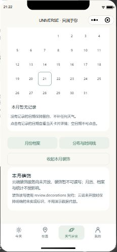
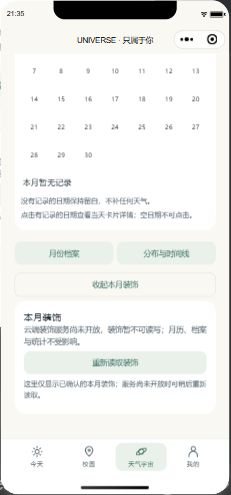
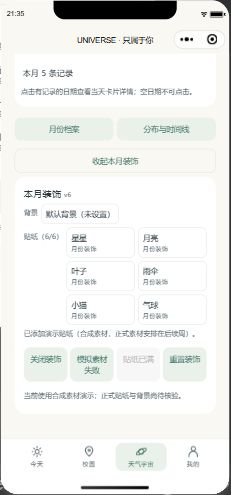
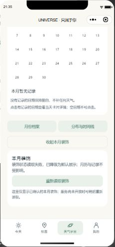

# PR #34与本地W2成果整合审查

## 固定来源

| 项目         | 核对结果                                                                                                               |
| ------------ | ---------------------------------------------------------------------------------------------------------------------- |
| 成员         | Zhifeng0419 / Zhifeng Dai，W2 Z01—Z05                                                                                  |
| 原始交审     | [PR #34](https://github.com/HX-Jan/MoodSky/pull/34)，c66d3d5db3a23f8c5b55a9ae729271845ce68ed0，9文件；审查时无追加提交 |
| 原主分支     | 34d7fdf7c505bdaa89b89fa88bfa7845e0b17730                                                                               |
| 批准与合入   | HX-Jan按原提交批准后Squash合入5db50c418bab8d136818217a7b219b7a46336c4a；未绕过原PR quality                             |
| 本地续作来源 | work/xiang-hong-week2-local-20261020，最终5bc72bc；26个本地提交保留原分支，采用合成整合提交，不改原用户工作区          |
| 整合分支     | publish/w2-pr34-integration-20261021；最终发布提交以合并PR和v0.2.3标签为准                                             |

## PR原交付逐项取舍

| 原文件/交付               | 重叠实现与采用方式                                                          | 实际入口及验证                                             | 保留边界                                        |
| ------------------------- | --------------------------------------------------------------------------- | ---------------------------------------------------------- | ----------------------------------------------- |
| w2-z01.md                 | 保留五入口与统计样例；按实际服务改正分页、字段和get版本参数                 | review service/reader及月历、档案、统计场景                | 候选不等于上线；联合契约及字段独立确认待收齐    |
| w2-z02.md                 | 保留空月、切月、失败重读；改正五天气及正文边界                              | Universe→月份档案，原成员场景保留                          | 无SNOWY扩展；列表不接收正文，不提供卡片展开正文 |
| w2-z03.md                 | 保留删除/重建/旧ID/账号切换用例                                             | 详情及月历/档案onShow重读                                  | 本地替身不能充当独立成员复核                    |
| w2-z04.md                 | 保留单时间线推导统计及生产未开放检查；删除不存在的分页声明                  | 分布与时间线→7/30/90窗口                                   | 仍为完整窗口、无cursor/hasMore；真实云端待验证  |
| w2-z05.md                 | 保留原三态、素材演练与样式；加入读取中及隐藏/切月校验说明                   | Universe→本月装饰→重读                                     | 正式素材及真实加载失败未验收；不代填确认记录    |
| universe/index.js         | 合并云模式只读探测与既有演示读取门禁/六贴纸；补清屏、令牌、坏返回及主动重读 | 本次3项新回归先失败后通过；实际模拟器验证                  | 默认后端未开放；云模式无装饰写入入口            |
| universe/index.wxml       | 保留成员云状态卡片和原布局；加载/重读提示使用现有按钮样式                   | 原稿代码与原生截图对照，正文/配置不在错误态残留            | 没有新增正式素材或篡改原图标                    |
| helpers/backend-client.js | 保留生产路由测试模式，并兼容已有后端依赖注入                                | backendClient(backend,{production:true})；既有组装测试保留 | 仅测试助手，不改变生产router                    |
| review-week2.test.js      | 保留成员11项场景；生产模式调用适配后新增3项真实边界回归                     | 完整498项本地检查通过；不是把子场景额外计数                | 合成样本、离线SDK、CI与真机分开计证             |

本地26项提交按原审查证据采用：账号/记录/回顾显式组装、拒绝回执、未知请求与环境绑定、编辑隐私及离开保护、演示一致性、导出快照/围栏候选和必要验证。逐文件范围见[文件清单](2026-10-21-pr34-integration/file-scope.json)。公共API与默认云入口不改，只有APP_VERSION及四份包元数据统一为0.2.3，依赖解析不变。

## 原稿与实际界面对照

以下均为实际微信开发者工具截图。为了展示尚未开放的云分支，仅在隔离副本注入合成只读返回；真实cloudReady=false，没有云调用。原稿截图使用PR原始JS/WXML和同一类合成返回；不是成员提交的独立设计验收。

| 原PR未开放状态                                                          | 整合后保留提示并提供重读                                               |
| ----------------------------------------------------------------------- | ---------------------------------------------------------------------- |
|  |  |

| 原有六贴纸保留                                                        | 不兼容返回降级                                                              |
| --------------------------------------------------------------------- | --------------------------------------------------------------------------- |
|  |  |

## 验证记录与仍欠条件

原PR原样395项检查通过。整合后498项检查、SDK离线入口与云依赖审计通过。本次10项原生检查覆盖原有六贴纸、有效只读、切月等待清空、手动隐藏/迟到响应、未开放重读、坏返回及夹具恢复。截图先发现重读按钮未沿用原样式，修正后复核最终图；工具第一次挂接超时及原稿截图助手路径错误另留原始记录，修复后重跑，不写成产品云失败。

60行任务表与5bc72bc解析对比：只变更W2 Z01—Z05成果/合入状态，其余55行一致；全部原计划字段、工时、估点、独立意见保留。参与协作的姓名与本地测试结果不当作对应成员已签署验收。

真实身份/云事务、历史H03五项失败、旧账号迁移、五来源共同协议、真实导出与清理、正式素材和独立意见仍待验证。此前用户手机离线反馈保留原时点，本次不新增手机验收声明。发布过程只更新GitHub，不部署云端、不清理保留数据、不上传微信预览包。
