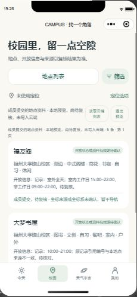
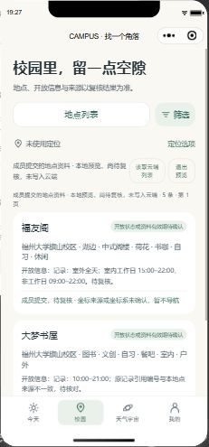

# 2026-10-22 第二周整合审查与 H01/H04/H05 续作

本次基于 main `ea105de743ab7c292ad3b6258b5f4fc7b8c06e93`，在隔离副本的 `work/week2-integration-20261022` 分支整合。原工作目录和成员个人配置未覆盖。本报告记录整合人的实现与验证，不代替成员本人或指定复核人的验收。

## 固定来源与全部文件核对

| 来源                                                            | 首次交付及本次读取的最新 head                                                                                  | 交付范围与取舍                                                                                                                                        |
| --------------------------------------------------------------- | -------------------------------------------------------------------------------------------------------------- | ----------------------------------------------------------------------------------------------------------------------------------------------------- |
| [Qinghan / PR39](https://github.com/HX-Jan/MoodSky/pull/39)     | 首次 `c4a28cc5ce9bbd1a9df219691f2d1a8c3a83346a`；最新 `54b94e91aa9753c7f6a4de103a86045635d87111`，共 11 个提交 | 35 个文件全部保留；保留地点资料、原证据、字段、列表/详情、候选收藏纠错、固定模拟天气与专项测试。少数 JS/Markdown 格式修正；运行时修复见下文           |
| [Qizhen Chen / PR40](https://github.com/HX-Jan/MoodSky/pull/40) | 首次及最新 `a2c57673649428d6d233f3b310acffe6ed8a1a3a`                                                          | 22 个文件全部保留；任务候选控制器、导航、后台 SDK 锁文件和 OAuth 适配均采用；补乱序响应与异常数据测试                                                 |
| [Linghan / PR41](https://github.com/HX-Jan/MoodSky/pull/41)     | 首次及最新 `c54b8af76e3c5a1529ef7756d4248b8c99e92c3f`                                                          | 5 个文件全部保留；按配置选择健康检查、公共反馈、原请求序列保护均采用；补错误码清空与实际页面事件测试                                                  |
| Xiang Hong / 天气需求                                           | 本地原提交 `6906f074f090c99a111cd40689a15f8e09db1a59`                                                          | [七类天气与私有自定义名称](../../week2/xiang-hong/weather-options-20261022.md)完整保留；风雨/暴雨旧占位合并到雷雨，台风和自定义可选；旧记录代码不迁移 |

逐文件内容比较、PR39 首次到最新的追加内容以及完整来源提交列表见 [scope-audit.json](scope-audit.json)。没有删除或整包替换成员文件；原照片、地点来源与本人交付结论保留。地点资料仍是“成员提交、待复核”，没有因为合入把网络图片或未确认日期升级为现场核验。

## 原交付基础上的修复

| 原问题                                                                 | 整合结果及实际入口                                                                                                            | 证据 / 仍需完成                                                                                                        |
| ---------------------------------------------------------------------- | ----------------------------------------------------------------------------------------------------------------------------- | ---------------------------------------------------------------------------------------------------------------------- |
| PR39 的 quality 在 `setImmediate` 未声明处失败，后续还有格式问题       | 在 Node 测试显式导入计时器，定向格式化；未放宽全仓 lint                                                                       | 原始 CI [39734588020](https://github.com/HX-Jan/MoodSky/actions/runs/39734588020)；整合全量通过                        |
| 校园页面离开后列表、定位和支持资源回调仍可能回填；支持资源可能一直加载 | Campus 隐藏/卸载使读取过期、清空私人展示和定位等待；回到尚未完成的列表时重新读取；关闭后地图回调不改新详情                    | 页面逻辑测试覆盖迟到成功、隐藏与返回；原生模拟器分页/返回通过                                                          |
| 地点返回的旧 `navigationAvailable` 会覆盖前端重新计算结果              | 使用当日有效期、核验和坐标条件重新计算展示与导航限制                                                                          | 未核验记录即使带 true 仍不可导航；真实定位/地图授权未执行                                                              |
| 收藏/纠错 operation、可信账号和幂等尚无正式联合约定                    | 保留 PR39 的候选请求及本地专项测试；`privateActionsReady: false` 让正式入口明确待接入，不读取或写入真实私人数据，纠错输入保留 | 合成测试显式打开候选 seam；正式开启前 Junhan/Qinghan/Xiang Hong 定稿、绑定可信身份并由 Qizhen Cai 复测跨账号及未知结果 |
| 任务快速入口的较早响应可能覆盖新响应                                   | 快速入口使用独立请求序列，旧成功/失败均不能覆盖最新结果；销毁后不发布                                                         | 合成乱序测试；保留任务页与 Today/Me 原入口                                                                             |
| 任务异常状态、无效日期或畸形条目可误显示                               | 排除继承自原型的状态/操作、无效业务日期、非正时长及畸形建议；新读取/操作清空旧错误码                                          | 异常数据与非法操作测试；JF02 状态机差异仍待共同定案，不改变正式后端                                                    |
| Me 重试或切换账号后旧健康错误码残留                                    | 新检查及账号变更清空错误码、旧请求号和反馈；仍用原序列/账号 token 拒绝旧结果                                                  | 实际 Page 事件测试；本地健康检查模拟器通过，正式健康未验收                                                             |
| 后台 SDK 构建没有在 CI 覆盖                                            | CI 增加按锁文件安装、生成 bundle 与审计；不提交生成文件/配置/令牌                                                             | 本机 SDK 3.4.8 构建成功、依赖漏洞 0；已核对安装包中的 OAuth/session 声明，真实 OAuth 未执行                            |

任务、校园、后台的云函数业务占位和默认私人服务门禁未被改为成功。任务状态候选与 JF02 草案的差异、历史分页/窗口及真实账号切换仍由 [Qizhen 交接](../../week2/qizhen-chen/README.md)跟踪。UI 接线并不等于正式服务完成。

## 验证与视觉对照

2026-10-22 本地运行 `npm run cloud:prepare` 后执行 `npm run check`：lint、格式、结构检查及 **547 项测试通过、0 失败**。后台 `npm ci --prefix admin --ignore-scripts` 与 bundle 构建成功，依赖审计 0 漏洞。共享类型继续通过严格编译。GitHub CI 结论以最终整合 PR 与 main 对应运行记录为准，不把本地结果写成远端成功。

原生微信模拟器使用独立项目副本：`cloudEnabled: false, journalDemo: true`，没有注入成功处理器。13 条整合断言与 14 条天气断言均通过，详见 [native-checks.json](native-checks.json)。部分断言覆盖相同天气入口，数量表示断言条数，不当作 27 个独立业务用例。源码与模拟器副本 132 个受控文件逐字节一致。

| 原交付实际页面                                     | 整合后实际页面                                |
| -------------------------------------------------- | --------------------------------------------- |
|  |  |

两张均在原生模拟器打开相应源码拍摄；保留成员地点卡、筛选、分页和原有视觉素材，没有用另一套界面代替原稿。以下为整合后的实际入口；合成任务不写入真实账号：

- [地点详情及未核验提示](integrated-campus-detail-visible.jpg)
- [Me 本地健康响应及请求号](integrated-me-health-visible.jpg)
- [任务完成状态（合成）](integrated-task-completed.jpg)
- 七类天气选择、私人自定义名称和回顾的 14 条断言在本次整合源码重新执行；原天气报告中的 515 项是上一阶段记录，不与本次 547 项相加。

**未执行**：真实 CloudBase、OAuth、正式双账号/并发、Android/iOS 真机、体验版上传或部署。历史 H03 五项失败与 120 条保留记录未操作、未关闭。原手机反馈属于历史版本，不能当作本次真机验收。

## 本周台账与下一步

[60 项任务台账](../../week2/xiang-hong/task-intake.csv)按三份真实交付补齐成果来源和状态：29 项有状态（14 待复核、9 进行中、6 阻塞），31 项仍空白，空白表示未收齐报告。QH 状态沿用本人交接；QC 的进行中/待复核为整合收件状态，不能替代本人或独立验收。原 12 人分工、60 项编号/原交付、实际工时、估点、独立意见均保持原值，没有新增“已验收”。

H01/H02：七类天气和自定义字段的调用、校验、存储、回顾、导出与预检同步已有本地实现；正式账号、迁移和联合契约确认待完成。前后端必须同步更新后再做真实部署验证，旧客户端不认识新天气代码。

H04：保留记录/回顾原控制器、草稿、原请求重试与隐私处理；本次补多模块入口及天气回归。H05：三份成员成果完成来源核查、整合修复与收件登记；发布状态以关联 PR 为准。整合 PR 被 quality 检查通过并合入、再次确认来源 head 未追加且全部内容已吸收后，才可按协作规定关闭被替代的成员 PR，保留其讨论和分支。

后续仍需对应成员回传：Jiawei/JH 的正式任务及校园/后台契约，Xiang Yu 的数据库/生命周期确认，Yuen 与 Qizhen Cai 的实际环境和独立复测，全员本人实际工时、完整估点与签字。本记录是周中交接，不声称本周所有任务已验收。
