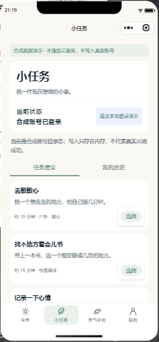
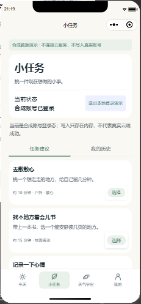
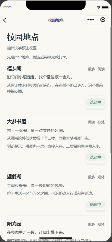
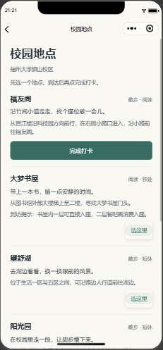

# 11 月 21 日七项成员 PR 整合

## 基线与接收范围

从 main `6e91ead92dd8ecc143e38bff956ff239e4765296` 接续。逐项审查 #215、#216、#218、#219、#220、#221、#222 的原交审与追加提交；完整 head、提交链、文件 Git blob 和整合前后 SHA-256 见 [sources.json](sources.json)。所有非共享文件均与最终交审逐字节相同；共享导航与格式排除列表组合保留各方增补，没有覆盖主干既有实现。

| 来源                                                         | 接收内容与入口                                                                | 调整、验证与剩余项                                                                                                                                                                                                                                  |
| ------------------------------------------------------------ | ----------------------------------------------------------------------------- | --------------------------------------------------------------------------------------------------------------------------------------------------------------------------------------------------------------------------------------------------- |
| [#215](https://github.com/HX-Jan/MoodSky/pull/215)，蔡奇真   | [W6-C 本地独立意见](../../week6/Qizhen_Cai/README.md)                         | 原 `b2467be` 的 CI 仅因 4 份 Markdown 排版失败；追加格式修正 `6dc83fb`，原报告仍在历史中。当前 head quality 通过。重跑 14 个生命周期场景；原 109/19 子集不另加到全量计数。W6-C 的基线意见不替代最终候选、Alpha C1 或洪翔的独立签认。                |
| [#216](https://github.com/HX-Jan/MoodSky/pull/216)，Linghan  | [C1](../../alpha-sprint/l/c1/progress.md)及 C2—C4 回传、截图与设备补验清单    | 保留本人追加的截图及第一人称总结。C2—C4 实际在 11 月 21 日预跑，后续周期、最终冻结 SHA 与设备结果仍待验；本人填报工时保留出处，不代为证实。截图证明禁云页面可达，`sim-06` 显示“暂时无法读取任务”，不能作为正式云建议读取成功的证据。                |
| [#218](https://github.com/HX-Jan/MoodSky/pull/218)，Jiaqi    | [按钮反馈交付](../../week6/ZhuJiaqi/README.md)，13 页、3 组件的按压与回弹     | 同时接收原 `de71c84` 与追加 `b289239`，后者修正任务动效禁用条件。147 个按钮原业务属性一致，原点击事件、参数、禁用条件与基础样式保留；新增 9 项回归。下附实际原生补验，浏览器投影图仍按原来源保留。大字体、手机和原 W6-JQ 独立复核未补签。           |
| [#219](https://github.com/HX-Jan/MoodSky/pull/219)，Xiang Yu | [DD-07 交接](../../week6/XiangYu/dd07-handoff/README.md)及本地生成器          | 独立重跑 16 个回执并断言状态，JSON 1076 字节、Markdown 993 字节与原样例相同。R16 缺少清理回执返回 `FORBIDDEN`。请求/任务 ID 随进程变化，不要求这些 ID 与旧执行相同。可作为 Linghan 后续对齐输入，尚不代表对方已复核。草拟的 PR 评论仅作为文件保留。 |
| [#220](https://github.com/HX-Jan/MoodSky/pull/220)，Xiang Yu | [C1 数据基线](../../alpha/xiang-yu/c1-20261121/README.md)及生成器             | 9 个场景、15 项断言通过，5 个重新生成文件与交付一致。导出和清理使用独立合成副本；成员机器上的原阻塞日志保留，整合机器全量检查已通过。C2—C4 及独立复核仍待实际执行。                                                                                 |
| [#221](https://github.com/HX-Jan/MoodSky/pull/221)，Junhan   | [C1 校园接口](../../alpha/junhan-huang/c1-20261121/progress.md)及样例选择工具 | 先重新运行 W6 生成器的 23 个样例，再生成 C1 的 12 组；JSON 值及 CSV 与交付一致。固定 11 月 18 日时钟、旧工具中的日期/基线标签保留，实际重跑为 11 月 21 日当前整合源码。动态地点停用传播、目标云与独立复核仍待验。                                   |

补入收尾复查发现的 [#222](https://github.com/HX-Jan/MoodSky/pull/222)：Jiaqi 的 [C1 视觉走查](../../alpha-sprint/Jiaqi%20Zhu/c1/progress.md)，固定 head `06717f54847e281c1fa34b4144253c0cd1db8550`，quality 通过且已批准。20 个新增资料文件逐字节保留，产品修复已包含于 #218；资料分支 1638 项与产品候选 1647 项分开。原 AUTH_TASK_ERROR、文本换行说明、未签认与待补三组状态图保留；本轮原生补验不改写作者当次环境失败或代签原任务。

原 PR 在整合 PR 成功合入后，逐项复查最新 head；全部内容仍被覆盖时以“被整合替代”关闭，保留作者与原提交历史。原任务 Issue 仅作 Refs，不因材料接收自动完成或关闭。

## 实际验证

Windows、Node `24.21.0`，禁云及合成 A/B 数据。依次执行 `npm.cmd run cloud:prepare`、`npm.cmd run check`、`npm.cmd run team:check:production`，均退出 0；全量 **1647/1647**，无失败或跳过，离线生产装配 8 组通过。随后重跑生命周期、DD-07、C1-XY、W6-JH、C1-JH 工具，不重复累计为新增全量测试。

证据：[检查汇总](verification.json)、[完整检查日志](full-check.log)、[离线装配日志](production-offline.log)、[生命周期日志](xy-lifecycle.log)、[147 个按钮属性对照](button-binding-comparison.json)。成员已有的 1638 项等旧计数保持原构建来源。

`git diff --check` **退出 2**：#216 四份 `environment.txt` 共 16 处行尾空白，加上 #222 原失败日志 `task-motion-before.txt` 的 2 处空白行，共 18 处，逐字节保留，不把此检查写成通过。其他新增整合说明单独检查。未修改原日志来制造干净结果。

## 原生模拟器补验

从整合客户端复制独立工程；产品文件与 #218 当前 head 一致，仅个人配置为 `cloudEnabled:false`、`journalDemo:true`、开发模式、本地任务 enabled。未连接云、不使用真实身份。任务与校园 WXML/WXSS 局部编译成功；这不代表整包发布或手机验收。

- 任务卡片右侧“选择”实测 64 × 44 逻辑像素；按下 `button-held`，变换为 `matrix(0.94, 0, 0, 0.94, 0, 0)`，释放选择后进入校园。
- 校园“选这里”仍靠右，实测约 64.33 × 44；按下同样为 0.94，释放选择后出现“完成打卡”，没有把选地点冒报为打卡完成。
- 在不会离页的任务建议标签复测：按下 0.94，释放 2 秒后状态清空、变换 `none`。第一次在任务选择后查询旧按钮返回找不到元素，因为页面已跳转；原结果保留，随后在稳定元素完成复测，不将失败查询计为通过。

实际命令、状态及产品文件指纹见 [native-verification.json](native-verification.json)。以下为禁云合成演示，图片已逐张查看：

| 任务原位                      | 任务按压                           | 校园选地点                       | 选中后待手动完成                    |
| ----------------------------- | ---------------------------------- | -------------------------------- | ----------------------------------- |
|  |  |  |  |

## 收件与发布边界

本次是源码整合和资料收件。L、XY、JH 的 C1 材料已取得，不改写此前“0/24”固定收件快照，也不据此算全队验收率；对口成员、蔡奇真和 Yuen 的当期复核仍按本人实际回传登记。

已上传微信的 0.5.3 固定来源是 `0580e148004bda027ac5c14b3178538c1ebc8e2f`，本次新增按钮动效尚未进入该上传包。未部署云函数、未上传新微信版本、未提交审核或公开发布；需要交付本轮界面时另从最终提交装配、验证并登记新包来源。

隐私核查：产品变化仅为内存中的按钮视觉状态，无新增网络请求、埋点、权限、SDK、身份字段或私人内容传播；服务及数据契约未变。材料和生成工具仅含合成数据，不将模拟器或离线结果当作真实微信登录、手机文件送达、真实维护或隐私声明生效证据。平台与原 W6 外部待验继续保留。
