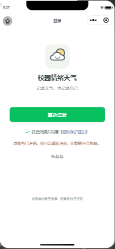
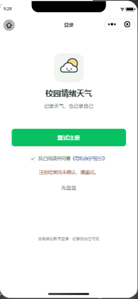

# 注销后重新注册空账号

## 问题与决定

用户提供蔡奇真的`C2-C_注销后重登阻断发现记录.md`。原记录日期2026-11-21，当时按既有规则将“注销后无法重新登录”判为保护行为通过；原报告和原结论保留，不追改本人签认，也不据手机截图推定设备源码构建。

2026-11-22负责人明确要求：**允许同一微信重新注册空账号，旧数据不恢复**。本轮源码基线为`035b96b060ad45830f93f89a96847e7bb7ad91cd`；开工核对远端main一致，开放#224/#225为资料交付，与本修复不重叠，未将它们记为已接收。

## 最终行为

1. 普通登录发现当前账号已注销，读取本次微信身份的重新注册状态。仅有合法注销与清理任务时显示“重新注册”。
2. 用户确认新账号为空、旧数据不恢复，且完成必要隐私授权后提交。未确认、取消授权、缺少同意或页面离开时不自动注册。
3. 服务端在单事务内创建新代独立账号并更新原始停用标记上的代数。原账号仍disabled，旧导出仍不能领取，旧私人请求不能带入新代。
4. 清理任务继续只删除旧owner的数据；即使在重新注册后完成旧任务，也保留当前代数映射，新账号和其他账号不受影响。
5. 重复点击、网络结果未知和原请求重试只复用同一个新账号；该账号后续有新记录也不会被重试清空。再次注销后必须针对最新代数重新确认，早先的确认不能创建第三个账号或注销当前账号。

接口及字段详见[API说明](../api.md)。这里的“代数”是内部隔离方式，产品页面只显示新账号和旧数据不恢复的含义。

## 信息影响

| 项目       | 本次变化                                                                                                              |
| ---------- | --------------------------------------------------------------------------------------------------------------------- |
| 身份来源   | 仍只读本次可信微信调用；客户端不能指定OpenID、owner或代数；不新增权限、SDK或外部服务                                  |
| 账号元数据 | 原始停用标记新增服务端整数`registrationGeneration`，用于定位当前新代；各代账号编号与scope分别派生，不持久化原始OpenID |
| 私人数据   | 新owner无旧记录、资料、偏好、任务或导出；不复制、不复活旧账号；旧owner数据仍按原清理任务执行                          |
| 请求与回执 | 注册确认绑定当前注销账号的scope；原请求重试不重复创建。原清理回执只能处理其旧job，不作为新账号登录凭证                |
| 公开与日志 | 无新增分享、遥测或私人日志；用例仅用合成A/B数据，响应不含内部owner、OpenID或正文                                      |
| 平台与留存 | 发布者在配套部署前核对隐私说明中的新注册行为和必要映射元数据；备份恢复不覆盖最新停用/代数标记。未声称后台已生效       |

## 验证与交接

新增服务端回归覆盖：新账号为空、旧导出/旧scope拒绝、旧清理与旧记录恢复隔离、A/B保留、并发与原请求重试、再次注销的旧确认、伪造输入以及原子回滚。安装版本CloudBase SDK的离线数据库回归保持单独标注。

新增页面回归覆盖：确认与取消、隐私授权取消、撤回勾选、提交中连点、未知结果原请求重试、换号与离页迟到响应、旧后端兼容和无效响应。原普通登录的停用围栏测试继续保留。

实际本地检查：`cloud:prepare`、`check`通过，完整1662项通过、0失败、0跳过，其中新增15项注册回归；`team:check:production`的8组离线装配通过，子集不另加到全量。`git diff --check`通过。完整日志留本机，公开记录只列必要统计。

原生开发者工具的登录WXML/WXSS局部编译通过，“重新注册／重试注册／正在注册”文字已实际读取。下图为禁云独立工程注入的合成显示状态，只证明原生模板和文案；没有在模拟器执行真实微信登录、注册或注销，也不作为真实云/手机流程通过的证据。

| 可以重新注册                                                                    | 未知结果可重试                                                                  |
| ------------------------------------------------------------------------------- | ------------------------------------------------------------------------------- |
|  |  |

截图原样保留，来源和产品文件指纹见[原生核对记录](2026-11-22-account-reregistration/native-verification.json)。普通游客AppID尝试因工具不识别失败，改用仓库既有团队AppID的独立禁云工程后编译通过；不把这项工具恢复记作微信登录成功。

接口调用与账号入口交Linghan/Jiawei，字段与清理交Xiang Yu，独立生命周期复验交蔡奇真/Yuen；相关原任务继续按实际对口回传验收，不代签成员确认。用户提供的原报告仍是原环境、原日期下的历史证据，新行为需新版本实测。

## 配套发布与回退边界

本轮未部署。上线前须确认旧维护调用已结束，先更新支持保留`registrationGeneration`的维护函数，再更新业务函数和客户端；旧维护代码完成清理时会丢弃新增映射字段，不能与新注册功能混用。更新后在受控A/B账号上补正常注册、旧导出拒绝、清理前后、新数据保留及再次注销验证。

已经产生新代账号后，回退应关闭注册入口并保留兼容的新代解析/清理，不能直接回滚到会删除代数映射的旧维护包或覆盖原始停用标记。平台隐私说明、真实构建/环境和独立验收由发布者按实际证据补齐。
