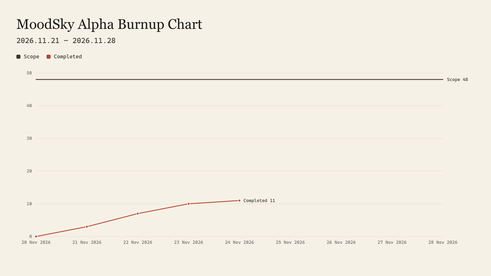
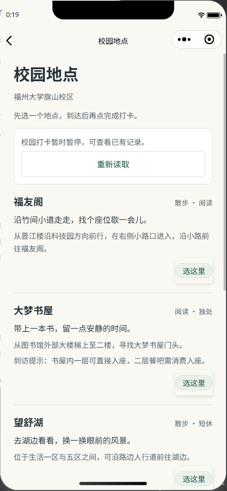
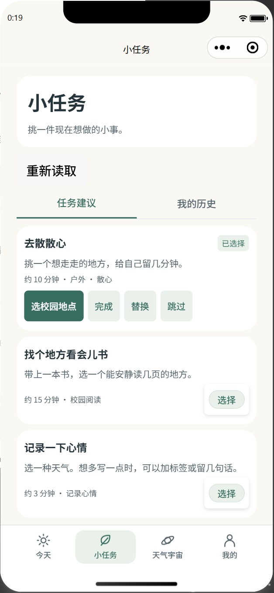

# MoodSky Alpha Sprint Log 2: Recovery, Account Isolation and Integration

| Item             | Details                                                                                                                                                          |
| ---------------- | ---------------------------------------------------------------------------------------------------------------------------------------------------------------- |
| Course           | [2601_FZU-MU_SE](https://bbs.csdn.net/forums/2601_MU_SE_FZU)                                                                                                     |
| Assignment       | [Fifth Assignment — Alpha Sprint](https://bbs.csdn.net/topics/620611106)                                                                                         |
| Reporting period | November 23–24, 2026                                                                                                                                             |
| Objective        | Verify failure recovery and account boundaries, integrate reviewable submissions, and record the remaining gaps                                                  |
| References       | [Repository](https://github.com/HX-Jan/MoodSky), [integration decisions](README.md), [A/B test-support issue #232](https://github.com/HX-Jan/MoodSky/issues/232) |

This update records the reports available at the November 24 integration cutoff. Some C2 handoffs are still missing or partial. The table below separates received evidence from completed delivery; it does not assign work or signatures to members who have not returned them.

## 1. What we integrated

Our product version remains **0.5.3**. The first integration baseline for this period was `78812fedeb90c5603e927fbda8050eab23b5338f`; the November 24 review starts from `44d7e4a302758fc13fe12c1a0b8ed2d44e0ccf39`. Full source heads and the resulting integration are recorded in the accompanying review and receipt.

The updates add test support and evidence. The client tree remains `62b91cfd56b8461c0fe5fb4a2c222747590e551b`. The agreed seven weather choices, right-side selection buttons, explicit task completion and original-request recovery remain in place. The existing empty-account re-registration flow is preserved.

| Submission                                                       | Result of review                                                                                                          |
| ---------------------------------------------------------------- | ------------------------------------------------------------------------------------------------------------------------- |
| [#241 — Xiang Yu](https://github.com/HX-Jan/MoodSky/pull/241)    | Integrated through [#242](https://github.com/HX-Jan/MoodSky/pull/242): 64 export-access checks and reproducible samples   |
| [#243 — Yuen Lin](https://github.com/HX-Jan/MoodSky/pull/243)    | Accepted the local regression return, 64-check reruns and 16-check A/B result; the rest of the C2 handoff remains pending |
| [#236 — Yifan Ji](https://github.com/HX-Jan/MoodSky/pull/236)    | Accepted the repaired C1 evidence submission; original capture dates and baseline retained                                |
| [#244 — Yifan Ji](https://github.com/HX-Jan/MoodSky/pull/244)    | Accepted the 73-test recovery report as a partial C2 delivery; account-switch verification remains due                    |
| [#237 — phone login](https://github.com/HX-Jan/MoodSky/pull/237) | Held for changes: enabling the new entry makes the original WeChat re-registration route unreachable                      |

The three November 24 submissions contain documents and evidence, rather than replacement application directories. We corrected two stale inventory hashes and two report descriptions while preserving the raw screenshots and logs. The audit records the original and adopted files separately.

## 2. Export access and a usable A/B test entry

Xiang Yu's tool checks export contents and ownership, cross-account requests, stale exports, expiry, deactivation and new-account registration. It uses **six independent scenario groups**; sequential checks inside a group share its state. The maintainer ran it twice on November 23. Yuen ran it twice on November 24, and the maintainer verified it again during integration. The five generated outputs matched the submitted files byte for byte.

These checks exercise the production business entry with a disposable memory database. They confirm that both accounts can obtain their own exports, B cannot obtain A's actual generated job, and changing A's records invalidates A's old file while B's file remains usable. Thirteen checks cover a separate 300-second claim-token policy; they do not establish that policy as an active production endpoint.

[Issue #232](https://github.com/HX-Jan/MoodSky/issues/232) exposed a test-support gap: signing out and back in through the same WeChat identity does not create an independent B account. We added `tools/alpha-h/ab-workbench.cjs` so a reviewer can use two distinct synthetic identities with the actual business entry. Identity injection stays inside the local test host.

The workbench passed **16/16** checks for own-history access, targeted cross-account export denial, stale exports, deactivation, old-scope rejection and explicit registration of an empty new account. A deliberately incorrect export cache keyed only by job ID was also detected by a regression test. Yuen independently reproduced the local result on clean commit `44d7e4a`. Qizhen Cai's own execution and acceptance remain pending; another person's run cannot replace them.

## 3. Record recovery and C1 evidence repair

Yifan submitted a **73-test** report for unknown writes, retained drafts, original request bindings, stale replay, date rollover and supporting recovery behavior. The original log and its inventory hash agree. The maintainer ran those seven files together with the task-flow file: **84/84 passed**. This is an overlapping targeted set, not 84 new tests.

The report is a partial C2 delivery. The original C2 card also requires switching from A to B while A's request is pending, then releasing A's late response. That scenario has not been supplied in this return. An invalid identity being rejected is useful evidence, but does not demonstrate that a late response cannot repaint B's page.

PR #236 now restores the shared seed and provides the previously missing native JSON, logs and three task-chain images. Its C1 delivery is recorded on **November 24**, when the repaired materials were reviewed, while the November 22 execution dates remain intact. Yuen's final review of the repaired AS-YF01 material is still required.

Yifan's older full-check log records ten failures. Neither Yuen nor the maintainer reproduced them on the reviewed baseline. The cause remains unresolved. The latest November 24 full-check failure log is still on the member's computer and needs to be supplied. We removed the unsupported claim that upstream campus test files had been split between `36ff7f5` and `44d7e4a`; that comparison only adds the two workbench regressions.

## 4. Burnup chart

<!-- FIGURE 1: Insert images/01_burnup.png here. -->

**Figure 1.** Scope is 48 period-delivery checkpoints: 12 members across four reporting periods. Cumulative completed delivery is 3 on November 21, 7 on November 22, 10 on November 23 and 11 at this November 24 cutoff. Future actual values are blank.

November 23 added Yuen's and Qinghan's C1 carryover deliveries and Xiang Yu's C2 delivery. November 24 adds Yifan's repaired C1 delivery. A C1 supplement is counted once, on its delivery-review date; it is not counted again as C2 work. This gives **10/12 C1 deliveries and 1/12 C2 deliveries**, or **11/48 overall (22.9%)**. The separate 24 final acceptance units are not automatically signed off by these delivery counts.

The chart was produced in **4080 Studio** from the verified CSV. The upload PNG is a direct conversion of its native SVG export. Earlier chart snapshots are preserved. The chart contains only its title, reporting dates, axes, legend and statistics.

## 5. Application running evidence

These are Qinghan's original November 23 developer-tool simulator captures, received through [#239](https://github.com/HX-Jan/MoodSky/pull/239) and integrated through [#240](https://github.com/HX-Jan/MoodSky/pull/240). They show C1 carryover work executed inside this reporting period. The capture baseline is `36ff7f54476ff19cbacba7238b11ee34a5adcdf6`, using an offline SDK fixture with cloud access disabled. Its client tree matches the unchanged current client tree. Both images are included without editing.

<!-- FIGURE 2: Insert images/02_campus_right_selection.png here. -->

**Figure 2.** The campus list retains directions and restrictions, with Select here on the right and the check-in pause message visible. Selecting a destination does not create a check-in.

<!-- FIGURE 3: Insert images/03_return_selected.png here. -->

**Figure 3.** After choosing a destination and returning from campus, the task remains selected. The user must explicitly complete it. This local simulator result does not prove physical arrival, real-device delivery or target-cloud operation.

## 6. Results and unresolved issues

The full check passed **1,693/1,693 tests**, with no failures or skips. The increase from 1,691 consists of two workbench regressions: the normal A/B flow and the incorrect-cache counterexample. All **nine local team groups** and **eight production-assembly offline groups** passed. The 64 export checks, 16 workbench checks and 84 targeted tests are reported separately and are not added to inflate the full total.

| Issue                                  | Evidence and next action                                                                                            |
| -------------------------------------- | ------------------------------------------------------------------------------------------------------------------- |
| Independent A/B verification           | Local entry and instructions are ready; Qizhen Cai must return their own execution and findings                     |
| Phone-login re-registration regression | #237 remains outside main; restore the reachable confirmation/cancellation flow and verify new-generation isolation |
| Missing recovery isolation scenario    | Yifan must supply A→B pending-request and late-response evidence; Yuen to review                                    |
| Member-only ten-test failure cluster   | Preserve the failure; obtain the latest raw output and compare environment/configuration before assigning a cause   |
| Read-only task wording                 | Qizhen Chen and Linghan to correct the misleading login hint and provide a matching visual retest                   |
| Native campus standard-suite timeout   | Retain the failed run; focused campus checks do not replace rerunning the full native suite                         |
| Device, cloud and platform acceptance  | Real file delivery, maintenance execution and platform privacy/review receipts remain separate pending checks       |

## 7. Individual progress at this cutoff

| Member        | Verifiable work received for November 23–24                                                                               | Remaining C2 handoff                                                                            |
| ------------- | ------------------------------------------------------------------------------------------------------------------------- | ----------------------------------------------------------------------------------------------- |
| Xiang Hong    | Integrated export evidence; implemented local A/B workbench; prepared reviews, risk/retest tables, this article and chart | Named review and outstanding intake; C2 not self-approved                                       |
| Yifan Ji      | Repaired C1 submission #236; partial C2 recovery report #244, 73 tests                                                    | Pending-request A/B case, latest failure log and Yuen's review                                  |
| Zhifeng Dai   | Earlier harness and C1 review retained with original dates                                                                | Current shared-input, edit/delete propagation and failure-state return not yet received         |
| Linghan Chen  | Earlier interface pre-run retained as a dated reference                                                                   | Current share/export branches, cancellation, failure and account-switch return not yet received |
| Jiaqi Zhu     | Existing media and visual issue index retained                                                                            | Current issue follow-up, matching before/after evidence and media index not yet received        |
| Qinghan Zhang | November 23 native campus evidence accepted as C1 carryover                                                               | Current pause/history/request comparison not yet received                                       |
| Junhan Huang  | Existing interface examples retained                                                                                      | Current replay, cross-day, pause and retired-place/history results not yet received             |
| Jiawei Fang   | Existing task-mode and account examples retained                                                                          | Current transitions, original-request dates and preference isolation return not yet received    |
| Qizhen Chen   | Existing page matrix and prior local review retained                                                                      | Current two-route, explicit-completion and failure-state return not yet received                |
| Xiang Yu      | C2 export-access tool, 64 checks, two formats and receipts accepted; Yuen's local rerun received                          | Qizhen Cai's review and external lifecycle/file verification remain pending                     |
| Yuen Lin      | #243: full 1693, XY64, AB16, source and five-output checks                                                                | Period statistics/chart snapshot and testing-method contribution still needed                   |
| Qizhen Cai    | Earlier blocked report retained; phone-login PR remains under changes requested                                           | Own current A/B execution and privacy/lifecycle opinion not yet received                        |

“Not yet received” refers to the PR, issue-comment and repository evidence available at this cutoff. It does not claim that the member has done no work. Personal hours and signatures are left for the relevant members to provide.

## 8. Next period

Complete the missing current-period handoffs first. Review the pending-request account-switch case and the repaired C1 evidence, close the local verification gaps with actual reviewer feedback, and carry the failure-to-retest links into the testing essay. Product changes require affected-path verification before a new candidate is frozen. Target-cloud, device and platform results will be recorded only after those checks are performed.
