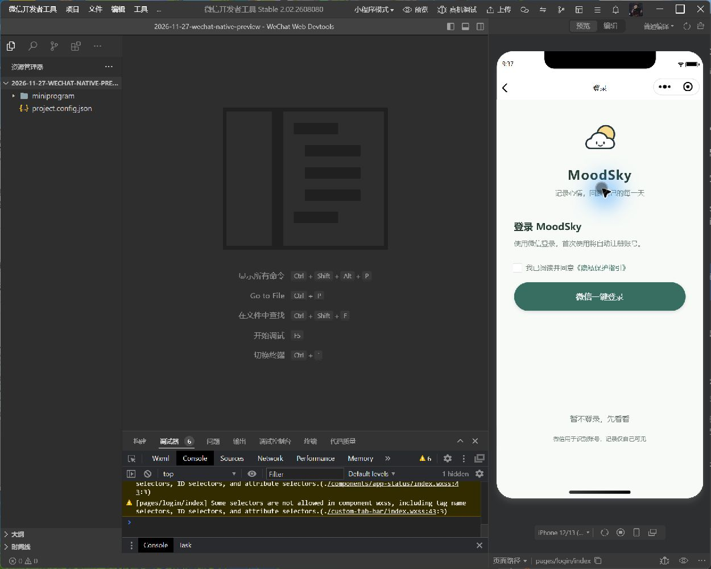
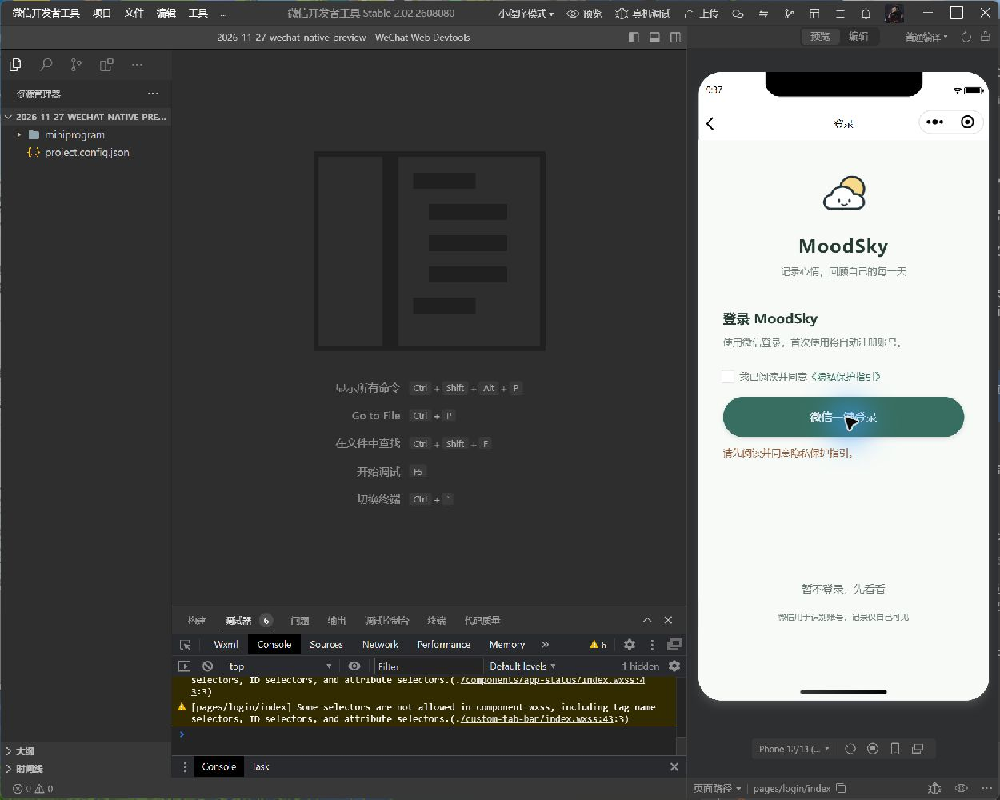

# 微信登录与首次注册

2026-11-27，基于主干 `9033bf64b40430e8ed43657e36d18a2a9c851276`。负责人确认当前小程序不能开放手机号能力，现行候选采用微信登录，首次使用自动注册；手机号候选保留历史来源，不作为当前发布入口。

## 用户流程

1. 点击「我的」头像区进入登录页，阅读隐私指引；同意框默认不选中。
2. 主按钮为「微信一键登录」。未同意时提示阅读并同意，不建立账号。公开页面可通过「暂不登录，先看看」继续浏览。
3. 同意并登录后，服务端根据此次可信微信身份识别账号。首次使用创建空账号；已有用户回到原账号，无需手机号、短信验证码或密码。
4. 退出后重新使用同一微信登录，仍进入同一账号。不同微信对应独立账号；A/B 验收需两个微信，不能将同一微信的两次登录作为两个独立账号。
5. 已注销用户先明确确认「重新注册」，才建立新一代空账号；旧记录和导出不恢复，旧账号清理继续执行。

本次关闭客户端手机号入口，不删除历史号码映射、不自动合并账号。已有且仍有效的号码会话恢复后，点击进入仍保留其账号，避免静默切换到另一微信账号；凭证失效或退出后的号码账号恢复不在本次承诺范围内，不得用客户端号码或 OpenID 绕过验证。

## 实现与信息范围

- 沿用既有 `account.session`、`account.registration`、`account.register` 协议，不接入新的认证或短信 SDK。微信身份由服务端可信调用上下文取得，客户端不提供账号归属授权依据。
- 登录页明确首次自动注册、用途及本人可见范围。私人访问、账号状态、会话代次和迟到响应围栏继续生效。
- 普通生产打包默认 `phoneLoginEnabled: false`，不生成业务函数手机号 OpenAPI 配置；本次不得使用历史文档中的手机号显式开启命令。
- 无新增个人字段、外部接收服务或日志采集；既有微信派生身份仍属个人信息，沿用原导出、注销及清理规则。既有 UGC 和正式平台声明核对不因本次修改免除。

腾讯云[小程序云函数接入说明](https://docs.cloudbase.net/recipes/add-cloud-function-wechat-miniprogram)说明可信微信调用上下文的身份取得方式；本项目复用既有账号实现，不因此切换为另一套认证 SDK。

## 实际验证

| 环境                   | 本次结果                                                                                                                                                                    |
| ---------------------- | --------------------------------------------------------------------------------------------------------------------------------------------------------------------------- |
| 本地完整检查           | `cloud:prepare` 后 `check` 通过：1730 项测试，失败、取消、跳过均为 0；含格式、静态和文档检查                                                                                |
| 登录及打包重点用例     | 47/47，通过；是全量的子集，不重复累加。新增首次微信注册、重开同账号、关闭手机号后的旧会话恢复，以及默认包关闭号码能力的断言                                                 |
| 已部署业务函数下载副本 | 构建 `98c0659a73a1c6a5fbb7cb4b284b68ee3776ab2f`，离线注入合成身份、数据库及测试密钥，验证微信登录、记录读写、A/B 隔离及明确确认后空账号重注册；没有调用真实云或使用真实账号 |
| 原生模拟器             | Stable 2.02.2608080、基础库 3.18.0、390×844，禁云；实际登录入口显示微信主按钮，未同意点击有提示。首次启动失败后重新编译恢复，最后运行无错误，保留 6 条既有组件选择器警告    |
| 外部验证               | 本轮没有部署云函数、执行真机登录或操作公众平台；上传、设体验版、公开发布分别以实际回执登记                                                                                  |

### 登录页

通过实际首页入口打开，显示首次使用自动注册及微信身份用途；没有手机号按钮。未编辑的开发者工具截图，使用禁云环境，不证明真实授权成功。

### 未同意时的反馈

保持同意框未选中后点击微信按钮，页面提示先阅读并同意；没有替用户勾选或创建真实账号。

## 候选与手机补验

从最终干净主干使用普通 `release:package -- <工作区外新目录> closed` 打包，核对完整 `sourceCommit`、工作区干净、号码关闭、任务关闭及新增打卡暂停。按文件哈希确认后使用微信开发者工具上传客户端；本次协议兼容性离线通过不能等同于目标云成功，且不需要为更换入口改库或重置身份密钥。

真机依次检查：新微信首次登录、退出重登原记录、拒绝隐私后的公开浏览、登录失败后重试；使用两个微信验证本人隔离。注销及重新注册另用获准的测试账号，核对确认流程和旧数据不恢复。手机号能力不再作为这些用例的前提。
