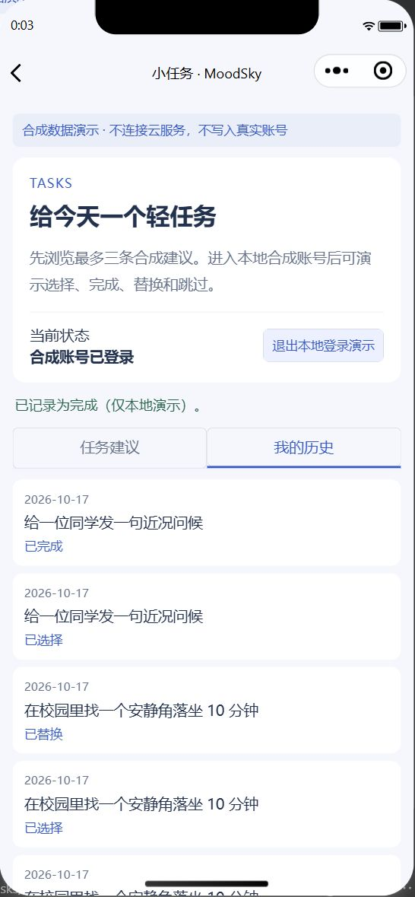
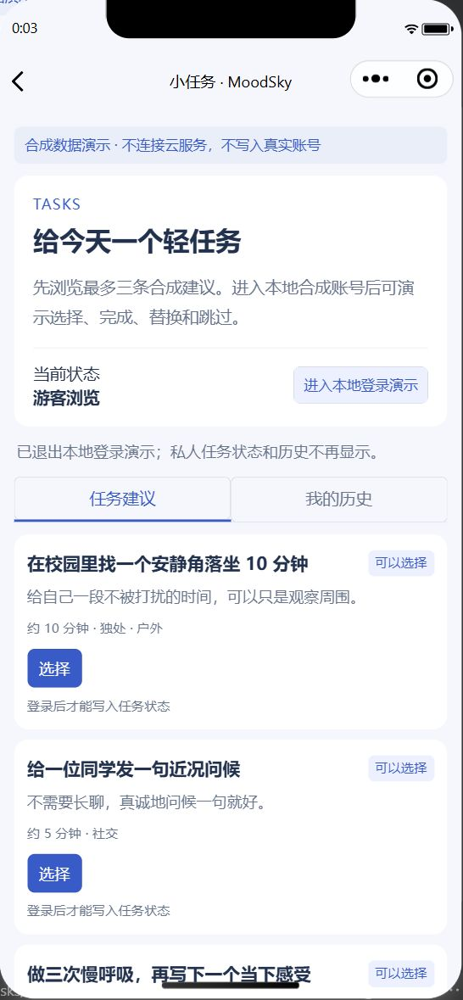
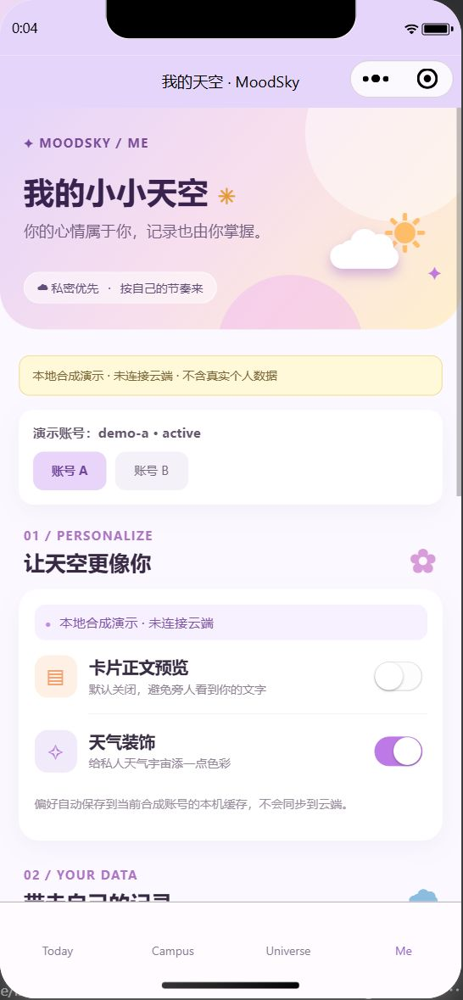

# 两个待处理成员 PR 的整合复核

日期：2026-10-17。源码版本：**0.2.1 开发预览**。范围：继续处理 v0.2.0 发布后仍开放的 #11 和 #14，并审查整合期间新到的 #16；不修改成员分工、个人工时、验收签名或历史实验结论。

## #11：空文档提交关闭，保留补交流程

复核时 head 为 `01a52027bb4f6da102f666858fb557ae10c5d3a3`，五个第一周文档仍为零字节，没有后续补充。已说明原因后关闭 PR，并保留源分支。成员补齐日期交互、边界样例等内容后可重新打开；已有 #7 Today 源码保留，不将空文件计为任务完成。

## #14：修正后纳入本地演示和候选适配层

成员更新 head 为 `3d069ca950ab66018a4593a7a847b461c996cacf`，该版本自动检查已通过，但仍移除既有记录/回顾路由并覆盖 Me 页面，且将业务失败包装当成成功。

复核期间又收到 `f1e2a0b`（成员恢复路由）、`1038063`（响应/权限修正）和 `35c0f10`（五项失败/关联检查）；均保留在分支历史中。`1038063` 覆盖整合门禁，在当时 21 项后台检查中造成 11 项失败，因此继续保持已测试的输入快照、严格请求关联、失败提示与真实提交关闭策略，并吸收“成功响应不能同时含 error”、失败/网络错误保留请求编号及五项新增检查。错误只暴露固定错误码，不回显原始文字；共用响应校验放在认证适配层，避免页面维护第二份。未验证的多种 SDK 包装兼容不作为已完成能力发布。

整合时先合入最新主分支，再作以下修正：

- 恢复已有页面路由、Me 账号/偏好/导出/注销/反馈功能，仅添加任务入口。
- 后台校验请求编号、API 版本和成功/失败响应；已知失败不清空表单，不显示后台原始错误文字。
- 不以浏览器会话的角色字段认定服务端已授权。真实资料提交继续关闭；四类表单仅在本地合成演示中可模拟提交。
- Web SDK 版本、方法、OAuth 与响应包装仍为待验证候选；真实身份链路和后台业务均未验收。
- 任务演示只在 `journalDemo: true` 且 `cloudEnabled: false` 时启用；默认未连接状态不允许操作。
- 修复反复“选择→替换”时错误重用旧回执的问题；显式请求编号仍保持幂等，输入校验拒绝身份字段和非法编号。
- 将 `admin/config.js` 加入忽略规则，保持个人配置不入库。

## 验证记录

完整项目代码、格式、结构及 **218 项测试通过**；其中本次后台和任务针对性检查 33 项，成员 14 项、整合新增 19 项。使用本地替身和页面运行环境，不调用真实 SDK 或云函数。云 SDK 本地加载检查通过；`admin/config.js` 忽略规则已验证。

实际微信开发者工具模拟器 **15 项检查通过**，包括游客拦截、合成账号、三次选择/替换循环、完成历史、退出隐藏、Today/记录/Universe/档案/Campus/Me 路由保留及云关闭。新开项目后首次自动导航等待超时；打开模拟器页面并重新连接后完整复测通过，没有进行云操作。机器可读结果见 [simulator-validation.json](simulator-validation.json)。截图中的任务历史及账号均为合成演示，截图时源码版本为 0.2.0；后续版本标记单独登记。

| 任务历史                               | 游客建议                     | 保留的 Me 页面                   |
| -------------------------------------- | ---------------------------- | -------------------------------- |
|  |  |  |

## #16：新增账号与任务契约材料

来源 `2d6f615`，纳入 JF01—JF05 八份材料及账号门禁检查。修订只读候选与正式默认适配器的差别、任务提案与演示状态机的差别、唯一键的并发限制以及清理分工。首次创建、偏好/任务业务和清理回执签发未实现；联合验收仍待原负责人执行。成员 11 项原始记录保留，新增 A08 后账号文件 12 项通过。

## 最终源码整合与发布检查

- #14 已由拥有者复核、通过 [quality 38929733367](https://github.com/HX-Jan/MoodSky/actions/runs/38929733367) 后合入，主分支提交 `23aea3357a20c8b842cf4e61991c66a5db4a7768`。
- #16 已由拥有者复核、通过 [quality 38930097121](https://github.com/HX-Jan/MoodSky/actions/runs/38930097121) 后合入，主分支提交 `ecf0c2d`。
- PR #16 阶段完整项目 230 项本地测试通过；[整体复核优化](whole-project-review.md)再补四项回归，最终为 **234 项通过**，代码/格式/结构和云 SDK 本地加载通过。前述阶段结果不与最终次数相加。
- 微信模拟器 15 项为本轮功能复测结果，截图中的 0.2.0 是复测当时标记；0.2.1 已另核对版本标记、云关闭和任务入口，见 [version-marker.json](version-marker.json)，不把相同检查重复计数。
- 根包、锁文件、云函数包和唯一共享 APP_VERSION 同步为 0.2.1；不改依赖。现有 0.2.0 云上传包是历史材料，本次不重新上传部署包。
- 第一周索引及 H05 60 行台账同步实际来源；15 行更新，个人输入列和其余 45 行保留，独立复核未代填。
- 整体优化另完成 2 项实际模拟器检查，本轮累计 17 项功能检查通过；证据和未完成项见[整体复核](whole-project-review.md)。

发布仍须等版本整理 PR 和最终 main 的 GitHub quality 通过，实际结果登记在 GitHub 预发布说明；不得仅凭本地通过提前声称发布成功。

## 证据边界

本次没有真实 Web 登录、云调用、云端实验、云函数部署、资源修改或保留数据清理，也没有上传微信体验版/正式版。H03 旧批次 failed、60 条合成记录及报告缺失保持历史结论；新批次 12 项通过、5 项失败的报告不变。本地测试不能替代真实 SDK 接入、云端授权或并发写入验收。
