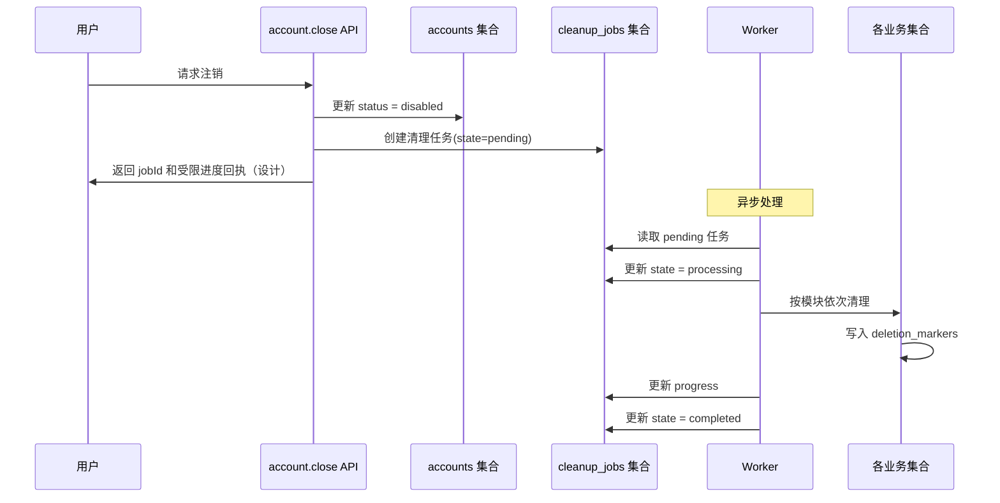
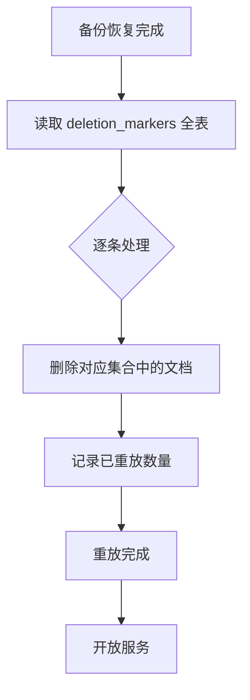

# W1XY04 清理重试与恢复设计

- 编写人：Xiang Yu（学号 832401124）
- 编写时间：2026-10-15
- 任务编号：W1XY04
- 版本：v0.2（本次集成修订；仍待原复核人验收）
- 依据：`database/collections.json` + 第一周任务计划

---

整合说明：本文件是尚未实现的清理设计；本轮没有运行删除、恢复或新测试批次。保留原作者的流程拆分，修订原子性、凭证、能力状态和时间目标，不能直接执行旧样例清理现有数据。

## 1. 目标

设计用户注销后的数据处理完整流程：

1. 账号立即停用
2. 创建清理任务
3. 按模块依次清理
4. 失败可重试
5. 状态可查询
6. 备份恢复后已删数据不复活

**待验收的时间目标：** 尚无真实执行或平台能力证据，不作为已达到的用户承诺。

| 项       | 目标                           |
| -------- | ------------------------------ |
| 主库删除 | 24 小时内                      |
| 注销完成 | 7 天内                         |
| 备份保留 | 最长 30 天（需按平台能力确认） |

---

## 2. 清理流程顺序



### 步骤详解

| 步骤 | 执行方              | 动作                         | 时间要求       |
| ---- | ------------------- | ---------------------------- | -------------- |
| 1    | `account.close` API | `accounts.status = disabled` | 立即           |
| 2    | `account.close` API | 创建 `cleanup_jobs` 任务     | 立即           |
| 3    | Worker              | 读取 `pending` 任务          | 5 分钟内       |
| 4    | Worker              | 更新 `state = processing`    | 立即           |
| 5    | Worker              | 按模块清理                   | 24 小时内      |
| 6    | Worker              | 写入 `deletion_markers`      | 与清理同步     |
| 7    | Worker              | 更新 `progress`              | 每完成一个模块 |
| 8    | Worker              | 更新 `state = completed`     | 清理完成后     |

---

## 3. 模块清理清单

先停用账号、撤销导出/领取能力并持久化任务，再执行下表的分批清理。任务建立必须与账号停用形成可恢复的持久化边界；不能只有 disabled 状态却没有可恢复任务。以下全部为待实现职责，不是可重复执行能力的验收。

| 顺序 | 集合                | 清理方式                         | 负责人       | 可重复执行    |
| ---- | ------------------- | -------------------------------- | ------------ | ------------- |
| 1    | `journals`          | `where({ownerId}).remove()` 分页 | Xiang Hong   | 待实现/待验收 |
| 2    | `favorites`         | `where({ownerId}).remove()`      | Junhan Huang | 待实现/待验收 |
| 3    | `task_history`      | `where({ownerId}).remove()`      | Jiawei Fang  | 待实现/待验收 |
| 4    | `preferences`       | `where({ownerId}).remove()`      | Jiawei Fang  | 待实现/待验收 |
| 5    | `month_decorations` | `where({ownerId}).remove()`      | Xiang Hong   | 待实现/待验收 |
| 6    | `export_jobs`       | 删除云存储文件 + 集合记录        | Xiang Yu     | 待实现/待验收 |
| 7    | `request_receipts`  | `where({ownerId}).remove()`      | Xiang Hong   | 待实现/待验收 |

**保留数据：**

- `places`、`task_templates`、`support_resources`：**公共数据，不删除**
- `operator_roles`：如果用户是运营角色，需单独撤销角色（不是删除用户数据）
- `accounts`：只保留满足账号停用及恢复控制所需的最小元数据；身份映射和保留期需明确审查，不能因“审计需要”无限保留完整个人资料

---

## 4. 分页删除设计

本节是不可执行流程草稿，尚未实现 Worker、锁、分页或数据库事务：

```text
确认可信内部清理任务、disabled 账号和允许的固定集合
先使导出任务、领取凭证及关联缓存不可读
循环取一批属于该任务账号的文档（批量大小经平台验证后确定）
  对每条文档，以稳定标识幂等地写删除意图，并在同一受支持原子边界内删除
  只有标记和删除均已持久化，才推进检查点及 processedCount
  超时或结果不明时按原任务和检查点恢复，不另起范围更大的删除
所有模块和文件处理确认完成后，才置 completed
```

不能使用“先删除，之后另一次请求写标记”作为可靠方案：若两步之间失败，重扫主库已找不到文档，无法补齐恢复删除清单。事务能力、稳定键、条件删除和文档缺失时的幂等语义都需验证；批量 100 和函数运行窗口只是调优提案，不是已确认限制。

## 5. 删除标记（deletion_markers）

### 作用

用于**备份恢复后重放删除清单**，确保已删数据不会从备份中复活。

### 集合结构

```json
{
  "_id": "marker_xxx",
  "collection": "journals",
  "docId": "journal_abc123",
  "deletedAt": "2026-10-15T10:00:00Z"
}
```

**索引提案：** collection + docId 唯一；当前未在基础部署清单中建立

### 写入时机与恢复边界

删除意图和主库删除必须处于经验证的原子边界，或先可靠保存可恢复的删除意图再执行删除。标记不得含正文、下载凭证或原始身份；处理条件绑定可信账号和固定集合。标记失败不能被当作该项完成，也不能在文档已消失后只靠重新枚举主库恢复。

collection + docId 的唯一索引是尚未部署的提案，需要与现有 collections.json 对齐后另行审查。恢复所需的删除账本必须覆盖被恢复备份之后的删除操作；不能把删除标记随同旧备份一起回滚，再声称已删数据不会复活。独立持久化/水位线和重放机制仍待验证。

## 6. 失败重试机制

### 重试触发条件

| 场景                      | 处理                                            |
| ------------------------- | ----------------------------------------------- |
| 某个集合删除失败          | 记录 error，`state` 保持 `processing`，自动重试 |
| 写入 deletion_marker 失败 | 同上                                            |
| 云存储文件删除失败        | 记录 error，下次重试                            |
| Worker 崩溃               | 定时任务扫描超时的 `processing` 任务，重新处理  |

### 重试策略

- **重试次数上限**：5 次
- **重试间隔**：指数退避（1s → 2s → 4s → 8s → 16s）
- **超过上限**：`state = failed`，写入 error 详情，人工介入

### cleanup_jobs 结构

```json
{
  "_id": "cleanup_xxx",
  "ownerId": "internal_account_xxx",
  "state": "processing",
  "progress": {
    "journals": 100,
    "favorites": 100,
    "task_history": 50,
    "preferences": 0,
    "month_decorations": 0,
    "export_jobs": 0,
    "request_receipts": 0
  },
  "error": null,
  "retryCount": 0,
  "createdAt": "2026-10-15T10:00:00Z",
  "updatedAt": "2026-10-15T10:00:30Z"
}
```

**progress 设计含义**：此处各数字为该模块已确认处理的记录数，不能同时解释为百分比。只有存在可信总量及分母时才可另外计算百分比；字段及完成状态还需业务 PR 确认。

---

## 7. 状态查询接口

### `account.cleanupStatus`

**用途：**用户查询自己注销任务的进度。

**请求：**

```json
{
  "apiVersion": "1",
  "requestId": "req_cleanup_status_001",
  "action": "account.cleanupStatus",
  "payload": { "jobId": "cleanup_xxx", "receiptCredential": "synthetic_placeholder_only" }
}
```

**成功响应：**

```json
{
  "apiVersion": "1",
  "ok": true,
  "data": {
    "jobId": "cleanup_xxx",
    "state": "processing",
    "progress": {
      "journals": 100,
      "favorites": 100,
      "task_history": 50,
      "preferences": 0,
      "month_decorations": 0,
      "export_jobs": 0,
      "request_receipts": 0
    },
    "createdAt": "2026-10-15T10:00:00Z",
    "updatedAt": "2026-10-15T10:00:30Z"
  },
  "requestId": "req_cleanup_status_001"
}
```

**只读约束：**

- 只返回进度，**不返回已删内容**
- 该 action 使用现有 receipt 访问类型；jobId 本身不是凭证。必须验证服务端签发、只绑定本任务的受限进度回执，示例字段命名仍待契约评审
- disabled 账号不能恢复普通私人权限；回执只允许读取安全进度，不允许查询正文或其他账号/任务
- 不返回 error 的详细技术信息（避免泄露内部细节）

---

## 8. 备份恢复流程

### 备份能力确认

**需在测试环境核验：**

- [ ] CloudBase 控制台是否支持数据库导出？
- [ ] 导出频率是多少（手动/自动）？
- [ ] 保留期最长多久（30 天是否符合）？
- [ ] 恢复是否覆盖全部数据？
- [ ] 恢复耗时多久？

### 恢复后重放删除标记



**实现步骤：**

1. 备份恢复后，**先不开放服务**
2. 合并备份后的可靠删除账本和必要标记，确认水位线完整；不能只读取随旧备份回滚的 deletion_markers
3. 对每条标记，检查对应集合中是否存在该文档
4. 存在则删除，并记录
5. 全部重放完成，再开放服务

### 验证

**待 Qizhen Cai 独立验证的计划（未执行）：**

- 恢复后，已删数据不会出现
- 重放过程可重复执行（幂等）
- 重放失败有日志记录

---

## 9. 时间目标与保留期

| 项                    | 目标                           | 依据                       |
| --------------------- | ------------------------------ | -------------------------- |
| 主库删除              | 24 小时内                      | 待实测目标，不是已达到承诺 |
| 注销完成              | 7 天内                         | 用户隐私承诺               |
| 备份保留              | 最长 30 天                     | 需按平台能力确认           |
| deletion_markers 保留 | 永久（或至少与备份保留期一致） | 恢复时需要                 |
| cleanup_jobs 保留     | 完成后保留 30 天               | 审计需要                   |

**待确认：** 平台实际备份保留、物理删除和恢复能力尚未核实；不能用设计时限宣称已完成物理删除，也不能提前承诺永久保留标记或固定清理周期。

---

## 10. 待确认项

- [ ] **CloudBase 备份能力**：控制台是否支持数据库导出/恢复？
- [ ] **备份保留期**：30 天是否符合实际？
- [ ] **删除标记保留期**：永久还是与备份期一致？
- [ ] **Worker 实现方式**：云函数定时器还是外部 Worker？
- [ ] **重试次数上限**：5 次是否合理？
- [ ] **清理失败后的人工介入流程**：由谁处理？
- [ ] **注销流程中的用户可见状态**：只显示进度，还是显示具体模块？

---

## 11. 交接

本文档需发给以下人员复核：

- **Jiawei Fang**：停用/创建任务的顺序，`account.close` 和 `account.cleanupStatus` 接口对齐
- **Qizhen Cai**：恢复验证用例、幂等性验证
- **Xiang Hong**：journals、month_decorations、request_receipts 的清理能力
- **Junhan Huang**：favorites 清理能力
- **Linghan Chen**：Me 页面注销进度展示
