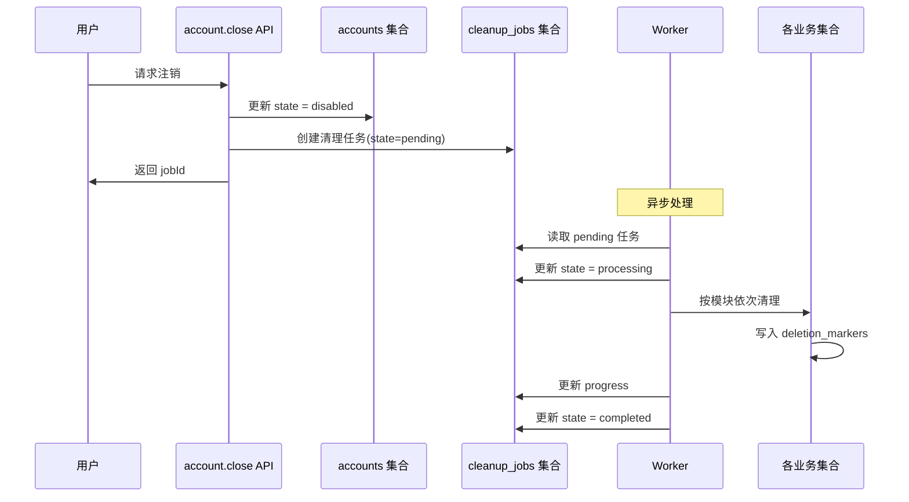
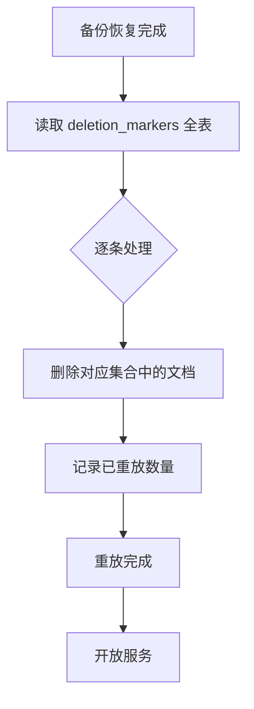

# W1XY04 清理重试与恢复设计

- 编写人：Xiang Yu（学号 832401124）
- 编写时间：2026-10-15
- 任务编号：W1XY04
- 版本：v0.1（初稿，待 Jiawei、Qizhen Cai 复核）
- 依据：`database/collections.json` + 第一周任务计划

---

## 1. 目标

设计用户注销后的数据处理完整流程：

1. 账号立即停用
2. 创建清理任务
3. 按模块依次清理
4. 失败可重试
5. 状态可查询
6. 备份恢复后已删数据不复活

**时间目标（需求上限）：**

| 项       | 目标                           |
| -------- | ------------------------------ |
| 主库删除 | 24 小时内                      |
| 注销完成 | 7 天内                         |
| 备份保留 | 最长 30 天（需按平台能力确认） |

---

## 2. 清理流程顺序



### 步骤详解

| 步骤 | 执行方              | 动作                        | 时间要求       |
| ---- | ------------------- | --------------------------- | -------------- |
| 1    | `account.close` API | `accounts.state = disabled` | 立即           |
| 2    | `account.close` API | 创建 `cleanup_jobs` 任务    | 立即           |
| 3    | Worker              | 读取 `pending` 任务         | 5 分钟内       |
| 4    | Worker              | 更新 `state = processing`   | 立即           |
| 5    | Worker              | 按模块清理                  | 24 小时内      |
| 6    | Worker              | 写入 `deletion_markers`     | 与清理同步     |
| 7    | Worker              | 更新 `progress`             | 每完成一个模块 |
| 8    | Worker              | 更新 `state = completed`    | 清理完成后     |

---

## 3. 模块清理清单

按清理顺序（先清理私人数据，最后清理导出文件）：

| 顺序 | 集合                | 清理方式                         | 负责人       | 可重复执行 |
| ---- | ------------------- | -------------------------------- | ------------ | ---------- |
| 1    | `journals`          | `where({ownerId}).remove()` 分页 | Xiang Hong   | ✅         |
| 2    | `favorites`         | `where({ownerId}).remove()`      | Junhan Huang | ✅         |
| 3    | `task_history`      | `where({ownerId}).remove()`      | Jiawei Fang  | ✅         |
| 4    | `preferences`       | `where({ownerId}).remove()`      | Jiawei Fang  | ✅         |
| 5    | `month_decorations` | `where({ownerId}).remove()`      | Xiang Hong   | ✅         |
| 6    | `export_jobs`       | 删除云存储文件 + 集合记录        | Xiang Yu     | ✅         |
| 7    | `request_receipts`  | `where({ownerId}).remove()`      | Xiang Hong   | ✅         |

**保留数据：**

- `places`、`task_templates`、`support_resources`：**公共数据，不删除**
- `operator_roles`：如果用户是运营角色，需单独撤销角色（不是删除用户数据）
- `accounts`：账号记录**保留为 disabled**，不物理删除（审计需要）

---

## 4. 分页删除实现

CloudBase 单次 `remove()` 有数量限制，需要**分批循环删除**：

```javascript
async function cleanupByOwnerId(collectionName, ownerId) {
  const BATCH_SIZE = 100;
  let deletedTotal = 0;
  let hasMore = true;

  while (hasMore) {
    const res = await db.collection(collectionName).where({ ownerId }).limit(BATCH_SIZE).get();

    if (res.data.length === 0) {
      hasMore = false;
      break;
    }

    for (const doc of res.data) {
      await db.collection(collectionName).doc(doc._id).remove();
      // 同步写入删除标记
      await db.collection('deletion_markers').add({
        data: {
          collection: collectionName,
          docId: doc._id,
          deletedAt: db.serverDate(),
        },
      });
      deletedTotal++;
    }

    // 如果本批不足 100 条，说明已经删完
    if (res.data.length < BATCH_SIZE) {
      hasMore = false;
    }
  }

  return deletedTotal;
}
```

**关键点：**

- 每批 100 条，避免云函数超时
- 每删除一条，写入一条 `deletion_markers`
- 记录已删除总数，写入 `cleanup_jobs.progress`

---

## 5. 删除标记（deletion_markers）

### 作用

用于**备份恢复后重放删除清单**，确保已删数据不会从备份中复活。

### 集合结构

```json
{
  "_id": "marker_xxx",
  "collection": "journals",
  "docId": "journal_abc123",
  "deletedAt": "2026-10-15T10:00:00Z"
}
```

**索引：**`collection + docId`（唯一）

### 写入时机

**每次删除记录时同步写入**，与主库删除在同一逻辑单元内：

```javascript
await db.collection('journals').doc(docId).remove();
await db.collection('deletion_markers').add({
  data: { collection: 'journals', docId, deletedAt: db.serverDate() },
});
```

**如果删除成功但写标记失败**：记录在 `cleanup_jobs.error` 中，支持重试。**宁可多写标记，不能漏写。**

---

## 6. 失败重试机制

### 重试触发条件

| 场景                      | 处理                                            |
| ------------------------- | ----------------------------------------------- |
| 某个集合删除失败          | 记录 error，`state` 保持 `processing`，自动重试 |
| 写入 deletion_marker 失败 | 同上                                            |
| 云存储文件删除失败        | 记录 error，下次重试                            |
| Worker 崩溃               | 定时任务扫描超时的 `processing` 任务，重新处理  |

### 重试策略

- **重试次数上限**：5 次
- **重试间隔**：指数退避（1s → 2s → 4s → 8s → 16s）
- **超过上限**：`state = failed`，写入 error 详情，人工介入

### cleanup_jobs 结构

```json
{
  "_id": "cleanup_xxx",
  "ownerId": "internal_account_xxx",
  "state": "processing",
  "progress": {
    "journals": 100,
    "favorites": 100,
    "task_history": 50,
    "preferences": 0,
    "month_decorations": 0,
    "export_jobs": 0,
    "request_receipts": 0
  },
  "error": null,
  "retryCount": 0,
  "createdAt": "2026-10-15T10:00:00Z",
  "updatedAt": "2026-10-15T10:00:30Z"
}
```

**`progress` 字段**：每个集合的记录数或百分比（推荐用百分比）。

---

## 7. 状态查询接口

### `account.cleanupStatus`

**用途：**用户查询自己注销任务的进度。

**请求：**

```json
{
  "jobId": "cleanup_xxx"
}
```

**成功响应：**

```json
{
  "data": {
    "jobId": "cleanup_xxx",
    "state": "processing",
    "progress": {
      "journals": 100,
      "favorites": 100,
      "task_history": 50,
      "preferences": 0,
      "month_decorations": 0,
      "export_jobs": 0,
      "request_receipts": 0
    },
    "createdAt": "2026-10-15T10:00:00Z",
    "updatedAt": "2026-10-15T10:00:30Z"
  },
  "requestId": "req_xyz789"
}
```

**只读约束：**

- 只返回进度，**不返回已删内容**
- 只有本人能查询自己的清理任务
- 不返回 error 的详细技术信息（避免泄露内部细节）

---

## 8. 备份恢复流程

### 备份能力确认

**需在测试环境核验：**

- [ ] CloudBase 控制台是否支持数据库导出？
- [ ] 导出频率是多少（手动/自动）？
- [ ] 保留期最长多久（30 天是否符合）？
- [ ] 恢复是否覆盖全部数据？
- [ ] 恢复耗时多久？

### 恢复后重放删除标记



**实现步骤：**

1. 备份恢复后，**先不开放服务**
2. 读取 `deletion_markers` 集合的全部记录
3. 对每条标记，检查对应集合中是否存在该文档
4. 存在则删除，并记录
5. 全部重放完成，再开放服务

### 验证

**Qizhen Cai 独立验证：**

- 恢复后，已删数据不会出现
- 重放过程可重复执行（幂等）
- 重放失败有日志记录

---

## 9. 时间目标与保留期

| 项                    | 目标                           | 依据             |
| --------------------- | ------------------------------ | ---------------- |
| 主库删除              | 24 小时内                      | 用户隐私承诺     |
| 注销完成              | 7 天内                         | 用户隐私承诺     |
| 备份保留              | 最长 30 天                     | 需按平台能力确认 |
| deletion_markers 保留 | 永久（或至少与备份保留期一致） | 恢复时需要       |
| cleanup_jobs 保留     | 完成后保留 30 天               | 审计需要         |

**注意：** 备份即时物理删除做不到，用户协议应说明"备份随滚动周期清除"。

---

## 10. 待确认项

- [ ] **CloudBase 备份能力**：控制台是否支持数据库导出/恢复？
- [ ] **备份保留期**：30 天是否符合实际？
- [ ] **删除标记保留期**：永久还是与备份期一致？
- [ ] **Worker 实现方式**：云函数定时器还是外部 Worker？
- [ ] **重试次数上限**：5 次是否合理？
- [ ] **清理失败后的人工介入流程**：由谁处理？
- [ ] **注销流程中的用户可见状态**：只显示进度，还是显示具体模块？

---

## 11. 交接

本文档需发给以下人员复核：

- **Jiawei Fang**：停用/创建任务的顺序，`account.close` 和 `account.cleanupStatus` 接口对齐
- **Qizhen Cai**：恢复验证用例、幂等性验证
- **Xiang Hong**：journals、month_decorations、request_receipts 的清理能力
- **Junhan Huang**：favorites 清理能力
- **Linghan Chen**：Me 页面注销进度展示
