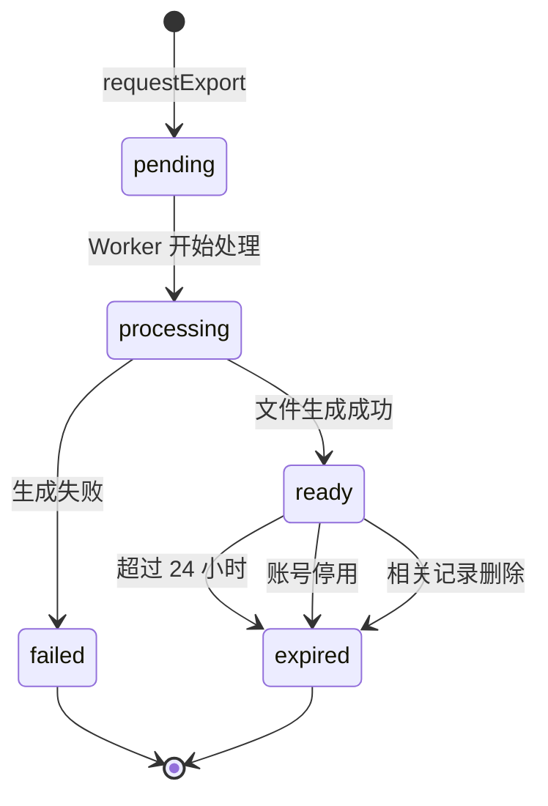

# W1XY03 导出流程设计

- 编写人：Xiang Yu（学号 832401124）
- 编写时间：2026-10-15
- 任务编号：W1XY03
- 版本：v0.1（初稿，待 Linghan、Jiawei 复核）
- 依据：`database/collections.json` + 第一周任务计划

---

## 1. 目标

设计用户数据导出的完整流程，使用户能够：

1. 发起导出请求（JSON 或 Markdown 格式）
2. 查询导出任务状态
3. 通过短时链接下载导出文件

**约束：**

- 临时凭证最长有效期：**5 分钟**
- 服务端文件最长保留：**24 小时**
- 只有本人能发起、查询、下载自己的导出
- 账号停用、相关记录删除后，旧导出自动失效

**本周范围：**只交付**设计文档 + 两种格式的合成样例**，不要求导出执行器上线。

---

## 2. 三个接口定义

### 2.1 `requestExport`

**用途：**用户发起导出请求，创建一个导出任务。

**请求：**

```json
{
  "format": "json"
}
```

| 字段   | 类型   | 必填 | 说明                 |
| ------ | ------ | ---- | -------------------- |
| format | String | 是   | `json` 或 `markdown` |

**成功响应（202 Accepted）：**

```json
{
  "data": {
    "jobId": "exp_20261015_abc123",
    "state": "pending",
    "format": "json",
    "createdAt": "2026-10-15T10:00:00Z"
  },
  "requestId": "req_xyz789"
}
```

**错误响应：**

| 错误码                   | 场景                      |
| ------------------------ | ------------------------- |
| `EXPORT_ALREADY_PENDING` | 已有未完成的导出任务      |
| `EXPORT_FORMAT_INVALID`  | format 不是 json/markdown |
| `SESSION_INVALID`        | 会话失效                  |
| `ACCOUNT_DISABLED`       | 账号已停用                |

**实现要点：**

- `ownerId` 从会话取得，**不接受客户端传入**
- 写入 `export_jobs` 集合，`state = pending`
- 返回 `jobId`（即 `export_jobs` 的 `_id`）

---

### 2.2 `exportStatus`

**用途：**查询导出任务状态。

**请求：**

```json
{
  "jobId": "exp_20261015_abc123"
}
```

**成功响应：**

```json
{
  "data": {
    "jobId": "exp_20261015_abc123",
    "state": "ready",
    "format": "json",
    "progress": 100,
    "expiresAt": "2026-10-16T10:00:00Z",
    "createdAt": "2026-10-15T10:00:00Z",
    "updatedAt": "2026-10-15T10:00:30Z"
  },
  "requestId": "req_xyz789"
}
```

**state 枚举：**

| state        | 说明                       |
| ------------ | -------------------------- |
| `pending`    | 任务已创建，等待处理       |
| `processing` | 正在生成导出文件           |
| `ready`      | 文件已生成，可下载         |
| `expired`    | 文件已过期（超过 24 小时） |
| `failed`     | 生成失败                   |

**权限校验：**

- `ownerId` 从会话取得
- 检查 `jobId` 对应的 `export_jobs.ownerId` 是否匹配
- **不匹配返回 404**（不暴露任务是否存在）

---

### 2.3 `downloadExport`

**用途：**生成短时下载链接。

**请求：**

```json
{
  "jobId": "exp_20261015_abc123"
}
```

**成功响应：**

```json
{
  "data": {
    "url": "https://cloud-storage.example.com/...&sign=...&t=...",
    "expiresIn": 300
  },
  "requestId": "req_xyz789"
}
```

| 字段      | 说明                             |
| --------- | -------------------------------- |
| url       | 云存储临时链接                   |
| expiresIn | 有效期（秒），固定 300（5 分钟） |

**错误响应：**

| 错误码             | 场景                     |
| ------------------ | ------------------------ |
| `EXPORT_NOT_READY` | state 不是 ready         |
| `EXPORT_EXPIRED`   | state 是 expired         |
| `EXPORT_FORBIDDEN` | 不是本人任务（返回 404） |

**实现要点：**

- 只对 `state = ready` 的任务生成链接
- 用云存储 `getTempFileURL` 生成 5 分钟有效的链接
- **不缓存链接**，每次请求重新生成

---

## 3. 任务状态机



**状态转换说明：**

| 触发                     | 转换                                               |
| ------------------------ | -------------------------------------------------- |
| 用户调用 `requestExport` | 创建 `pending` 任务                                |
| Worker 取任务            | `pending → processing`                             |
| 文件生成成功             | `processing → ready`，写入 `fileId` 和 `expiresAt` |
| 文件生成失败             | `processing → failed`，写入 `error`                |
| 超过 24 小时             | `ready → expired`（定时任务）                      |
| 账号停用                 | `ready → expired`（立即触发）                      |
| 相关记录删除             | `ready → expired`（立即触发）                      |

---

## 4. JSON 导出格式样例

```json
{
  "exportVersion": "1.0",
  "exportedAt": "2026-10-15T10:00:00Z",
  "ownerId": "internal_account_xxx",
  "campusId": "campus_demo",
  "data": {
    "journals": [
      {
        "date": "2026-10-01",
        "weather": "SUNNY",
        "tags": ["课业"],
        "text": "今天想慢一点。",
        "version": 1,
        "createdAt": "2026-10-01T08:00:00Z",
        "updatedAt": "2026-10-01T08:00:00Z"
      },
      {
        "date": "2026-10-02",
        "weather": "CLOUDY",
        "tags": [],
        "text": "",
        "version": 1,
        "createdAt": "2026-10-02T09:00:00Z",
        "updatedAt": "2026-10-02T09:00:00Z"
      }
    ],
    "favorites": [
      {
        "placeId": "place_001",
        "placeName": "图书馆阅读角",
        "createdAt": "2026-10-03T10:00:00Z"
      }
    ],
    "taskHistory": [
      {
        "taskId": "task_001",
        "taskTitle": "在安全开放区域走 10 分钟",
        "date": "2026-10-04",
        "state": "completed",
        "createdAt": "2026-10-04T15:00:00Z"
      }
    ],
    "preferences": {
      "cardPreview": true,
      "decorationEnabled": false,
      "updatedAt": "2026-10-05T12:00:00Z"
    },
    "monthDecorations": [
      {
        "month": "2026-10",
        "stickerId": "sticker_sun",
        "backgroundId": "bg_cream",
        "updatedAt": "2026-10-05T12:00:00Z"
      }
    ]
  }
}
```

---

## 5. Markdown 导出格式样例

```markdown
# MoodSky 数据导出

- 导出时间：2026-10-15T10:00:00Z
- 格式版本：1.0
- 所属校区：campus_demo

---

## 天气记录（2 条）

### 2026-10-01 晴天

- 标签：课业
- 正文：今天想慢一点。
- 创建时间：2026-10-01T08:00:00Z

### 2026-10-02 阴天

- 标签：（无）
- 正文：（空）
- 创建时间：2026-10-02T09:00:00Z

---

## 收藏地点（1 个）

- 图书馆阅读角（place_001）
  - 收藏时间：2026-10-03T10:00:00Z

---

## 任务历史（1 条）

- 2026-10-04：在安全开放区域走 10 分钟（已完成）

---

## 偏好设置

- 卡片预览：开启
- 装饰启用：关闭
- 更新时间：2026-10-05T12:00:00Z

---

## 月份装饰（1 个）

- 2026-10：贴纸 sticker_sun / 背景 bg_cream

---

_本文件由 MoodSky 生成，仅本人可领取。导出文件最长保留 24 小时。_
```

---

## 6. 失效规则

| 触发条件                                  | 处理                                                     |
| ----------------------------------------- | -------------------------------------------------------- |
| 账号被停用（`accounts.state = disabled`） | 该账号所有 `ready` 状态的导出立即标记为 `expired`        |
| 相关记录被删除                            | 下一次导出时不再包含该记录；**已有导出不改**（避免误删） |
| 文件超过 24 小时                          | 定时任务标记 `expired`，删除云存储文件                   |
| 用户注销                                  | 立即停用账号，触发清理任务，导出文件随清理任务删除       |

**关于"记录删除后旧导出是否失效"的决策：**

任务描述里有"删除相关记录和过期后的失效"这一句。**两种理解：**

**方案 A（保守）**：记录删除**不**影响已有导出文件。用户导出的是"当时的快照"，不追溯。

**方案 B（严格）**：记录删除**立即**让包含该记录的导出失效。实现复杂，需要记录导出文件与记录的关联。

**推荐方案 A**，理由：

- 导出文件是"历史快照"，符合用户预期
- 方案 B 需要额外维护关联表，成本高
- 只要**新导出**不包含已删记录即可

**这个决策需要在群里跟 Xiang Hong 确认。**

---

## 7. 数据来源（各模块查询能力）

| 集合                | 查询方式                        | 负责人       | 导出的字段                                    |
| ------------------- | ------------------------------- | ------------ | --------------------------------------------- |
| `journals`          | `where({ ownerId }).get()` 分页 | Xiang Hong   | date, weather, tags, text, version, createdAt |
| `favorites`         | `where({ ownerId }).get()` 分页 | Junhan Huang | placeId, createdAt                            |
| `task_history`      | `where({ ownerId }).get()` 分页 | Jiawei Fang  | taskId, date, state, createdAt                |
| `preferences`       | `where({ ownerId }).get()`      | Jiawei Fang  | cardPreview, decorationEnabled                |
| `month_decorations` | `where({ ownerId }).get()`      | Xiang Hong   | month, stickerId, backgroundId                |

**云存储要求：**

- 导出文件写入私有存储
- 通过 `getTempFileURL` 生成临时链接
- **不使用永久公开 URL**

---

## 8. `export_jobs` 集合字段

```json
{
  "_id": "exp_20261015_abc123",
  "ownerId": "internal_account_xxx",
  "format": "json",
  "state": "pending",
  "fileId": null,
  "progress": 0,
  "error": null,
  "expiresAt": null,
  "createdAt": "2026-10-15T10:00:00Z",
  "updatedAt": "2026-10-15T10:00:00Z"
}
```

**索引：**`ownerId + createdAt`（非唯一，加速个人任务查询）

---

## 9. 待确认项

- [ ] **记录删除后旧导出是否失效？** 推荐方案 A（不失效），待 Xiang Hong 确认
- [ ] **导出频率限制？** 是否允许同一用户并发发起多个导出？
- [ ] **导出大小限制？** 是否需要设置单次导出的最大记录数？
- [ ] **`progress` 字段含义？** 是百分比还是阶段编号？
- [ ] **云存储文件命名规则？** 由谁定义？
- [ ] **定时任务由谁负责？** 清理过期文件是 Worker 还是云函数定时器？

---

## 10. 交接

本文档需发给以下人员复核：

- **Linghan Chen**：Me 页面导出入口、进度展示、下载按钮
- **Jiawei Fang**：账号校验能力、注销入口对接
- **Xiang Hong**：journals、month_decorations 查询能力；失效规则决策
- **Junhan Huang**：favorites 查询能力
- **Qizhen Cai**：导出生命周期验收用例
