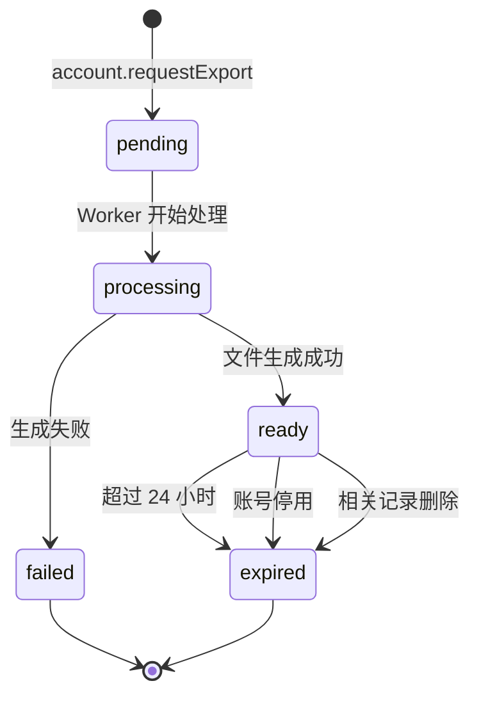

# W1XY03 导出流程设计

- 编写人：Xiang Yu（学号 832401124）
- 编写时间：2026-10-15
- 任务编号：W1XY03
- 版本：v0.2（本次集成修订；仍待原复核人验收）
- 依据：`database/collections.json` + 第一周任务计划

---

## 1. 目标

设计用户数据导出的完整流程，使用户能够：

1. 发起导出请求（JSON 或 Markdown 格式）
2. 查询导出任务状态
3. 通过短时链接下载导出文件

**约束：**

- 临时凭证最长有效期：**5 分钟**
- 服务端文件最长保留：**24 小时**
- 只有本人能发起、查询、下载自己的导出
- 账号停用、相关记录删除后，旧导出自动失效

**本周范围：**只交付**设计文档 + 两种格式的合成样例**，不要求导出执行器上线。

---

## 2. 三个接口定义

本节沿用唯一 action/error 注册表及 API 信封，全部为设计样例，当前 account 业务仍返回 NOT_IMPLEMENTED。字段细节需业务 PR 同时同步校验器、类型和调用方；不因本文产生新的公开入口。云函数响应不使用 HTTP 202/404 作为业务协议。

### 2.1 account.requestExport

请求使用 apiVersion、requestId、action、payload；format 只允许 json 或 markdown。ownerId 从 SDK 可信身份解析的 active 内部账号取得，不接受客户端指定。

```json
{
  "apiVersion": "1",
  "requestId": "req_export_create_001",
  "action": "account.requestExport",
  "payload": { "format": "json" }
}
```

成功样例为 {apiVersion:"1", requestId:"req_export_create_001", ok:true, data:{jobId:"exp_synthetic_001", state:"pending", format:"json"}}。重试保留原请求 ID 与输入；账号检查和任务创建的原子边界仍待实现。

| 现有错误码       | 设计场景                                         |
| ---------------- | ------------------------------------------------ |
| CONFLICT         | 已有未完成任务或请求状态竞争，具体策略待业务确认 |
| INVALID_INPUT    | format 非法                                      |
| UNAUTHENTICATED  | 缺少有效可信身份                                 |
| ACCOUNT_DISABLED | 账号已停用                                       |

不新增 EXPORT_ALREADY_PENDING、EXPORT_FORMAT_INVALID 或 SESSION_INVALID；错误外层沿用 {apiVersion,requestId,ok:false,error:{code,message}}。

### 2.2 account.exportStatus

请求示例为 {apiVersion:"1", requestId:"req_export_status_001", action:"account.exportStatus", payload:{jobId:"exp_synthetic_001"}}，成功 data 只返回该账号任务的安全状态，不返回文件地址、正文、内部 ownerId 或领取凭证。

| state      | 设计含义                                     |
| ---------- | -------------------------------------------- |
| pending    | 已创建、待处理                               |
| processing | 正在生成                                     |
| ready      | 文件生成完成；领取仍须重新检查权限和失效状态 |
| expired    | 过期或因账号/来源数据变化而失效              |
| failed     | 生成失败，只返回安全原因                     |

每次从可信账号检查归属。不存在与不属于本人使用相同的安全失败表现，可沿用 FORBIDDEN，不泄露他人任务存在性。progress 的阶段/计数定义仍待确认，不编造百分比。

### 2.3 account.downloadExport

请求示例为 {apiVersion:"1", requestId:"req_export_claim_001", action:"account.downloadExport", payload:{jobId:"exp_synthetic_001"}}。只有 active 本人、ready 任务、文件未过期且来源记录仍有效时，才能取得受控领取能力。

- 领取凭证最长 300 秒，文件最长保留 24 小时，复用共享 LIMITS；每次领取及实际受控读取均须重新检查账号、归属、任务和来源版本/删除状态。
- 当前 SDK 的临时链接能否满足即时撤销尚未验证。仅调用 getTempFileURL 并设置短期有效，不能证明记录删除后已发链接立即失效；受控下载入口/代理和凭证存储方式需另行设计验证。
- 已删除记录关联的旧任务及未领取文件立即失去读取资格；不能只保证下一次新导出不包含它。
- 未就绪可使用 CONFLICT，过期/失效或无权限沿用 FORBIDDEN，不新增 EXPORT_NOT_READY、EXPORT_EXPIRED、EXPORT_FORBIDDEN。
- 不把真实下载 URL、凭证、正文或 OPENID 记入公共日志或仓库。外部样例只使用明确的合成占位符。

## 3. 任务状态机



**状态转换说明：**

| 触发                             | 转换                                               |
| -------------------------------- | -------------------------------------------------- |
| 用户调用 `account.requestExport` | 创建 `pending` 任务                                |
| Worker 取任务                    | `pending → processing`                             |
| 文件生成成功                     | `processing → ready`，写入 `fileId` 和 `expiresAt` |
| 文件生成失败                     | `processing → failed`，写入 `error`                |
| 超过 24 小时                     | `ready → expired`（定时任务）                      |
| 账号停用                         | `ready → expired`（立即触发）                      |
| 相关记录删除                     | `ready → expired`（立即触发）                      |

---

## 4. JSON 导出格式样例

```json
{
  "exportVersion": "1.0",
  "exportedAt": "2026-10-15T10:00:00Z",
  "campusId": "campus_demo",
  "data": {
    "journals": [
      {
        "date": "2026-10-01",
        "weather": "SUNNY",
        "tags": ["STUDY"],
        "text": "今天想慢一点。",
        "version": 1,
        "createdAt": "2026-10-01T08:00:00Z",
        "updatedAt": "2026-10-01T08:00:00Z"
      },
      {
        "date": "2026-10-02",
        "weather": "CLOUDY",
        "tags": [],
        "text": "",
        "version": 1,
        "createdAt": "2026-10-02T09:00:00Z",
        "updatedAt": "2026-10-02T09:00:00Z"
      }
    ],
    "favorites": [
      {
        "placeId": "place_001",
        "placeName": "图书馆阅读角",
        "createdAt": "2026-10-03T10:00:00Z"
      }
    ],
    "taskHistory": [
      {
        "taskId": "task_001",
        "taskTitle": "在安全开放区域走 10 分钟",
        "date": "2026-10-04",
        "state": "completed",
        "createdAt": "2026-10-04T15:00:00Z"
      }
    ],
    "preferences": {
      "cardTextPreview": true,
      "decorationsEnabled": false,
      "updatedAt": "2026-10-05T12:00:00Z"
    },
    "monthDecorations": [
      {
        "month": "2026-10",
        "stickerId": "sticker_sun",
        "backgroundId": "bg_cream",
        "updatedAt": "2026-10-05T12:00:00Z"
      }
    ]
  }
}
```

---

## 5. Markdown 导出格式样例

```markdown
# MoodSky 数据导出

- 导出时间：2026-10-15T10:00:00Z
- 格式版本：1.0
- 所属校区：campus_demo

---

## 天气记录（2 条）

### 2026-10-01 晴天

- 标签：课业
- 正文：今天想慢一点。
- 创建时间：2026-10-01T08:00:00Z

### 2026-10-02 阴天

- 标签：（无）
- 正文：（空）
- 创建时间：2026-10-02T09:00:00Z

---

## 收藏地点（1 个）

- 图书馆阅读角（place_001）
  - 收藏时间：2026-10-03T10:00:00Z

---

## 任务历史（1 条）

- 2026-10-04：在安全开放区域走 10 分钟（已完成）

---

## 偏好设置

- 卡片预览：开启
- 装饰启用：关闭
- 更新时间：2026-10-05T12:00:00Z

---

## 月份装饰（1 个）

- 2026-10：贴纸 sticker_sun / 背景 bg_cream

---

_本文件由 MoodSky 生成，仅本人可领取。导出文件最长保留 24 小时。_
```

---

## 6. 失效规则

本节依据已获审查的 H03 删除设计整合，不采纳“已有导出不变”的旧提案。

| 触发                          | 设计处理                                                        |
| ----------------------------- | --------------------------------------------------------------- |
| accounts.status 变为 disabled | 立即拒绝新请求及领取；已有任务和凭证失效                        |
| 相关记录删除                  | 包含该来源的旧任务及未领取导出失效；领取时重新核对删除/版本状态 |
| 文件到期                      | 立即拒绝读取，随后按受控任务清除文件                            |
| 用户注销                      | 停用账号并持久化清理任务，先撤销导出能力，再分批清理            |

已下载到用户设备的文件无法由服务端收回，不把它写成可远程删除。上述规则是待实现约束，不是已完成验证；来源关联方式、生成/领取竞争和物理文件回收需要单独测试。

## 7. 数据来源（待实现的模块交接）

下表表示预期服务端查询职责，不代表当前具备本人查询或导出能力；现有领域模块及账号适配器仍未实现。

| 集合                | 查询方式                        | 负责人       | 导出的字段                                    |
| ------------------- | ------------------------------- | ------------ | --------------------------------------------- |
| `journals`          | `where({ ownerId }).get()` 分页 | Xiang Hong   | date, weather, tags, text, version, createdAt |
| `favorites`         | `where({ ownerId }).get()` 分页 | Junhan Huang | placeId, createdAt                            |
| `task_history`      | `where({ ownerId }).get()` 分页 | Jiawei Fang  | taskId, date, state, createdAt                |
| `preferences`       | `where({ ownerId }).get()`      | Jiawei Fang  | cardTextPreview, decorationsEnabled           |
| `month_decorations` | `where({ ownerId }).get()`      | Xiang Hong   | month, stickerId, backgroundId                |

**云存储要求：**

- 导出文件写入私有存储
- 临时领取或下载能力必须满足上文重新校验和失效约束；单独使用 getTempFileURL 尚不足以证明这些要求
- **不使用永久公开 URL**

---

## 8. `export_jobs` 集合字段

```json
{
  "_id": "exp_20261015_abc123",
  "ownerId": "internal_account_xxx",
  "format": "json",
  "state": "pending",
  "fileId": null,
  "progress": 0,
  "error": null,
  "expiresAt": null,
  "createdAt": "2026-10-15T10:00:00Z",
  "updatedAt": "2026-10-15T10:00:00Z"
}
```

**索引：**`ownerId + createdAt`（非唯一，加速个人任务查询）

---

## 9. 待确认项

- [x] 设计基线已对齐 H03：记录删除后旧任务和未领取导出必须失效；实现及竞争验证仍待完成
- [ ] **导出频率限制？** 是否允许同一用户并发发起多个导出？
- [ ] **导出大小限制？** 是否需要设置单次导出的最大记录数？
- [ ] **`progress` 字段含义？** 是百分比还是阶段编号？
- [ ] **云存储文件命名规则？** 由谁定义？
- [ ] **定时任务由谁负责？** 清理过期文件是 Worker 还是云函数定时器？

---

## 10. 交接

本文档需发给以下人员复核：

- **Linghan Chen**：Me 页面导出入口、进度展示、下载按钮
- **Jiawei Fang**：账号校验能力、注销入口对接
- **Xiang Hong**：journals、month_decorations 查询能力；失效规则决策
- **Junhan Huang**：favorites 查询能力
- **Qizhen Cai**：导出生命周期验收用例
