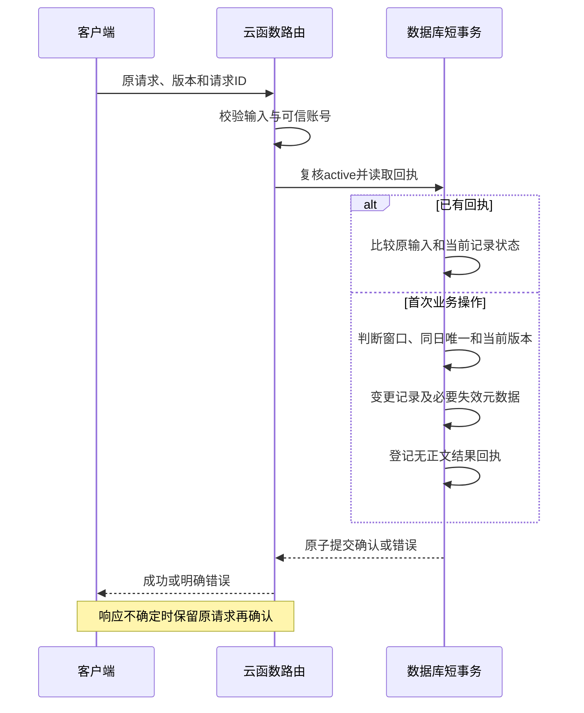

# W1 H03 可靠写入与删除处理设计草稿

整理日期：2026-10-14（北京时间）。负责人：Xiang Hong。状态：拥有者已于 2026-10-14 审查通过本设计草稿，并批准准备隔离测试包与部署清单；Xiang Yu、Qizhen Cai 的独立复核及真实数据库技术验证仍待执行，H03 整项任务尚未验收通过。

2026-10-15 进度补充：[真实隔离验证](w1-h03-report-retention-validation.md)已取得完整新报告，12 项通过、5 项并发失败；报告留存/读取通过，H03 技术验证和成员独立验收仍未完成。旧批次的逐项结果仍未知；下文设计约束不因实验失败而放宽。[H04 草稿](w1-h04.md)已另行准备，尚未同步正式契约。

## 1. 范围与证据边界

本稿承接已由拥有者审查通过的 [H02 接口草稿](w1-h02.md)，设计同日并发新建、旧版本竞争编辑、同请求重试、同 ID 不同输入以及删除的失效顺序。第一周交付设计和技术验证证据；正式记录闭环按计划安排在第二周。本步更新 H02 审查记录并新增本文，不修改业务代码、共享类型、集合或索引，不推送 GitHub，不部署，也不发起真实数据库请求。

依据[需求基线](../../requirements.md)、[架构边界](../../architecture.md)、[分工](../../team.md)、[开发说明](../../development.md)、[集合设计](../../../database/collections.json)、[云路由](../../../cloudfunctions/moodsky/router.js)、[记录模块](../../../cloudfunctions/moodsky/domains/journal.js)、[回顾 service](../../../miniprogram/modules/review/service.js)及 [H01 环境登记表](w1-h01.md)。现有记录模块和账号适配器仍返回 `NOT_IMPLEMENTED`。

### 已核对与待验证

| 依据                                                                                                                                                | 本步能确认的事实                                                                                                | 不能据此确认                                                                       |
| --------------------------------------------------------------------------------------------------------------------------------------------------- | --------------------------------------------------------------------------------------------------------------- | ---------------------------------------------------------------------------------- |
| [已有数据库结构记录](../../test-reports/2026-10-13/database-live.json)                                                                              | 历史记录包含 `journals(ownerId,date)` 和 `request_receipts(ownerId,action,requestId)` 唯一索引                  | 唯一冲突、并发、条件更新或事务已经实测通过；本步未查询当前云端                     |
| [锁定依赖](../../../cloudfunctions/moodsky/package.json)与本地 SDK                                                                                  | wx-server-sdk 4.0.2、@cloudbase/database 1.5.1；本地加载后数据库对象暴露 `runTransaction/startTransaction` 函数 | 当前云运行时、环境套餐及后端服务实际支持下面的提交方案                             |
| 本地锁定依赖的事务源码                                                                                                                              | `runTransaction` 会调用回调、提交事务；识别数据库事务冲突时可能再次调用回调；`times` 缺省为 3，递归时减一       | 将 3 直接当作总执行次数；任意异常都能安全自动重试；当前 SDK 的所有返回形态均已验证 |
| [腾讯 CloudBase 官方 Node SDK 事务说明](https://github.com/TencentCloudBase/node-sdk/blob/master/docs/database/database.md#runtransaction-使用说明) | 官方示例包含事务提交/回滚、自定义结果和事务冲突处理                                                             | 官方说明使用的 SDK 与本项目依赖完全相同；最新文档能替代项目环境实验                |

官方仓库页面显示该仓库已归档，本稿只用它核对事务接口概念；实际支持情况以锁定 SDK 和隔离云端实验为准。本地 SDK 核对只做加载和函数存在性检查，没有调用开启事务、查询、写入或提交。下面的事务方案是待验证提案。

## 2. 设计必须保持的规则

| 编号 | 必须保持的规则                                                           |
| ---- | ------------------------------------------------------------------------ |
| I01  | 本人身份来自可信上下文和 active 内部账号；不由 payload 或去重 ID 决定    |
| I02  | 每个账号/日期最多一条有效记录，不靠客户端按钮或“先查后插”保证唯一        |
| I03  | 编辑/删除必须比较当前版本；旧版本不能静默覆盖或删除新版本                |
| I04  | 一次已接纳请求只提交一个确定结果；相同 ID 不同输入不能执行第二个操作     |
| I05  | 记录变更、必要账号保护元数据和请求回执一起提交，避免“写了记录却没回执”   |
| I06  | 删除后本人读取、五种回顾及未领取旧导出不能重新暴露该记录；回执不保存正文 |
| I07  | 删除后重建不重用旧版本；旧编辑、旧删除及旧保存重试不能修改新一代记录     |
| I08  | 云函数中断、事务重试、清理重试和备份恢复都不能重新生成已删除的私人正文   |
| I09  | 只在提交状态已确认后返回成功；不确定结果保留原请求，不伪造未执行或已完成 |

## 3. 拟用的数据与原子边界

### 3.1 优先方案：短事务

一次被接纳的写请求使用一个短事务，包含账号状态复核、回执判定、当日记录变更和必要的失效元数据。数据库内部重试仍使用同一请求 ID、原输入、候选 entry ID 和调用时间，不更新客户端的 `expectedVersion`。回调内没有发通知、上传/删除文件、数据库操作以外的网络请求或其他不可回滚副作用。

业务版本冲突和输入错误不作为数据库事务冲突自动重试。只有已识别的数据库冲突进入有限重试；实际次数、耗时预算、退避和 SDK 异常映射待隔离验证。冲突重试耗尽或提交结果未知时，沿用安全的 `INTERNAL_ERROR`，要求保留原请求；不能把未知提交结果强行改为 `CONFLICT` 或让客户端换 ID 再写。

短事务优先使用可由服务器确定的文档定位键，避免假定事务内的集合查询、跨集合批量更新或文件操作都受支持。定位键从可信内部账号和业务日期/请求 ID 推导，绝不从客户端接收；键格式、长度、碰撞处理和已有随机文档 ID 的迁移须由 Xiang Yu 验证。实际记录仍核对 `ownerId/date`，哈希键本身不提供授权。

### 3.2 共享数据变更提案

以下都未写入集合设计或实际数据库；不新增集合数量，不改变现有 private action 的输入输出。具体字段名及索引需在数据接口变更中确认。

| 位置              | 拟增加或明确的内容                                                                                          | 作用与复核人                                                              |
| ----------------- | ----------------------------------------------------------------------------------------------------------- | ------------------------------------------------------------------------- |
| journals          | 当日稳定定位键、`state: active/deleted`、单调递增 `version`；有效记录另有对外 `entryId`                     | 每次编辑保留 entryId；重建换 entryId，版本不重置。Xiang Yu、Xiang Hong    |
| journals 删除态   | 仅留 ownerId、date、version、必要的旧 entryId/删除时间；移除 weather、tags、text 等内容字段                 | 不保存一份“软删除正文”；用最少元数据阻止旧版本复活。Xiang Yu              |
| accounts          | `operationFence`、`journalRevision`、`exportEpoch` 等无正文元数据                                           | 同一账号状态变更参与冲突；回顾来源变更及旧导出失效。Xiang Yu、Jiawei Fang |
| request_receipts  | 规范化版本、输入摘要、摘要密钥版本、结果种类、必要 entryId/version/时间或删除布尔值；不含正文/天气/标签副本 | 绑定原输入，重建安全结果。Xiang Yu、Xiang Hong                            |
| deletion_markers  | 原 entryId、删除版本、影响日期/月、清理阶段与重试信息；不含正文                                             | 提交后清理、装饰关联修复与恢复屏障。Xiang Yu、Qizhen Cai                  |
| month_decorations | 记录关联采用 entryId；读取时检查源记录有效；清理状态或来源版本待定                                          | 去掉已删记录的引用，保留未关联该记录的月份装饰。Zhifeng Dai、Xiang Yu     |
| export_jobs       | 导出来源 exportEpoch、领取/撤销状态及私有文件引用                                                           | 生成及领取均复核版本，撤销旧文件的访问。Xiang Yu、Jiawei Fang             |

`operationFence` 是拟议的账号文档竞争字段：记录写入、合法回执重放、空删除回执、导出领取及账号停用需按同一协议读取或更新账号文档，确保这些操作的先后顺序可验证。新业务变更才增加 `journalRevision/exportEpoch`，回执重放及空删除不再次增加它们。领取只触碰竞争字段，不改变导出来源版本。增加这一协议会影响其他账号业务，必须由 Jiawei、Xiang Yu 共同复核；当前默认门禁的一次普通查询不能自动保证提交时账号仍为 active。

稳定当日文档保留版本信息，删除时版本也前进一位，例如“首次创建 v1 → 编辑 v2 → 删除态 v3 → 重建 v4”。重建要求日期仍在新建窗口内，输入仍传 `expectedVersion: 0`；对外返回实际 v4。旧记录编辑传 v1/v2 时不会命中新一代 v4。对外 id 为有效 entryId，不把内部定位键当作身份凭证。

删除字段必须通过经实测的更新/替换语义移除；不能仅因新对象没写 `text` 就假定 SDK 已清掉旧字段。元数据保留期、清理时机、安全整数范围及容量待确认；安全边界不明时不能删除代际元数据后重新从版本 1 开始。

## 4. 输入摘要与回执生命周期

### 4.1 原输入如何比较

1. 按现有外层和业务白名单校验请求，并保留请求封装冻结的原 payload；归属从服务器 actor 获取。
2. 摘要包括规范化版本、apiVersion、action 和原 payload。对象属性按固定顺序编码；数组顺序保留，正文不 trim、不做 Unicode 归一化。
3. 区分可选字段缺省与显式空值，例如原请求没带 text，后来改为 `text: ""` 也属于改变原输入；校验得到相同存储结果不能允许旧 ID 改输入。
4. 拟采用服务端带密钥的输入摘要，防止简单短正文被离线猜测；算法、密钥版本、轮换与旧回执验证待 Xiang Yu 确认。密钥不写入文档、GitHub、样例或日志。
5. 重试使用回执记载的规范化/密钥版本核对输入；验证材料丢失或版本无法解释时拒绝重放，不重新执行写操作。

请求键为既有 `(ownerId, action, requestId)`。不同账号或不同 action 的相同 ID 不互相读取回执。客户端仍须保留完全不变的原请求，不能利用规范化规则修改输入后重试。

### 4.2 何时建立回执

外层或字段校验不合法的请求立即拒绝，不接纳为业务操作；未登录/停用也不建立可绕过账号门禁的回执。字段合法且 active 账号已解析后，在短事务内登记确定结果：创建、编辑、实际删除、空删除，以及日期窗口或版本等业务拒绝。

业务拒绝只保存错误码和安全的文案标识，不保存输入；它与回执一起提交，不修改有效日记或来源版本。提交后由适配器转换为现有 `AppError`。如果在事务内直接抛业务错误导致整笔回滚，就不能同时声称该拒绝已经被持久绑定。

优先方案不另留独立的持久 `RUNNING` 锁：事务尚未提交时没有已提交结果；两个实例争用同一回执键，只有一个事务能提交。另一个实例必须在冲突重试后重新读取回执，不能重新执行保存。是否满足这一行为由实验 V02、V04、V05 验证。

| 已提交状态                                | 相同输入重试                                                   | 输入不同         |
| ----------------------------------------- | -------------------------------------------------------------- | ---------------- |
| 保存成功，当前有效 entryId/version 仍匹配 | 从当前原始记录及无正文回执重建原成功结果；不新增记录或增加版本 | CONFLICT，不执行 |
| 保存成功，但已编辑、删除或重建            | CONFLICT，要求重新读取，不返回旧正文                           | CONFLICT，不执行 |
| 实际删除或空删除成功                      | 重放原 deleted 布尔值；不再操作后来出现的记录                  | CONFLICT，不执行 |
| 业务拒绝已提交                            | 重放原错误，不把同 ID 改作新的成功操作                         | CONFLICT，不执行 |
| 回执过期，保留最小键占用标记              | CONFLICT，确认当前状态；不把 ID 重新当成新请求                 | CONFLICT，不执行 |

回执有效期和最小键占用标记的保留期是待确认项，本稿不编造时长。回执到期可以减少结果元数据，但不能直接删除唯一键后允许一个迟到请求重新执行。现有 ID 中的客户端时间不是可信过期依据。若需要完全回收旧键，必须另外设计可验证的请求时限或代际协议，同步 H02/公共封装后再审查。

## 5. 请求处理顺序与并发场景

### 5.1 公共处理顺序

1. 复用 router 外层校验及可信账号门禁；补查询/删除字段校验，复用保存校验。冻结原请求和本次调用的服务端时间，准备摘要及服务器候选 entryId。
2. 进入短事务，重新读取当前内部账号，检查 active；按拟议竞争协议参与账号文档冲突。账号停用后的重试不能使用旧成功回执授权。
3. 按可信账号/action/ID 读取回执：不同输入或无法验证即拒绝；已有结果先处理，不先应用新建窗口。
4. 无回执才读取本人当日文档。首次无回执执行以本次调用冻结的服务器业务日判断窗口；新的调用重新取服务器时间。成功回执跨日重放不重新判为窗口外新建。
5. 按新建、编辑、删除规则作出决定。凡查到的文档均核对 ownerId/date；出现定位键不一致等内部异常时停止，不覆盖。
6. 在同一事务内提交日记变更、版本、账号来源版本、无正文回执；删除还提交删除标记和导出失效版本。空删除/业务拒绝只提交必要的回执与账号保护元数据。
7. 事务确认提交后才构造 H02 结果。提交已发生但响应丢失时，客户端保留原请求，下一次通过回执判定结果；不能先显示“保存成功”。
8. 提交后执行可重复的清理任务。清理失败不会重新保存旧正文，也不能回退逻辑删除；失败阶段可观测并交负责人处理。

### 5.2 同日并发新建

两个不同 ID 都携带 expectedVersion 0。它们竞争同一账号/日期文档和唯一键；一个事务提交有效记录及回执。另一事务重新读取后发现已有有效记录，登记并返回 CONFLICT；不把原请求改成编辑。若遇到临时数据库失败且尚不能确认胜负，返回安全的未确定结果，不能声称两个都成功或直接忽略重复键错误。

数据库重复键异常只有在确认来自本人 journal/receipt 的预期唯一键时才能转成相应业务判断，不能把所有重复键异常一概当作“保存成功”。随机文档 ID 的先查后插仍必须有数据库唯一约束；客户端禁止重复点击只改善交互。

### 5.3 旧版本竞争编辑与编辑/删除竞争

两个不同 ID 都携带同一当前版本。第一个成功后版本变化；第二个在事务冲突后重新读取，仍比较请求原 expectedVersion，因此 CONFLICT，不跟随新的版本继续覆盖。同样处理编辑与删除竞争：哪个先提交由数据库决定，另一个必须重新校验版本。

已有旧日期的编辑不套用新建 30 天窗口；正版本对应的记录已不存在或是删除态时也不自动新建。删除与重建竞争必须保留版本代际，不能用“现在没有记录”作为任意旧请求写入的理由。

### 5.4 同 ID 重试与同 ID 不同输入

同 ID 同输入的两个实例竞争同一回执键，第一个提交，第二个重新读回执。原保存版本仍有效才重放保存成功；原删除即使遇到新一代记录，也只重放其原布尔值。原业务拒绝不自动升级为成功。

同 ID 不同输入的两个实例不能各自提交一份结果；唯一回执绑定先提交的原输入，另一实例比较摘要后 CONFLICT。服务端和客户端都不能在一次不确定重试中修改正文、标签、日期或 expectedVersion。

## 6. 删除、回顾、装饰与导出失效

### 6.1 删除的提交点

只有当前有效记录且版本匹配才能实际删除。在同一短事务内完成：将日记改为无正文删除态并推进版本，增加 journalRevision/exportEpoch，写无正文删除标记和 deleted:true 回执。空删除也登记 deleted:false 回执，避免迟到重试删除后来新建的记录。

所有本人读取、五种回顾及导出领取必须尊重删除态及失效版本后，才能把这个提交点称为业务删除成功。某个消费者尚未接入时，不得上线对外返回完整删除成功；单独的实验结果只能证明局部能力。物理清除、私有文件删除及恢复核验的完成状态另外记录。

### 6.2 交给回顾与客户端的清单

| 消费者                                 | 删除后必须发生的变化                                               | 负责人                              |
| -------------------------------------- | ------------------------------------------------------------------ | ----------------------------------- |
| journal.get / Today 表单               | 返回 entry:null；旧草稿与服务端已删记录分清；旧请求不能恢复记录    | Xiang Hong、Yifan Ji                |
| review.calendar                        | 移除该日记录标记                                                   | Xiang Hong、Zhifeng Dai             |
| review.distribution                    | 从源记录重算窗口内数量，不能只改显示文字                           | Xiang Hong、Zhifeng Dai             |
| review.timeline                        | 移除该条时间线项目                                                 | Xiang Hong、Zhifeng Dai             |
| review.monthArchive                    | 月份档案/卡片不再显示该条，正文默认隐藏规则继续沿用                | Xiang Hong、Zhifeng Dai             |
| review.decorations / month_decorations | 删除对旧 entryId 的关联，读取立即过滤无效关联；独立月份装饰保留    | Zhifeng Dai、Xiang Yu、Xiang Hong   |
| 页面与本地缓存                         | 同账号新增/编辑/删除均通知相关视图刷新；删除成功清掉对应缓存及预览 | Yifan Ji、Zhifeng Dai、Linghan Chen |

回顾继续以有效原始 journal 为来源，不维护另一份正文。服务端派生缓存若存在，需比较来源 journalRevision 并重新生成，不能等后台清理完再停止显示。具体响应中的来源版本字段与装饰读写方式留给 H04 接口审查，不在本文单边加字段。

客户端给读取结果绑定会话与视图代次，删除成功或账号切换后增加代次；旧的在途响应不得写回新缓存。返回页面/恢复网络时重新核对当前数据，不能把旧缓存重新显示成当前记录。另一设备离线时已收到的内容无法由一次云事务撤回，因此真机验收需区分“服务器不再返回”和“客户端重新上线后清掉旧状态”，不宣称远程清除所有已有副本。

### 6.3 交给导出与清理负责人的清单

1. 创建导出任务时记录来源 exportEpoch，生成私有文件前后复核；删除提交后，旧 epoch 的 generating/ready 任务不再成为可领取结果。无法保证稳定来源时停止生成或重做，不能发布混合新旧数据。
2. exportStatus/downloadExport 每次执行可信 active 门禁，验证本人任务、到期及来源 epoch。ready 状态、旧请求 ID 或未过期凭证都不能越过删除失效检查。
3. 领取与删除必须参与同一账号文档的竞争协议。删除先提交时，旧任务领取失败；领取先提交时按已发生的授权传输单独记录，不承诺撤回已经传出的字节。具体领取提交点和传输前再次验证交 Xiang Yu、Jiawei、Qizhen Cai 确认。
4. 旧文件始终私有，不预先给未领取任务发绕过当前门禁的公共或长期链接。若采用临时直链，必须验证已发链接如何撤销、缓存及删除后的可访问性；单靠数据库 revoked 标记或 5 分钟到期不能证明立即失效。该项未解决时不得声称旧导出失效验收通过。
5. 删除事务用 exportEpoch 先统一封锁旧任务，再由标记驱动分页更新 export_jobs、解除装饰关联、删除旧私有文件及派生缓存；不在短事务内遍历所有任务或执行文件删除。
6. 清理工人按删除标记及阶段可重复执行。重复运行不改动新一代 entryId，不删除重建记录的新导出；完成标记须在实际动作完成后写入。失败保留阶段和安全错误，不把正文、下载凭证或平台原始身份写日志。
7. 恢复到旧备份后先重放完整删除标记和失效版本，再开放私人读取。删除标记不能只取自同一旧回档快照；需有能覆盖回档之后删除事件的独立恢复依据，否则暂不开放受影响数据。备份能力、标记保留与恢复顺序由 Xiang Yu 验证。

主库删除 24 小时、导出文件最长 24 小时、注销清理 7 天及备份最长 30 天仍是[需求中的待验证目标](../../requirements.md)，不是本步测量结果。注销由 Jiawei 先停用账号，再由 Xiang Yu 执行清理；本模块提供可重复的本人查询/清理能力，不用日记回执恢复注销后的访问。

## 7. 关键失败场景

| 编号 | 故障或竞争                              | 拟处理方式                                       | 必须保留的证据                       |
| ---- | --------------------------------------- | ------------------------------------------------ | ------------------------------------ |
| F01  | 两个 ID 同日同时创建                    | 唯一键与事务只允许一条有效记录；另一请求明确冲突 | 两个结果、最终条数、各回执与版本     |
| F02  | 两个 ID 同一旧版本编辑                  | 一个前进，另一个不覆盖                           | 版本变化及最终输入属于哪次操作       |
| F03  | 同 ID 相同输入同时提交                  | 回执只有一份，业务只改一次                       | 并发请求结果、唯一回执、最终版本     |
| F04  | 同 ID 不同输入同时提交                  | 绑定其中一个原输入，另一请求 CONFLICT            | 摘要比较与最终正文使用合成内容       |
| F05  | 写记录后、写回执前抛错                  | 整笔回滚；不能有半笔成功                         | 两集合及账号来源版本均无部分提交     |
| F06  | 提交成功后响应丢失                      | 原请求重试识别回执，不再次写入                   | 提交/响应故障点与重放后版本          |
| F07  | SDK 再次执行事务回调                    | 候选 ID 与输入固定，没有文件/通知副作用          | 回调次数、总耗时与副作用计数         |
| F08  | 保存成功后跨过 29/30 天边界重试         | 回执先于新建窗口；不重复建记录                   | 固定服务端时钟与两次结果             |
| F09  | 保存后被其他请求编辑/删除，再重试旧保存 | CONFLICT，不重放旧正文或重新插入                 | 当前状态和旧请求结果                 |
| F10  | 删除后同日重建，再发旧编辑或旧删除      | 版本/代际冲突；旧删除回执只重放                  | 新 entryId、版本及内容保持           |
| F11  | 空删除返回 false 后新建，再重试空删除   | 仍返回原 false，不删新记录                       | 空删除回执与新记录保持               |
| F12  | 删除与编辑、领取、停用交错              | 同一竞争协议排出提交顺序，不绕过版本/门禁        | 可复现交错顺序及最终状态             |
| F13  | 清理文件或装饰关联失败、重复执行        | 先保持逻辑不可读；按阶段继续，保护新代际         | 安全失败记录、重跑及关联状态         |
| F14  | 旧页面响应晚于删除成功返回              | 会话/视图代次拒绝旧结果，缓存不复活              | 页面事件与缓存变化，不含真实正文     |
| F15  | 回执过期、摘要密钥丢失或规范化版本未知  | 拒绝重放，不把原 ID 当新写入                     | 无第二次业务变更、明确错误           |
| F16  | 恢复旧备份含已删记录和旧导出            | 删除标记/失效版本先重放；缺依据则不开放          | 快照时间、删除事件覆盖及恢复后读拒绝 |
| F17  | 删除字段更新只合并，没有移除正文        | 技术验证失败，修正更新语义后才验收               | 删除态实际字段集合及正文不存在       |
| F18  | SDK 重试耗尽、提交状态无法确定          | 安全错误，客户端保留原请求；再按回执确认         | 失败次数、提交状态，不推断为已回滚   |

## 8. 隔离技术验证计划

本节是待执行计划。本步只核对 SDK 能加载及事务入口存在，未建立实验集合、部署测试函数、插入合成数据或运行以下云端场景。下一独立步骤可先准备具体测试包与部署清单，交拥有者审查后再执行。

验证环境采用 H01 登记的测试环境；实验另用经审查的 `h03_probe_` 前缀临时集合及独立测试入口，不操作现有 15 个业务集合或真实账号。集合、索引、测试入口名称、调用权限、合成账号映射、锁定依赖、失败注入方式和清理范围必须在可审查的部署包中固定。只有账号解析实验的输入来自受信测试入口；不能把任意客户端 ownerId 作为实验授权。测试结束只清理本次明确创建的资源，不清理业务集合。

| 编号 | 实验内容                                          | 通过条件                                                     | 当前状态                       |
| ---- | ------------------------------------------------- | ------------------------------------------------------------ | ------------------------------ |
| V01  | 在锁定 SDK/实际云运行时提交并回滚跨集合事务       | 日记/回执/账号元数据同时提交或同时不变；记录返回形态         | 待执行                         |
| V02  | 显式触发 journal 和 receipt 唯一键冲突            | 记录结构化 SDK 错误；确认预期唯一键，不能依赖文案猜测        | 待执行                         |
| V03  | 两个不同 ID 同版本竞争，含编辑/删除交错           | 至多一个修改成功，另一个明确冲突或安全的临时失败；无静默覆盖 | 待执行                         |
| V04  | 同 ID 相同输入并发，故意丢失一次响应              | 只提交一次，重试版本不增加，回执唯一                         | 待执行                         |
| V05  | 同 ID 不同输入并发；重放已登记的业务拒绝          | 不提交第二输入，拒绝结果不自动升级为成功                     | 待执行                         |
| V06  | 在记录变更后/回执登记前/提交响应后注入故障        | 前两种无部分提交；响应后重试通过回执判定                     | 待执行                         |
| V07  | 29/30 天、北京时间午夜、旧记录编辑                | 与 H02 固定时钟样例一致；成功跨日重试不误判新建              | 待执行                         |
| V08  | 实际删除/空删除后重建，重试旧保存、删除、编辑     | 新代际保持；无旧正文重放；删除态没有正文/天气/标签           | 待执行                         |
| V09  | 回顾/装饰的删除过滤和晚到客户端响应               | 五个入口、关联及缓存都不复活；独立月份装饰不误删             | 待相关消费者接入后执行         |
| V10  | 删除与导出生成/领取交错，旧链接和旧文件检查       | 删除提交后未领取旧任务不可获得正文；私有文件清理可重复       | 待导出消费者接入后执行         |
| V11  | active/disabled 竞争、切换账号、跨账号相同日期/ID | 账号隔离；停用后重试不能借回执访问                           | 待可信账号适配及竞争协议后执行 |
| V12  | 回执过期/密钥轮换、恢复旧快照、清理重跑           | 无二次写入或删除复活；验证恢复依据覆盖删除事件               | 待保留/备份方案后执行          |

每项分别保存代码/依赖版本、环境、临时资源名、服务端时钟、输入及预期、实际结果、失败注入点和最终快照；合成正文仅保存在隔离测试夹具，不使用真实个人数据。数据库错误先安全归类，报告不携带原始身份、密钥或领取凭证。真实云结果、本地 SDK 检查、合成状态模拟和真机结果分别记录。

## 9. 待验证项、替代方案与交接

| 编号 | 未解决内容                                          | 接收负责人及关闭条件                                                   |
| ---- | --------------------------------------------------- | ---------------------------------------------------------------------- |
| U01  | 当前环境事务及唯一冲突的实际支持，SDK 返回/异常映射 | Xiang Yu、Yuen；提供 V01/V02 证据，确认准确更新/删除统计及字段移除语义 |
| U02  | 稳定文档键、已有 ID 迁移、删除代际与版本安全范围    | Xiang Yu、Xiang Hong；无覆盖迁移方案与 V08 证据                        |
| U03  | 摘要规范化、密钥轮换、回执有效期和最小键保留        | Xiang Yu；确认不同输入不能同 ID 写入、到期不复活及 V05/V12             |
| U04  | 账号竞争字段与停用/领取的共同原子协议               | Jiawei、Xiang Yu、Xiang Hong；确认读写顺序和 V11，不仅复用一次门禁查询 |
| U05  | 回顾来源版本、装饰引用、客户端会话/视图代次         | Zhifeng、Yifan、Linghan；H04 接口确认及 V09                            |
| U06  | 旧导出失效、私有传输、领取时点、已发临时链接撤销    | Xiang Yu、Jiawei、Qizhen Cai；V10 实证，不只展示 revoked 状态          |
| U07  | 删除标记独立恢复依据、实际备份保留及清理时限        | Xiang Yu、Qizhen Cai；V12 及实际配置/耗时证据，目标不代替测量          |
| U08  | 并发负载、账号文档热点、有限重试次数及预算          | Yuen、Qizhen Cai；记录实际总次数/耗时，不先写性能达标                  |

若当前环境不能提供经验证的跨集合短事务，暂不开放正式写入。可以提出“当日单文档原子条件写入并绑定操作标记”的备选，但该方式还必须解决回执、账号停用、导出失效与删除标记的一致性；当前不是已完成替代方案。不能用内存锁、先查后写、非原子版本递增或关掉门禁代替验证。备选需另列数据与接口变更并交审。

| 交接人                    | 本稿交接内容                                               | 当前复核状态                |
| ------------------------- | ---------------------------------------------------------- | --------------------------- |
| 拥有者 Xiang Hong         | 优先原子边界、版本代际、回执规则、删除成功条件、下一步范围 | 2026-10-14 已通过本设计草稿 |
| Xiang Yu                  | 数据变更提案、唯一/事务实验、导出/清理与恢复责任           | 待本人复核；未代填通过      |
| Qizhen Cai                | I01—I09、F01—F18、V01—V12、领取与恢复反例                  | 待独立复核；未代填通过      |
| Yuen Lin                  | 锁定依赖、隔离部署、故障注入与实际证据模板                 | 待本人复核                  |
| Yifan / Zhifeng / Linghan | 冲突保留输入、刷新、缓存与迟到响应防护                     | 待客户端/接口方案共同复核   |
| Jiawei Fang               | active 门禁在提交/领取时仍成立，停用先于清理               | 待账号竞争协议共同复核      |

本步检查记录（2026-10-14）：

- H02 审查登记与本文格式检查通过；两份文件各 12 个不重复的本地文件链接均存在，本文的 1 个外部参考为已查阅的官方 SDK 说明。
- I01—I09、F01—F18、V01—V12、U01—U08 编号连续且不重复；文中的 6 个明确 action 均存在于现有唯一注册表。H02 的 10 组 JSON 样例仍可解析；已核对窗口、重试、空删除和版本代际的设计衔接。
- 本地加载锁定 SDK 后确认数据库对象提供 runTransaction/startTransaction；读取锁定源码确认回调存在重入路径。未调用事务入口，未进行数据库网络操作。
- 本文含 1 幅时序图，已核对参与者及分支结构；未运行独立图形渲染验收。纯设计文档未新增业务测试或运行全套代码检查。
- V01—V12、并发数据库验证、删除/导出/恢复验证及真机验证均未执行，不把场景编号完整或 SDK 接口存在计作云端通过。

学习要点：唯一索引、版本比较和请求回执分别解决不同竞争；事务回调可能执行多次，副作用需移到提交后；逻辑不可读、物理清除、导出撤销和恢复不复活各自需要证据。

审查记录：2026-10-14，拥有者原回复为“通过，准备隔离测试包与部署清单”。已获准准备[隔离部署清单](w1-h03-deployment.md)所列测试包，完成后再次交审；本设计草稿原有“本步检查”仍只记录设计整理时的检查。H03 的真实验证、组员复核及业务落地仍分别记录为待完成。
