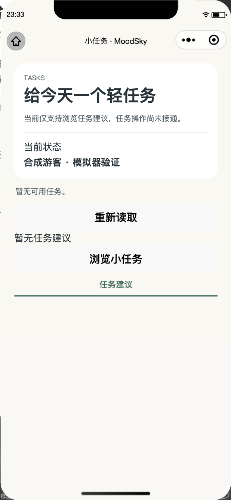
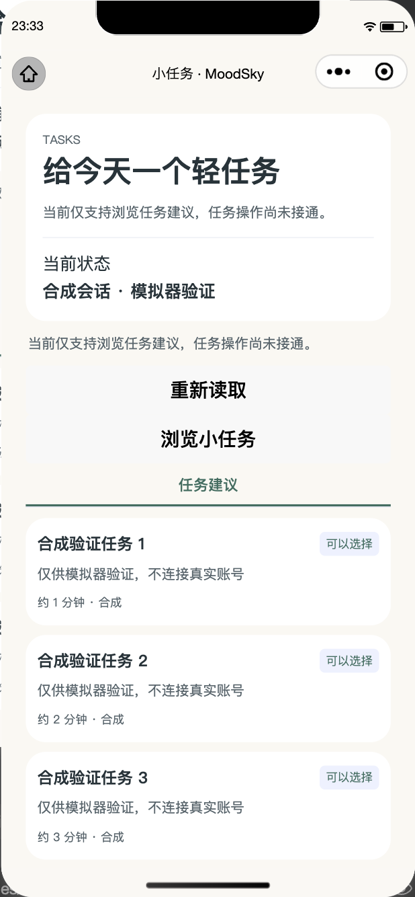

# QC01 / QC05 微信模拟器补充验证

本次是 Qizhen Chen / grrrced 的 W3 QC01、QC05 增补，承接 [PR #76](https://github.com/HX-Jan/MoodSky/pull/76) 已合入的源码与 [原交接](README.md)，关联 [Issue #75](https://github.com/HX-Jan/MoodSky/issues/75)、[W2 #38](https://github.com/HX-Jan/MoodSky/issues/38)。原报告、896项本地结果及个人签认字段保留原时点。

验证日期为2026-10-29；源码基线为 `a2a671980a392df1db0e2ec63bd4ec7af4f6b86e`（tree `27ef18e81a40e6011002084e9cec2e4f19ca6306`，含#76/#77/#82）。环境为macOS arm64、Node.js 24.18.0、微信开发者工具2.02.2609240 Stable、官方 `miniprogram-automator` 0.13.0。当前PR的具体工具版本由提交SHA追踪；截图对应上述源码及本次脚本，不是旧体验包或手机截图。

## 执行边界与实际结果

[重放脚本](../../../tools/week3-qc/wechat-smoke.cjs)连接真实微信模拟器，读取实际 WXML 节点并点击轻选择与“我的”菜单。Node端实际 `cloudfunctions/moodsky/candidate-router.js` 生成公开建议夹具；模拟器内从 `pages/tasks` 经实际 controller/service/request 到替换后的 `services/api.call`，该边界仅返回合成公开读取，其余动作本地拒绝。没有将Node路由描述成云函数部署。启动配置必须是 `cloudEnabled:false`；合成配置仅在内存暂存，业务传输替换先于启用，结束恢复API、配置、action-sheet替身并回到Today，断开驱动而不关闭开发者工具。

“合成会话”用实际控制器注入本地会话围栏，再给页面设置明确标签，**不经过真实账号登录**。Today的 `onNeeds` 在本地journal演示下执行，action sheet返回索引3；没有人工点击系统菜单或实际保存日记。

| 检查                                          | 实际结果                                                     |
| --------------------------------------------- | ------------------------------------------------------------ |
| 默认未配置任务页                              | 显示服务不可用，无合成任务卡                                 |
| 游客0条 / 3条                                 | 对应0/3张实际任务卡；只读、隐藏4种写按钮与历史标签           |
| 合成当前会话0条 / 3条                         | 同上；会话来自测试注入，不是登录验收                         |
| 伪造select/complete/replace/skip及history事件 | 实际Page处理器执行；传输次数不增加，无transition/history派发 |
| 轻选择“浏览小任务”实际按钮                    | 重读公开建议                                                 |
| “我的”实际任务菜单                            | 打开 `pages/tasks/index?view=history`，无私人history派发     |
| Today“做件很小的事”路径                       | 实际Page处理器与navigateTo到任务页；action sheet被替换       |
| 结束恢复                                      | 临时状态已移除；cloudEnabled恢复false；配置文件未改          |

[机器结果](simulator-20261029/verification.json)记录9项检查、15次合成公开传输与恢复校验；真实云业务调用0次。表格按场景归类，不另将子场景重复累计成测试总数。





两图已检查：只显示“任务建议”标签，无写操作；三张卡片在模拟器中渲染。卡片上的既有“可以选择”是状态文字，本轮没有把它当成可执行写控件或私人状态已接通。

## 重放

先按项目说明安装依赖并执行 `npm run setup`，将仓库根目录导入微信开发者工具，保持个人配置默认关闭云。官方自动化包安装在仓库外，不新增生产依赖或提交node_modules：

```sh
npm install --prefix /absolute/path/to/wechat-automation --ignore-scripts miniprogram-automator@0.13.0
/Applications/wechatwebdevtools.app/Contents/MacOS/cli auto \
  --project /absolute/path/to/MoodSky --auto-port 9420 --lang zh
MINIPROGRAM_AUTOMATOR_MODULE=/absolute/path/to/wechat-automation/node_modules/miniprogram-automator \
QC_SIMULATOR_OUTPUT=/absolute/path/to/results \
QC_SOURCE_SHA=a2a671980a392df1db0e2ec63bd4ec7af4f6b86e \
node tools/week3-qc/wechat-smoke.cjs
```

必须对准隔离项目及其实际源码SHA，不对另一项目运行。默认输出到系统临时目录；复跑失败时不产生新的通过报告，查看进程退出码，不把旧结果当成本轮通过。首次 `Page.callMethod` 遇到 `this.onTaskAction is not a function`，改用官方 `evaluate` 调用实际当前Page方法；第二次即时读取页面遇到尚未完成的Me导航，补入有界路由等待，保留原路径、参数和传输断言。最终格式化版本再跑9项通过，恢复断言通过；没有修改产品代码或降低验收条件。

## 仓库回归

2026-10-30执行 `npm run cloud:prepare`、`TMPDIR=/private/tmp npm run check`：lint、格式、结构、16份维护文档/293个本地链接、类型检查及924项测试全部通过，失败0、跳过0。与模拟器9项检查分别报告。首轮缺少云函数 `wx-server-sdk` 导致检查中断，按锁文件执行 `npm ci --prefix cloudfunctions/moodsky --ignore-scripts` 后完整重跑通过；没有改变依赖版本、产品源码或断言。两份运行日志保留在仓库外，脱敏摘要及文件哈希见[回归记录](simulator-20261029/quality.json)。

## 本周状态与剩余验收

- QC01：#76源码已合入；本次补齐原生模拟器的0/3条、只读、轻选择及事件保护。Jiawei、Yuen的指定独立复核仍待回传。
- QC02：没有收到双方共同确认的JF02最终表，继续只读；[原交接中的规则差异](README.md)保留，既有私人pilot不扩为正式能力。
- QC03：SDK失败保护已有本地结果；真实Web凭证、可信内部映射及指定账号/独立权限复核未完成。本补充不携带平台账号、环境访问配置或真实身份。
- QC04：地点维护本地链路已有结果，真实Web保存/重读与Junhan复核仍依赖QC03/JH03，其他写表单按实际能力保持关闭。
- QC05：本次补齐实际模拟器导航证据；与Linghan、Yuen、Qizhen Cai的独立回传仍分列。PR合入不自动更新手机体验包或代签周验收。

发布前核对的开放PR为#83（Fanny-126，head `e037137d455f6447c27e3d8a1a4e3656d1768d24`）、#84（Cai5133，`f797bbdd28c5c0519b84bc308d7cf131637649fd`）、#85（Yuminu，`4d6be5704159111939588110560fafc6866c7569`）、#86（Yuminu，`c91086cb9ad1a3587815ee81b4b1cab559105a94`）。这些是待审成员材料，本轮没有整合、批准或替代其独立结论。后续main有变化需记录新基线再复测。
